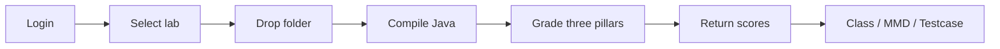
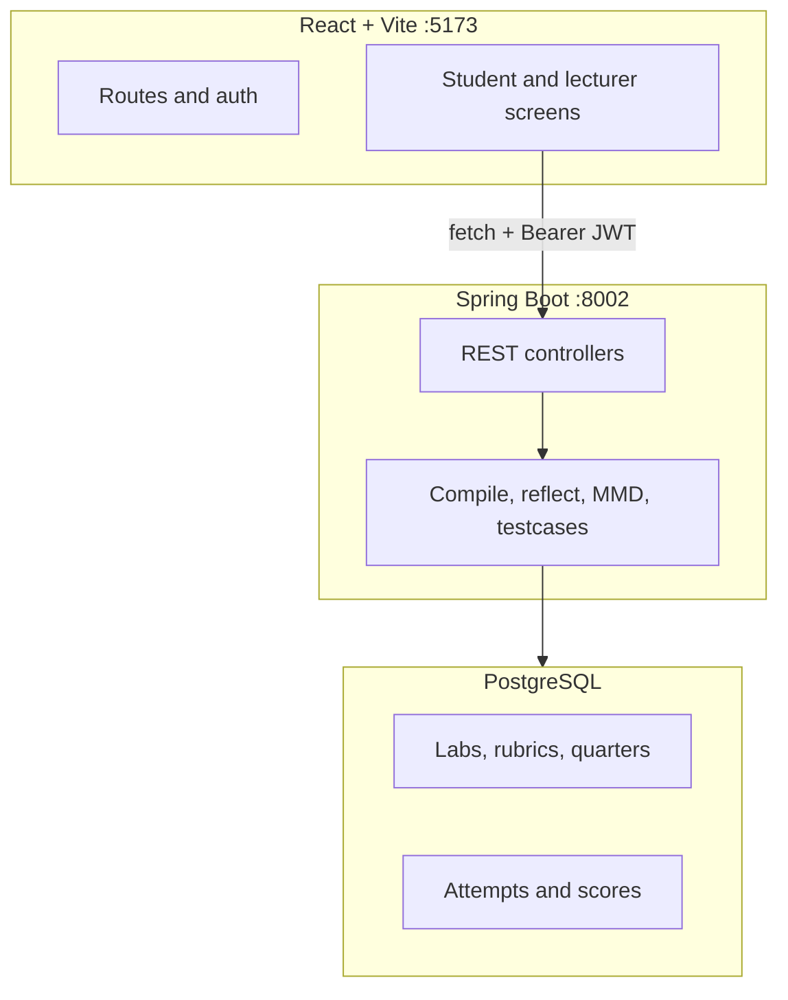

# OOP AutoGrader

**EIU Capstone** — full-stack grader for Object-Oriented Programming labs at Eastern International University.

Students upload Java sources (`.java`) and Mermaid class diagrams (`.mmd`). The backend compiles the Java and grades it against a lecturer rubric in PostgreSQL using reflection, diagram comparison, and operational testcases. The same grading path is used by the student dashboard, lecturer bulk grading, and the Windows offline practice app.

**Live:** [oop-autograder.vercel.app](https://oop-autograder.vercel.app)

---

## What it does

### Students

- Sign in with Google (`@eiu.edu.vn` only) or student code (IRN) + password.
- First-time Google users set IRN and password once.
- Students enrolled in the current quarter pick a lab, drop a folder, and get scores immediately.
- Students outside the current quarter can open history only.
- Each challenge shows **Class**, **MMD**, and **Operational Testcase** results. The dashboard uses the **latest attempt**, not the stored highest score.
- Official labs count toward Score total. Practice and Midterm stay visible as their own columns.
- Web extras: daily streak, mascot shop, gacha, weekly ranking, feedback, and a download of the offline practice folder.

### Lecturers

- Build rubrics: challenges, classes, fields, methods, constructors, relations, and operational testcases (with dry-run).
- Set deadlines, student visibility, and lab prefix (`Official`, `Practice`, or `Midterm`).
- Run the current quarter: enroll students, import Excel rosters, email the quarter, export practice packs.
- Watch the class dashboard, Score matrix, at-risk students (Official total under 50), and plagiarism flags.
- Bulk-grade a folder of student work without writing those scores into the roster.
- Manage accounts (create, edit, suspend, restore) and reply to feedback.

### Admin

`ADMIN` is its own role, not an alias of lecturer. Admins use the lecturer screens and are the only role that can grant, remove, or delete Admin. Only an Admin receives new feedback by email.

### Dual role

An account with both `STUDENT` and `LECTURER` lands on the lecturer dashboard. Student screens stay at `/student-dashboard` and `/student-history`.

---

## How grading works

Each challenge is scored on up to three pillars. A pillar that does not apply is skipped. The challenge score is the weighted mean of the pillars that do apply (`class_weight`, `mmd_weight`, `testcase_weight`, default 1). The lab score is the weighted mean of every challenge (`challenge.weight`); a missing challenge counts as 0%.

| Pillar | Checks | How |
|--------|--------|-----|
| **Class (Declaration)** | Fields, methods, constructors, visibility, types, modifiers | Reflection on compiled `.class` files |
| **MMD (Diagram)** | Classes and relations | Parse `.mmd` and compare to the rubric |
| **Operational Testcase** | Runtime behavior | Invoke student code; assert return values, stdout, fields, exceptions |

Class-tab members are all-or-nothing: a field, method, or constructor earns its points only when every graded attribute matches.



Upload path, in short:

```text
POST multipart
  → term access + rubric cache
  → compile each challenge in parallel
  → grade (class, then MMD, then operational testcases in an isolated worker JVM)
  → persist the new attempt and return lab_result
  → plagiarism check off the student wait
  → delete the temp folder
```

Operational testcases run in `worker.jar` (one JVM per upload). Optional container sandbox is off unless `SANDBOX_ENABLED=true`. Desktop practice never uses the sandbox.

### Folder layout

Official and Practice labs:

```text
my-submission/
├── challenge_1/
│   ├── Person.java
│   ├── Student.java
│   └── diagram.mmd
└── challenge_2/
    └── ...
```

Midterm labs use a flat folder: `IRN_Name/*.java` and `*.mmd` (no `challenge_n`). The server maps those files onto the lab’s single challenge.

Only `.java` and `.mmd` are graded. The browser keeps relative paths so each file lands on the right challenge. An optional `.git` folder is used for plagiarism signals, not for the score.

---

## Architecture



The SPA calls the API directly. There is no Vite proxy. CORS allows the configured frontend origin. Spring Security is default-deny: public auth, health, and local Swagger; every other route needs a JWT with the matching role. Missing token is 401. Wrong role is 403.

| Layer | Stack | Where it runs |
|-------|--------|----------------|
| Frontend | React 18, Vite 7, Tailwind 3 | `:5173` locally, Vercel in production |
| Backend | Java 17, Spring Boot 3.2, Spring Security, JPA | `:8002` locally, Render or Railway in production |
| Database | PostgreSQL | Local, or Neon (use the pooler host) |
| Practice app | Same API on profile `desktop`, H2, WebView2 host | Windows folder, API on `:18002` |

**JDK 17+ is required** (not a JRE). The API compiles student Java with `javax.tools.JavaCompiler`.

---

## Repository layout

```text
OOP-AutoGrader/
├── package.json                 # npm start runs API + SPA
├── CONCEPTS.md                  # Domain words
├── docs/                        # How it runs, grading, user guide, SQL
├── frontend/                    # React SPA
├── backend/                     # Spring Boot API, worker JAR, Dockerfile
├── desktop/launcher/            # Rust WebView2 host for offline practice
├── sandbox-image/               # Optional isolated testcase runner
└── scripts/assemble-student-desktop.ps1
```

---

## Run it locally

### Prerequisites

| Tool | Why |
|------|-----|
| Node.js 18+ and npm | SPA and root scripts |
| JDK 17+ and Maven | API, compiler, worker JAR |
| PostgreSQL | Rubrics and scores |
| Google OAuth client ID | Sign-in (audience must match `GOOGLE_CLIENT_ID`) |

### Install

```bash
git clone https://github.com/Project-G5741/OOP-AutoGrader.git
cd OOP-AutoGrader
npm install
```

Root `npm install` installs the frontend and the small backend Node helper.

### Environment

Copy `backend/.env.backend.example` to `backend/.env` and `frontend/.env.example` to `frontend/.env`. Do not commit either `.env`.

Backend (minimum):

```env
SPRING_DATASOURCE_URL=jdbc:postgresql://localhost:5432/oop_autograder
DB_USERNAME=postgres
DB_PASSWORD=<your-password>
JWT_SECRET=<at-least-32-bytes>
GOOGLE_CLIENT_ID=<your-google-client-id>
FRONTEND_URL=http://localhost:5173
SUBMISSION_BASE_DIR=submissions
MAIL_PROVIDER=smtp
MAIL_HOST=smtp.gmail.com
MAIL_PORT=587
MAIL_USERNAME=<email>
MAIL_PASSWORD=<app-password>
MAIL_FROM=<email>
WORKER_JAR=target/backend-1.0.0-worker.jar
```

`JWT_SECRET` is required and must be at least 32 bytes. Generate one with `openssl rand -base64 32`. The same secret keeps tokens valid across restarts.

Leave `SANDBOX_ENABLED` unset (or `false`) for a normal local run. Leave `SPRINGDOC_ENABLED` unset so Swagger stays on. Set it to `false` in production.

Frontend:

```env
VITE_GOOGLE_CLIENT_ID=<your-google-client-id>
VITE_API_URL=http://localhost:8002
VITE_MAINTENANCE_MODE=false
```

Create the database `oop_autograder`, then apply the operator scripts in `docs/sql/` for a new database. The API also patches older PostgreSQL on startup; it does not use Flyway.

### Start

```bash
npm start
```

| Service | URL |
|---------|-----|
| Web UI | http://localhost:5173 |
| API | http://localhost:8002 |
| Health | http://localhost:8002/ |
| Swagger | http://localhost:8002/swagger-ui/index.html |

`npm start` runs both processes. `npm run backend` packages the worker JAR, then starts Spring Boot. `npm run frontend` starts Vite only. From `backend/`, `mvn spring-boot:run` starts the API; run `mvn package -DskipTests` first if `worker.jar` is missing, or operational testcases fail.

### Check

| Check | Command |
|-------|---------|
| API tests | `cd backend && mvn test` |
| SPA build | `cd frontend && npm run build` |
| Upload | Sign in as a student, drop `challenge_1/*.java`, confirm scores |

---

## Routes

### Student

| Path | Screen |
|------|--------|
| `/` | Login, forgot password, first-time Google setup |
| `/student-dashboard` | Labs, upload, live results |
| `/student-history` | Past attempts |
| `/student-ranking` | Weekly board |

### Lecturer and Admin

| Path | Screen |
|------|--------|
| `/staff` | Lecturer sign-in while the site is in maintenance |
| `/lecturer-dashboard` | Quarter overview and lab roster |
| `/lecturer-grading` | Score matrix |
| `/lecturer-bulk-grading` | Folder grade that is not saved to the roster |
| `/lecturer-users` | Accounts |
| `/lecturer-solution` | Rubric editor |
| `/lecturer-terms` | Quarters, roster, practice packs |
| `/lecturer-report` | Analytics |
| `/lecturer-feedback` | Bug and contribution inbox |
| `/lecturer-ranking` | Weekly board |

`/no-access` is a kept session after a 403. `/rate-limited` holds the session after a 429, then returns.

When `VITE_MAINTENANCE_MODE` is on, guests and students see the maintenance page. Lecturers sign in at `/staff`. The flag is baked at build time; change it on Vercel, then redeploy. The desktop app ignores it.

---

## API

Collection routes use explicit segments (`/list`, `/create`, `/count`) instead of a bare controller root.

| Area | Base path | Use |
|------|-----------|-----|
| Health | `GET /` | Liveness |
| Auth | `/api/auth` | Google, IRN login, password reset |
| Labs | `/api/labs` | Lab list, stats, roster, export |
| Submissions | `/api/submissions` | Upload and student history |
| Rubrics | `/api/lecturer/labs` | Structure, deadlines, prefixes, dry-run, lab pack, bulk grade |
| Quarters | `/api/lecturer/terms` | Roster, Excel import, quarter mail, quarter pack |
| Lecturer home | `/api/lecturer` | Overview, score matrix, plagiarism |
| Tab bootstrap | `/api/lecturer/bootstrap` | First payload for each lecturer tab |
| Feedback | `/api/feedback`, `/api/lecturer/feedback` | Student/lecturer reports and lecturer replies |
| Users | `/api/users` | CRUD, suspend, restore |
| Student extras | `/api/students` | Term access, streak, mascots, ranking, practice zip |
| Analytics | `/api/analytics` | Reports |
| Lookups | `/api/master-data`, `/api/terms` | Scopes, types, relations, quarter list |

Upload:

```text
POST /api/submissions/{labId}/{attemptNumber}/upload
```

The `{attemptNumber}` segment is not an upsert key. Each upload inserts the next attempt.

A mutating burst over the limit returns **429** with `Retry-After`. Reads and auth use separate, higher budgets. Desktop profile has no burst filter.

---

## Authentication

| Method | What happens |
|--------|----------------|
| Google | SPA sends the ID token. API checks `@eiu.edu.vn` and `GOOGLE_CLIENT_ID`, then returns a JWT. |
| IRN + password | Student or lecturer code. Inactive accounts cannot sign in. |
| First Google visit | Setup screen collects IRN and password. |
| Forgot password | Reset email. SMTP locally; Brevo HTTPS API when SMTP ports are blocked. |

The JWT carries email, name, roles, IRN, and a session version. The SPA stores `accessToken` and `user` in `localStorage`. An expired token is treated as signed out. Changing roles bumps the session version and invalidates older tokens.

---

## Offline practice (Windows)

Students can grade the same labs without the website. The practice folder runs a local API (profile `desktop`, port **18002**, H2) inside a WebView2 window. Scores stay on that PC.

Lecturers export signed packs:

- Quarter: Term Management → **Download practice pack** → `Rubric_{year}_Q{n}.agpack`
- One lab: Solution Management → **Practice pack** → `Rubric_{labName}.agpack`

Export needs `DESKTOP_PACK_SIGNING_PRIVATE_KEY` on the server (pairs with `backend/src/main/resources/desktop-pack-public.key`). Without it, export returns 503.

Students download a runtime-only zip from the dashboard (**Practice folder**). Packs are handed out separately and imported in the app header. Grading logic matches the website. Streak, shop, ranking, and feedback are web-only. **Import mascot** is the only practice step that calls the cloud API.

Assemble from the repo root (needs Rust, MSVC Build Tools, and a JDK with `jlink`):

```powershell
$env:APP_DESKTOP_CLOUD_API_URL = "https://your-production-api-host"
.\scripts\assemble-student-desktop.ps1 -OutputDir "backend\target\StudentPractice"
```

That writes `backend/target/OOP-AutoGrader-Practice.zip` for the website download. Details: [docs/DESKTOP_STUDENT_DIST.md](docs/DESKTOP_STUDENT_DIST.md).

---

## Deploy

| Tier | Where | Notes |
|------|--------|--------|
| Frontend | Vercel | `VITE_API_URL`, `VITE_GOOGLE_CLIENT_ID`, and `VITE_MAINTENANCE_MODE` are fixed at build. See [frontend/DEPLOY_VERCEL.md](frontend/DEPLOY_VERCEL.md). |
| Backend | Render or Railway | Docker image ships `app.jar` and `worker.jar`. See [backend/DEPLOY_RENDER.md](backend/DEPLOY_RENDER.md) and [backend/DEPLOY_RAILWAY.md](backend/DEPLOY_RAILWAY.md). |
| Database | Neon PostgreSQL | Use the `-pooler` host and `socketTimeout=30`. |
| Testcase sandbox | Optional | [docs/SANDBOX_RUNNER_DEPLOY.md](docs/SANDBOX_RUNNER_DEPLOY.md). Leave it off to keep the local worker. |

Production mail: `MAIL_PROVIDER=brevo` (Render free tier blocks SMTP). Production Swagger: `SPRINGDOC_ENABLED=false`.

---

## More docs

| Document | What it covers |
|----------|----------------|
| [docs/PROGRAM_REPORT.md](docs/PROGRAM_REPORT.md) | Program overview |
| [docs/OBJECTIVES.md](docs/OBJECTIVES.md) | Objectives |
| [docs/HOW_IT_RUNS.md](docs/HOW_IT_RUNS.md) | Startup, login, upload |
| [docs/GRADING_WORKFLOWS.md](docs/GRADING_WORKFLOWS.md) | Pipeline and scoring |
| [docs/USER_GUIDE.md](docs/USER_GUIDE.md) | Lecturer and student screens |
| [docs/LECTURER_OPERATIONAL_TESTCASE_GUIDE.md](docs/LECTURER_OPERATIONAL_TESTCASE_GUIDE.md) | Writing operational testcases |
| [docs/DESKTOP_STUDENT_DIST.md](docs/DESKTOP_STUDENT_DIST.md) | Practice pack and assemble |
| [CONCEPTS.md](CONCEPTS.md) | Shared vocabulary |
| [backend/AGENTS.md](backend/AGENTS.md) | API and pipeline contract |
| [frontend/AGENTS.md](frontend/AGENTS.md) | SPA routes and API usage |
| [docs/sql/](docs/sql/) | Operator SQL for PostgreSQL |
| [docs/solutions/](docs/solutions/) | Past fixes — search here before debugging |

---

## License

ISC
