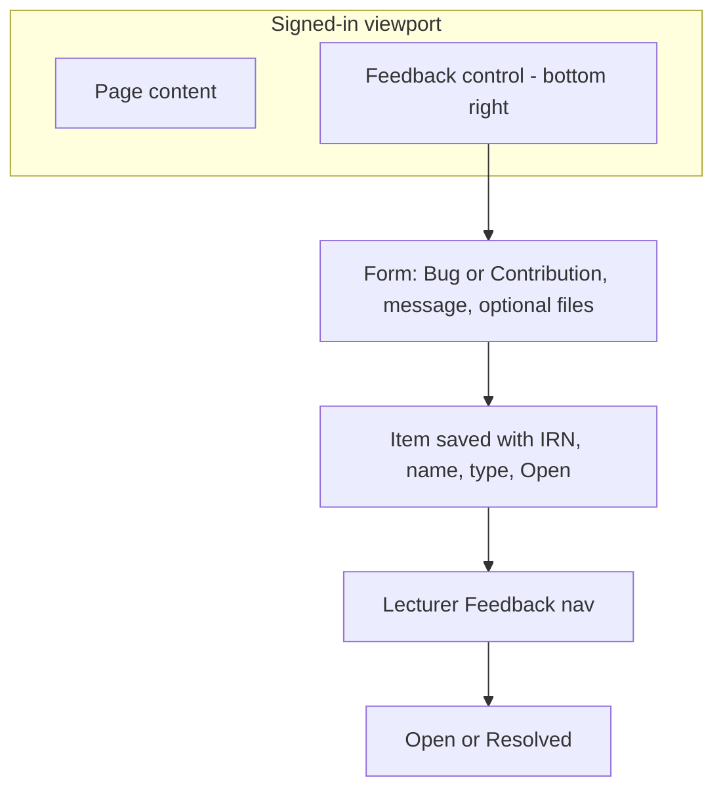
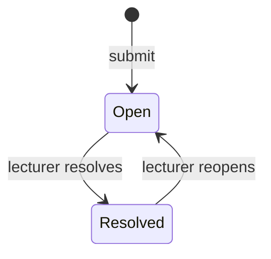
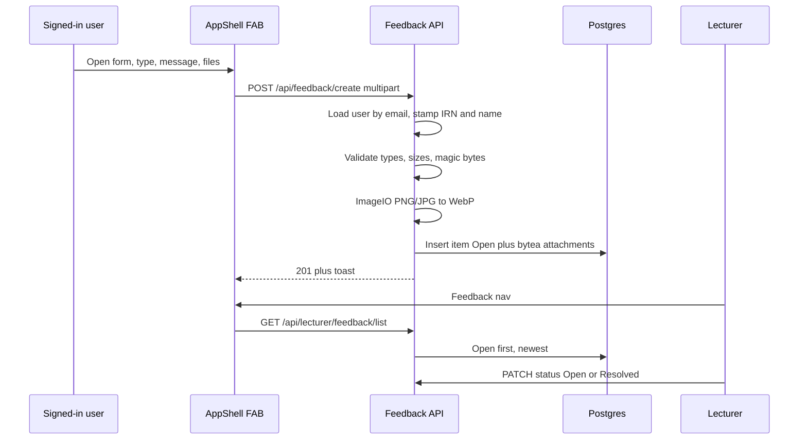

# Feedback Inbox - Plan

## Goal Capsule

- **Objective:** Let signed-in people send a Bug report or Contribution from a viewport-pinned control, and let lecturers review those items (with author IRN and name) in a new inbox, including Open / Resolved.
- **Product authority:** this plan (Product Contract below); Product Contract preservation: unchanged from the originating brainstorm (Outstanding Questions resolved into Planning Contract KTDs only).
- **Execution profile:** software implementation — operator SQL + Spring API + React AppShell FAB and lecturer Feedback nav.
- **Stop conditions:** none outstanding.
- **Tail ownership:** implementer runs `mvn test` from `backend/` and `npm run build` from `frontend/` before calling units done; operator applies new SQL on Neon/local before or with the API that maps the new tables.

## Product Contract

### Summary

A signed-in, bottom-right control opens one form: Bug report or Contribution, a message, and optional files. Lecturers get a new nav inbox (not analytics Reports) that lists every author’s items with IRN, name, type, and Open / Resolved.

### Problem Frame

Bugs and improvement ideas are spoken in class or lab and then forgotten. The course has no durable place to keep who said what. Lecturer **Reports** is class analytics, not this inbox.

### Key Decisions

- **Lecturers review; no Admin role.** (session-settled: user-directed — chosen over a new Admin role: the app only has Student and Lecturer.) Governs R10.
- **Author chooses Bug vs Contribution in the form.** (session-settled: user-directed — chosen over a course-wide mode switch and over lecturer-only reclassify.) Governs R3.
- **One inbox for every author.** (session-settled: user-directed — chosen over hiding lecturer-authored rows, and over students-only submit.) Governs R1, R10, R11.
- **IRN and name come from the signed-in account.** (session-settled: user-approved — chosen over typed identity: authors cannot submit under a fake name.) Governs R5.
- **PNG and JPG become WebP before they are kept; `.java` and `.mmd` stay as uploaded.** (session-settled: user-directed — chosen over keeping original raster images: smaller pictures.) Governs R7, R8.
- **Inbox uses Open / Resolved.** (session-settled: user-directed — chosen over a list with no status.) Governs R13, R14.
- **Nav label is Feedback**, distinct from analytics Reports. Governs R10.

### Actors

- A1. **Signed-in user** (student, lecturer, or dual-role) — opens the control, chooses type, writes a message, optionally attaches files, submits.
- A2. **Lecturer** — opens Feedback nav, reads items, filters or sorts, marks Open or Resolved.
- A3. **System** — stamps IRN and name from the session, converts raster images to WebP, stores optional `.java` / `.mmd` unchanged.

### Requirements

**Submit control**

- R1. Every signed-in web screen that uses the main app shell shows a Feedback control pinned to the bottom-right of the viewport so it stays visible while the page scrolls.
- R2. The control and form use semantic colors from the app theme config (primary, surface, text, error, success), including light and dark.
- R3. Opening the control shows one form with a required choice: **Bug report** or **Contribution**.
- R4. The form has a required message (description) and an optional drag-and-drop area that accepts `.png`, `.jpg`, `.java`, and `.mmd` only.
- R5. On submit, the item stores the author’s IRN and display name from the signed-in account. Those fields are not editable in the form.
- R6. Submit is refused when the user is not signed in, the type is missing, or the message is empty.
- R7. Each accepted `.png` or `.jpg` is converted to `.webp` and stored in that smaller form, not as the original raster file.
- R8. Each accepted `.java` or `.mmd` is stored with its original bytes and name suffix.
- R9. After a successful submit, the author sees confirmation and the form closes. Failure shows a friendly error without leaving the form.

**Lecturer inbox**

- R10. Lecturer navigation gains a **Feedback** item, separate from **Reports**.
- R11. The Feedback screen lists items from every author. Each row shows type, message (or a short preview), author IRN, author name, time submitted, and status.
- R12. The lecturer can open an item to read the full message and download or view attached files.
- R13. A new item is **Open**. A lecturer can mark it **Resolved** and can set it back to **Open**.
- R14. The inbox can show Open and Resolved distinctly (filter or grouping). Default view prefers Open items, newest first.

**Non-goals expressed as limits**

- R15. Unauthenticated screens (login, password reset, first-time setup) do not show the control.
- R16. Offline desktop practice does not include this feature in this work.

### Key Flows

- F1. **Send feedback**
  - **Trigger:** Signed-in user clicks the bottom-right control.
  - **Actors:** A1, A3
  - **Steps:** Choose Bug report or Contribution; write a message; optionally drop allowed files; submit; system stamps IRN and name; raster images become WebP; user sees success.
  - **Covered by:** R1–R9
- F2. **Review inbox**
  - **Trigger:** Lecturer opens Feedback.
  - **Actors:** A2
  - **Steps:** See newest Open items first; open one; read message and files; mark Resolved or reopen.
  - **Covered by:** R10–R14

### Acceptance Examples

- AE1. **Covers R1, R15.** Given a student on the submit dashboard, when they scroll, then the Feedback control stays at the bottom-right. Given the login screen, then the control is absent.
- AE2. **Covers R3, R5.** Given a signed-in student whose account name is `Nguyen Van A` and IRN is `2331200001`, when they send a Contribution, then the stored item is type Contribution, name `Nguyen Van A`, IRN `2331200001`, and they could not edit those identity fields.
- AE3. **Covers R4, R7, R8.** Given an optional drop of `shot.png` and `Car.java`, when submit succeeds, then the picture is kept as WebP and `Car.java` is unchanged. A `.pdf` drop is rejected.
- AE4. **Covers R10, R11.** Given a student item and a lecturer-authored item, when a lecturer opens Feedback, then both rows appear with IRN and name. Analytics Reports is unchanged.
- AE5. **Covers R13, R14.** Given a new item, when a lecturer opens Feedback, then it is Open. After they mark Resolved, it is distinct from Open items. They can set it Open again.
- AE6. **Covers R2.** Given light or dark theme, when the control and form render, then they use theme semantic colors, not one-off palette hex.
- AE7. **Covers R16.** Given the offline desktop practice app, when this work ships, then Feedback submit and inbox are not part of that app.

### Success Criteria

- A lecturer can find who sent an idea without relying on class memory (IRN + name on every item).
- Students can send a bug or an idea without leaving the page they are on.
- Raster attachments are meaningfully smaller than the uploaded PNG/JPG.

### Scope Boundaries

**In scope**

- Signed-in web FAB, create API, lecturer Feedback inbox, Open / Resolved, optional attachments with WebP conversion.

**Out of scope**

- No new Admin role.
- No change to analytics Reports.
- No desktop practice Feedback.
- No anonymous or public submit.
- No author-facing history of their own items (submit-only for authors in this work).
- No lecturer reclassify of Bug into Contribution after submit; the author chose the type.
- No email/Slack notifications.

**Deferred to Follow-Up Work**

- Object storage (S3) if attachment volume outgrows Postgres.
- Author “my submissions” list.
- Burst-guard exemption for Feedback create (not needed for a single POST).

### Dependencies / Assumptions

- Theme colors continue to live in the existing frontend theme config and semantic classes.
- IRN is `student_code` or, if that is empty, `teacher_code`. Display name is the account full name. Auth payload uses `name`; the header currently reads `fullName`. JWT request principal is email, IRN, and roles only; name is not on the principal.
- Schema changes are operator-run SQL, consistent with the rest of the project.

### Outstanding Questions

None blocking. Former deferred items resolved in KTD1–KTD7.

### Sources / Research

- Lecturer **Reports** is analytics (`/lecturer-report`, dashboard analytics), not an issue inbox.
- Roles in product are Student and Lecturer only (`JwtRoleNames`).
- No existing Feedback table or FAB; toast is `fixed` top-right `z-[110]`; modals `z-[100]`.
- Identity: `UserAccount.getIrn()`, `AuthResponse.name`, Header `fullName`.
- Color contract: `frontend/src/theme/tokens.js` and semantic Tailwind classes (`frontend/AGENTS.md` Theme).
- Multipart global ceiling 50MB (`application.yml`); Feedback uses a tighter app-level cap (KTD3).
- Security: `SecurityConfig` default-deny; `/api/lecturer/**` is lecturer-only; leftover paths need authentication.
- WebP encode is absent from `backend/pom.xml`. Plan uses `com.github.usefulness:webp-imageio` ImageIO plugin (Maven Central; ImageIO.write `"webp"`). TwelveMonkeys `imageio-webp` is the decoder-oriented sibling, not the write path.

---

## Planning Contract

### Key Technical Decisions

- KTD1. **Attachments live in Postgres `bytea`, not disk.** (session-settled: user-approved — chosen over a temp folder like lab uploads: Render disk is ephemeral.) Item row plus child attachment rows. Governs R7, R8, R12.
- KTD2. **Convert PNG/JPG to WebP on the server** with `com.github.usefulness:webp-imageio` (ImageIO read then write `webp`, lossy quality ~80, longest side cap 1920px). (session-settled: user-approved — chosen over browser-only convert: the client cannot skip it.) Reject if magic bytes / ImageIO decode fail. Governs R7.
- KTD3. **Caps: at most 5 files, 25 MiB total original bytes per upload, message at most 4000 characters.** `.jpg` and `.jpeg` both count as JPEG. Excess files or bytes → 422 with a friendly error. Governs R4, R6.
- KTD4. **Stamp IRN and full name from `UserAccount` loaded by JWT email** via `JwtAuthHelper.requireActiveUser`. Persist copies on the item so later profile edits do not rewrite history. Refuse create when IRN is blank. Governs R5, R6.
- KTD5. **Create is `POST /api/feedback/create` (authenticated student or lecturer).** List/detail/status/files stay under `/api/lecturer/feedback/...` so existing lecturer matchers apply. Do not add a student GET of the inbox. Governs R6, R10–R14.
- KTD6. **Form shows read-only IRN and name** from the stored user object (`user.irn` / `user.studentCode` / `user.lecturerCode`, and `user.name` or `user.fullName`). Governs R5.
- KTD7. **FAB is `position: fixed` bottom-right on web `AppShell` only**, `z-[90]` under modals and toast. Panel uses existing `ModalOverlay`. Lucide `MessageSquarePlus`. Empty inbox copy: `No feedback yet.` Controllers `@Profile("!desktop")`. Governs R1, R2, R10, R15, R16.

### High-Level Technical Design

### Assumptions

- Operator runs new SQL on Neon and local Postgres in the same release as the JPA entities.
- Desktop H2 may auto-create unused tables if entities are scanned; UI and controllers stay off (`!desktop`).
- Native WebP encoder in `webp-imageio` includes Linux x86_64 for Render; if encode fails at runtime, create returns 422 rather than storing the original raster.
- No frontend test runner; U4/U5 proof is `npm run build` plus manual FAB and inbox.
- Feedback create stays inside the normal write burst budget (one POST).

### Sequencing

1. U1 — operator SQL + entities/repos.
2. U2 — create path, WebP, identity stamp, authorization tests.
3. U3 — lecturer list/detail/status/download.
4. U4 — AppShell FAB and form.
5. U5 — lecturer Feedback page, nav, route.

### Risks

- **Ephemeral disk:** mitigated by KTD1.
- **Polyglot / fake extensions:** magic bytes + ImageIO decode; never execute `.java`.
- **Native WebP on Render:** fail closed (422); do not keep PNG/JPG if convert fails (R7).
- **Name field split:** map `getFullName()` into stored `author_name`; SPA read-only line accepts `name` or `fullName` (KTD4, KTD6).
- **Nav overflow:** Feedback is an eighth lecturer item; keep the existing wrap/menu pattern in `NavBar.jsx`.

### System-Wide Impact

- Auth: new authenticated POST plus lecturer-only inbox GETs/PATCHes; no Admin role.
- Burst guard: create counts as a write; not exempt.
- Lecturer bootstrap: optional first-useful-data GET for the new tab, same “fresh on open” rule as other tabs — not required if the page’s own list GET is the first paint.
- Analytics Reports unchanged.

### Documentation / Operational Notes

- Operator: `docs/sql/2026-10-20-feedback-inbox.sql` on Neon and local Postgres.
- Update `backend/AGENTS.md` API table, `frontend/src/pages/AGENTS.md` route table, `frontend/AGENTS.md` if the FAB is a durable shell contract.
- `CONCEPTS.md` Feedback terms already exist.

---

## Implementation Units

### U1. Schema and persistence model

**Goal:** Durable `feedback_item` and `feedback_attachment` tables with JPA access.

**Requirements:** R5, R7, R8, R13

**Dependencies:** none

**Files:**
- `docs/sql/2026-10-20-feedback-inbox.sql` (new)
- `docs/sql/2026-10-13-schema-baseline-reconstructed.sql`
- `backend/src/main/java/model/FeedbackItem.java` (new)
- `backend/src/main/java/model/FeedbackAttachment.java` (new)
- `backend/src/main/java/repository/FeedbackItemRepository.java` (new)
- `backend/src/main/java/repository/FeedbackAttachmentRepository.java` (new)

**Approach:**
1. Operator SQL: item table (uuid id, user_id FK, author_irn, author_name, type `BUG`|`CONTRIBUTION`, message, status `OPEN`|`RESOLVED`, created_at, resolved_at nullable); attachment table (uuid id, item FK CASCADE, original_filename, stored_content_type, byte_size, content `bytea`).
2. Indexes: `(status, created_at desc)` for the default inbox.
3. JPA entities matching columns; no Flyway; no startup migrator.

**Test scenarios:**
- Test expectation: none — schema + entities only; behavior tests live in U2–U3.

**Verification:** SQL is idempotent (`IF NOT EXISTS`); entities compile.

---

### U2. Create feedback API and WebP conversion

**Goal:** Signed-in authors submit type, message, and optional files; identity is stamped; images become WebP.

**Requirements:** R3–R9, R15; F1; AE2, AE3

**Dependencies:** U1

**Files:**
- `backend/pom.xml`
- `backend/src/main/java/service/FeedbackService.java` (new)
- `backend/src/main/java/service/FeedbackImageConverter.java` (new)
- `backend/src/main/java/controller/FeedbackController.java` (new, `@Profile("!desktop")`)
- `backend/src/main/java/config/SecurityConfig.java` (only if create needs an explicit matcher; `authenticated()` already covers `/api/feedback/**`)
- `backend/src/test/java/unit/com/eiu/capstone/backend/service/FeedbackImageConverterTest.java` (new)
- `backend/src/test/java/authorization/com/eiu/capstone/backend/controller/FeedbackCreateAuthorizationTest.java` (new)
- `backend/src/test/java/unit/com/eiu/capstone/backend/service/FeedbackServiceCreateTest.java` (new)

**Approach:**
1. `POST /api/feedback/create` multipart: `type`, `message`, optional `files`.
2. `requireActiveUser`; stamp `getIrn()` and `getFullName()`; 403 if IRN blank (KTD4).
3. Validate KTD3; allow suffixes png/jpg/jpeg/java/mmd (case-insensitive).
4. Images: magic + ImageIO decode, then WebP (KTD2). Java/MMD stored as uploaded bytes with original suffix (KTD1).
5. Persist Open item. 201. Never run student Java.
6. Execution note: Implement converter and create authorization test-first.

**Patterns to follow:** thin controller; `GlobalExceptionHandler` 422/413; `JwtAuthHelper.requireActiveUser`; collection-style `/create`.

**Test scenarios:**
- Covers AE2. Authenticated student create with type Contribution stamps IRN and full name from the account, not the multipart body.
- Covers AE3. PNG + `.java` persist WebP + original Java; `.pdf` → 422.
- Anonymous POST → 401.
- Blank message or missing type → 422.
- Blank IRN on the account → 403.
- Six files or more than 25 MiB total → 422.
- Image whose extension is png but bytes are not an image → 422, no row.
- Convert failure → 422, no original raster stored.

**Verification:** new unit + authorization tests pass under `mvn test`.

---

### U3. Lecturer inbox API

**Goal:** Lecturers list, open, download, and set Open / Resolved.

**Requirements:** R10–R14; F2; AE4, AE5

**Dependencies:** U2

**Files:**
- `backend/src/main/java/controller/LecturerFeedbackController.java` (new, `@Profile("!desktop")`)
- `backend/src/main/java/service/FeedbackService.java`
- `backend/src/test/java/authorization/com/eiu/capstone/backend/controller/LecturerFeedbackAuthorizationTest.java` (new)
- `backend/src/test/java/unit/com/eiu/capstone/backend/service/FeedbackServiceInboxTest.java` (new)

**Approach:**
1. `GET /api/lecturer/feedback/list?status=OPEN|RESOLVED|ALL` default OPEN, newest first, include preview, IRN, name, type, status, createdAt, attachment count.
2. `GET /api/lecturer/feedback/{id}` full message + attachment metadata.
3. `GET /api/lecturer/feedback/{id}/attachments/{attachmentId}` streams bytes (`image/webp` or original java/mmd types).
4. `PATCH /api/lecturer/feedback/{id}/status` body Open or Resolved; set/clear `resolved_at`.
5. Student JWT on these paths → 403 via existing `/api/lecturer/**` matcher.

**Test scenarios:**
- Covers AE4. Lecturer list includes a student item and a lecturer-authored item with IRN and name.
- Student GET list → 403.
- Covers AE5. New item OPEN; PATCH RESOLVED; PATCH OPEN again; default list hides Resolved unless `status=ALL` or `RESOLVED`.
- Download returns WebP content type for converted images.
- Unknown id → 404.

**Verification:** authorization + unit tests pass.

---

### U4. Viewport Feedback control

**Goal:** Signed-in web AppShell shows the FAB and submit form.

**Requirements:** R1–R6, R9, R15, R16; AE1, AE6, AE7

**Dependencies:** U2

**Files:**
- `frontend/src/components/feedback/FeedbackFab.jsx` (new)
- `frontend/src/components/feedback/FeedbackForm.jsx` (new)
- `frontend/src/components/layout/AppShell.jsx`
- `frontend/src/App.desktop.jsx` (confirm FAB is not mounted)
- `frontend/src/components/ui/AGENTS.md` or `frontend/AGENTS.md` (shell contract)

**Approach:**
1. Mount FAB from web `AppShell` only (KTD7). `fixed bottom-4 right-4 z-[90]`. Semantic tokens only.
2. Open existing `ModalOverlay` form: Bug | Contribution, read-only IRN/name (KTD6), required message, optional dropzone for allowed suffixes.
3. `apiFetch` multipart create; success toast then close; failure stays open with friendly error (`toFriendlyError`).
4. Do not render on login routes; do not add to desktop entry.

**Test scenarios:**
- Test expectation: none automated — no frontend test runner.
- Manual Covers AE1, AE6, AE7: FAB on student/lecturer shells; absent on login; absent in desktop build; light/dark tokens.

**Verification:** `npm run build`; `npm run build:desktop` still has no FAB.

---

### U5. Lecturer Feedback nav and page

**Goal:** Lecturers open Feedback, read items, toggle status, open files.

**Requirements:** R10–R14; AE4, AE5

**Dependencies:** U3, U4

**Files:**
- `frontend/src/pages/FeedbackInbox.jsx` (new)
- `frontend/src/components/NavBar.jsx`
- `frontend/src/utils/authRoutes.js`
- `frontend/src/App.jsx`
- `frontend/src/pages/LecturerDashboard.jsx`
- `frontend/src/pages/AGENTS.md`
- `backend/AGENTS.md` (API table)

**Approach:**
1. Route `/lecturer-feedback`, nav id `feedback`, label Feedback, icon `MessageSquarePlus`, placed after Reports.
2. Page: filter Open / Resolved / All; default Open newest; row type, preview, IRN, name, time, status.
3. Detail: full message, attachment links (authenticated GET blob), Resolve / Reopen.
4. Do not change Reports analytics.

**Test scenarios:**
- Test expectation: none automated.
- Manual Covers AE4, AE5: both author kinds visible; status filter and reopen; Reports still analytics.

**Verification:** `npm run build`; lecturer can navigate without colliding with `/lecturer-report`.

---

## Verification Contract

- Backend: `mvn test` from `backend/` must include the new unit and authorization classes in U2–U3.
- Frontend: `npm run build` from `frontend/`.
- Desktop: `npm run build:desktop` — no Feedback FAB, no Feedback nav.
- Operator: apply `docs/sql/2026-10-20-feedback-inbox.sql` on the Postgres used by the running API before relying on create/list.
- Manual: student (or lecturer) submit Bug + Contribution with optional png/java; lecturer inbox IRN/name; Open/Resolved; login has no FAB.

## Definition of Done

- All Product Contract R1–R16 are implemented or explicitly limited as written.
- U1–U5 complete per their Verification fields.
- Verification Contract commands pass.
- Operator SQL exists and is documented in `backend/AGENTS.md`.
- Abandoned experimental encode/storage approaches are not left in the diff.
- DOX: nearest AGENTS.md files updated for the new route, API, and FAB shell contract.
