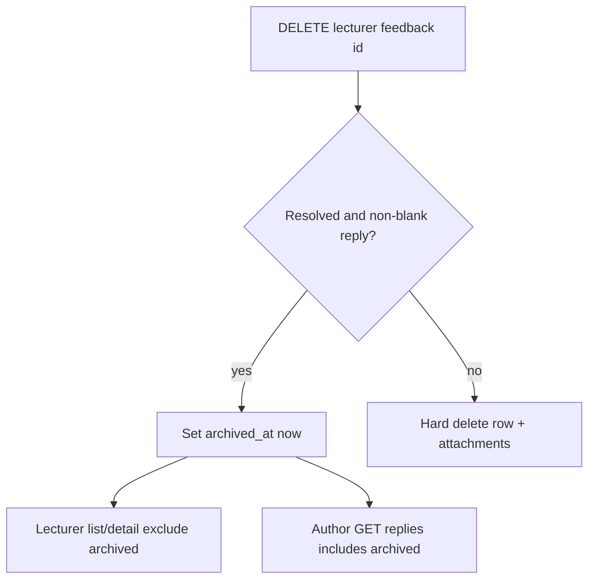

# Feedback Reply Durability - Plan

## Goal Capsule

- **Objective:** Shorten student feedback-reply notification titles, and keep lecturer replies visible to the author after the lecturer clears Resolved items from the inbox.
- **Product authority:** this plan (Product Contract below); Product Contract preservation: unchanged.
- **Execution profile:** software — operator SQL + Spring FeedbackService soft-archive + frontend title strings.
- **Stop conditions:** none outstanding.
- **Tail ownership:** implementer runs `mvn test` from `backend/` and `npm run build` from `frontend/`; operator applies new SQL on Neon/local before relying on soft-archive delete.

## Product Contract

### Summary

Student bell titles for lecturer replies become short **Re:** labels.
Lecturer delete removes Resolved feedback from the inbox (soft-archive when a reply exists; hard-delete when not) without wiping the author’s reply notice.
Clicking or opening the bell does not permanently dismiss that notice.

### Problem Frame

Lecturers often resolve an item, write a short reply, then delete it to keep the inbox clean.
Today the reply lives on the feedback row, so delete removes the student’s notification at the same time.
The current title (“Lecturer replied to your Bug report”) is longer than needed in the bell.

### Key Decisions

- **Soft-archive on lecturer delete.** (session-settled: user-approved — chosen over detaching replies into a separate store and over blocking delete while a reply exists: clears the inbox without killing the author’s notice.) Governs R3, R4.
- **Replies last indefinitely for the author.** (session-settled: user-directed — chosen over a fixed retention window and over unread-only soft-hide.) Governs R4.
- **No permanent dismiss on click.** (session-settled: user-directed — chosen over forever-gone after click: notice stays listed; unread/read for this visit may clear and reset on a later page load.) Governs R5.
- **Short Re: titles.** (session-settled: user-directed — chosen over the long “Lecturer replied to your …” wording.) Governs R1, R2.

### Actors

- A1. **Author** (usually a student; any signed-in user who submitted the item) — sees reply notifications in the student notification bell.
- A2. **Lecturer** — resolves feedback, writes a short reply, deletes Resolved items from the inbox.
- A3. **System** — keeps author-facing reply data available after inbox delete; builds short notification titles.

### Requirements

**Notification copy**

- R1. When the item type is Bug report, the student notification title is exactly `Re: Bug Report`.
- R2. When the item type is Contribution, the student notification title is exactly `Re: Contribution`.

**Durability after inbox delete**

- R3. When a lecturer deletes a Resolved feedback item, that item no longer appears in the lecturer Feedback inbox (list and detail).
- R4. If that item had a lecturer reply, the author continues to see that reply in the notification bell with no time limit, even after R3.
- R5. Opening the bell or interacting with a reply notification does not permanently remove it from the author’s list; it may mark read for the current visit and return to unread on a later page load, matching the existing session-scoped read behavior for student notifications.
- R6. Lecturer reopen-to-Open behavior that clears a reply on a still-visible inbox item is unchanged by this work.

### Key Flows

- F1. **Reply then clear inbox**
  - **Trigger:** Lecturer marks an item Resolved, saves a short reply, then deletes it.
  - **Actors:** A2, A1, A3
  - **Steps:** Reply is saved; delete hides the item from the lecturer inbox; author’s bell still shows the reply under R1 or R2.
  - **Covered by:** R1–R4
- F2. **Author opens the bell**
  - **Trigger:** Author opens the notification bell after a reply exists (whether or not the lecturer has deleted the item).
  - **Actors:** A1
  - **Steps:** Reply remains in the list; unread may clear for this visit; a later page load may show unread again; the reply itself is not gone.
  - **Covered by:** R4, R5

### Acceptance Examples

- AE1. **Covers R1, R2.** Given a Bug report reply and a Contribution reply, when the author opens the bell, then titles are `Re: Bug Report` and `Re: Contribution` respectively, not the long “Lecturer replied…” form.
- AE2. **Covers R3, R4.** Given a Resolved item with reply text “Fixed in lab 3”, when the lecturer deletes it, then the lecturer inbox no longer lists it, and the author’s bell still shows that message under `Re: Bug Report` (or `Re: Contribution`) with no expiry.
- AE3. **Covers R5.** Given a durable reply in the bell, when the author opens the bell, then the item stays in the list; after a full page reload in a new visit context, the reply is still present (not permanently dismissed by the earlier open).

### Scope Boundaries

**In scope**

- Student notification title copy for feedback replies.
- Soft-archive semantics for lecturer delete of Resolved feedback so author replies survive.
- Preserve existing session-scoped read marking (no new forever-dismiss feature).

**Out of scope**

- Lecturer undelete / restore UI for archived items.
- Permanent per-notification dismiss storage.
- Email or other out-of-app channels.
- Changing who may reply, reply length limits, or Resolved-only reply rules.
- Desktop practice Feedback (still absent).
- Purging attachment `bytea` on soft-archived rows (storage reclaim later).

### Dependencies / Assumptions

- Builds on the existing Feedback inbox and author `GET` replies path used by `StudentNotificationBell`.
- Student notification read IDs continue to use the existing session-scoped store; this work does not introduce a durable “mark done forever” store.

### Outstanding Questions

None blocking. Former deferred items resolved in KTD1–KTD3.

### Sources / Research

- Reply titles: `frontend/src/utils/studentNotifications.js` (`buildFeedbackReplyNotifications`).
- Author replies: `GET /api/feedback/replies` → `FeedbackService.listRepliesForAuthor` → `findByUser_IdAndLecturerResponseIsNotNullOrderByResponseAtDesc`.
- Delete today: `FeedbackService.deleteResolved` hard-deletes; cascade removes attachments.
- Inbox list: `findByStatusOrderByCreatedAtDesc` / `findAllByOrderByCreatedAtDesc` with no archive filter.
- Operator SQL pattern: `docs/sql/2026-10-20-feedback-inbox.sql` / `docs/sql/2026-10-20-feedback-lecturer-response.sql`.

---

## Planning Contract

### Key Technical Decisions

- KTD1. **Soft-archive via nullable `feedback_item.archived_at`.** Set on delete when a non-blank `lecturer_response` exists; lecturer list/detail/attachment/status/response treat `archived_at IS NOT NULL` as not found / excluded. Author `listRepliesForAuthor` includes archived rows. Governs R3, R4.
- KTD2. **Hard-delete Resolved items with no reply.** (session-settled: user-directed — chosen over always soft-archive: frees attachment `bytea` when there is nothing for the author to keep.) Governs R3.
- KTD3. **Title strings only on the SPA.** `Re: Bug Report` / `Re: Contribution` in `buildFeedbackReplyNotifications`; no API DTO change. Governs R1, R2.
- KTD4. **No frontend change to delete UX.** Lecturer still confirms delete; toast may stay “Feedback deleted.” Soft-archive is server-side. R5 needs no bell code change (sessionStorage read marking already matches).

### High-Level Technical Design

### Assumptions

- Operator applies `docs/sql/2026-10-20-feedback-soft-archive.sql` (or equivalent) on Neon/local in the same release as the API that sets `archived_at`.
- Desktop Feedback remains off (`!desktop`); column may exist unused if entities are scanned.
- Soft-archived attachment bytes remain until a future purge; not in this work.

### Sequencing

1. U1 — SQL + entity + repository filters + soft/hard delete behavior + unit tests.
2. U2 — student notification title strings + DOX notes.

### Risks

- **Forgotten list filter:** ALL/OPEN/RESOLVED queries must exclude archived or deleted items reappear — mitigated by repository method names and tests.
- **Lecturer detail by URL:** archived id must 404 via `requireItem` / equivalent.
- **Whitespace-only reply:** treat as no reply (same trim rules as `saveResponse`) so empty-looking responses hard-delete.

### System-Wide Impact

- Schema: one nullable timestamptz on `feedback_item`.
- Lecturer Feedback API delete semantics change; path and auth unchanged.
- Student `/api/feedback/replies` payload shape unchanged.

### Documentation / Operational Notes

- New operator SQL under `docs/sql/`; note in root `AGENTS.md` Child DOX Index and `backend/AGENTS.md` FeedbackService / schema scripts.
- Update `CONCEPTS.md` Feedback status so Resolved delete is soft-archive when a reply exists (author bell keeps the reply) and hard-delete when it does not.
- Update `frontend/src/components/student/AGENTS.md` if title copy is documented there.

---

## Implementation Units

### U1. Soft-archive delete and inbox filters

**Goal:** Lecturer delete archives Resolved items that have a reply; hard-deletes those without; inbox never shows archived rows; author replies still return archived replies.

**Requirements:** R3, R4, R6; F1; AE2

**Dependencies:** none

**Files:**
- `docs/sql/2026-10-20-feedback-soft-archive.sql` (new)
- `docs/sql/2026-10-13-schema-baseline-reconstructed.sql` (add `archived_at` on `feedback_item` if that table is listed)
- `docs/sql/2026-10-20-feedback-inbox.sql` (document `archived_at` for greenfield creates)
- `backend/src/main/java/model/FeedbackItem.java`
- `backend/src/main/java/repository/FeedbackItemRepository.java`
- `backend/src/main/java/service/FeedbackService.java`
- `backend/src/test/java/unit/com/eiu/capstone/backend/service/FeedbackServiceInboxTest.java`
- `backend/AGENTS.md`
- `AGENTS.md` (Child DOX Index SQL row)
- `CONCEPTS.md` (Feedback status — soft-archive vs hard-delete on Resolved delete)

**Approach:**
1. Operator SQL: `ALTER TABLE feedback_item ADD COLUMN IF NOT EXISTS archived_at TIMESTAMPTZ;` optional partial index on list paths is fine but not required for low volume.
2. Entity field + getters/setters for `archivedAt`.
3. Repository: list methods require `ArchivedAtIsNull` (status + all). Author replies query stays response-not-null ordered by `responseAt` (no archived filter).
4. `requireItem` / detail / attachment / status / response: if `archivedAt != null` → 404.
5. `deleteResolved`: still reject non-Resolved; if trimmed `lecturerResponse` non-empty → set `archivedAt` and save; else `delete` as today.
6. R6: reopen-clear-reply path unchanged for non-archived items.

**Patterns to follow:** operator SQL + JPA like `docs/sql/2026-10-20-feedback-lecturer-response.sql`; existing `FeedbackServiceInboxTest` Mockito style.

**Test scenarios:**
- Covers AE2. Resolved with reply → delete sets `archivedAt`, does not call `delete`; list OPEN/RESOLVED/ALL exclude it; `listRepliesForAuthor` still returns the reply text.
- Resolved with blank/null reply → delete calls repository `delete` (hard-delete).
- Delete Open → still 422.
- Detail / attachment on archived id → 404.
- Default list still Open-only among non-archived.

**Verification:** updated unit tests pass under `mvn test` from `backend/`.

---

### U2. Short Re: notification titles

**Goal:** Student bell shows `Re: Bug Report` / `Re: Contribution` for lecturer replies.

**Requirements:** R1, R2, R5; F2; AE1, AE3

**Dependencies:** U1 (for end-to-end durability; titles can ship alone)

**Files:**
- `frontend/src/utils/studentNotifications.js`
- `frontend/src/components/student/AGENTS.md` (if title wording is documented)

**Approach:**
1. Change `buildFeedbackReplyNotifications` titles to exactly `Re: Bug Report` and `Re: Contribution` from `itemType`.
2. Leave `StudentNotificationBell` read/sessionStorage behavior unchanged (R5 / AE3).

**Test scenarios:**
- Test expectation: none automated (no frontend test runner).
- Manual Covers AE1: Bug and Contribution replies show the short titles.
- Manual Covers AE3: open bell → items stay; reload in a new session context → replies still present when U1 is live.

**Verification:** `npm run build` from `frontend/`.

---

## Verification Contract

- Backend: `mvn test` from `backend/` includes updated `FeedbackServiceInboxTest` scenarios for soft vs hard delete and author replies after archive.
- Frontend: `npm run build` from `frontend/`.
- Operator: apply `docs/sql/2026-10-20-feedback-soft-archive.sql` on the Postgres used by the running API before relying on soft-archive.
- Manual: resolve + reply + delete → lecturer inbox empty for that item; author bell still shows reply with `Re:` title; resolve + delete with no reply → row gone and no reply for author.

## Definition of Done

- Product Contract R1–R6 implemented as written.
- U1–U2 complete per their Verification fields.
- Verification Contract commands pass.
- Operator SQL exists and is indexed from `AGENTS.md` / `backend/AGENTS.md`.
- No lecturer restore UI or permanent dismiss storage introduced.
- `CONCEPTS.md` Feedback status matches soft-archive vs hard-delete.
