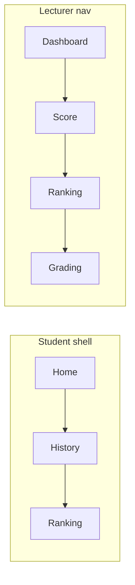
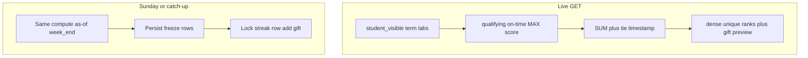
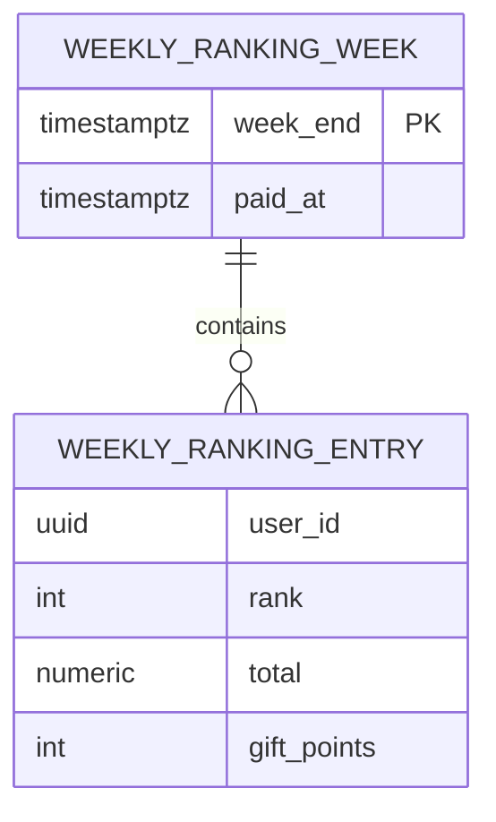

# Weekly Lab Ranking - Plan

## Goal Capsule

- **Objective:** Ship a public live weekly ranking of current-quarter students by running lab-score total, with shop-point gifts paid once at Sunday 23:59:59 Vietnam time, on dedicated Ranking screens for students and lecturers.
- **Product authority:** this plan (Product Contract below). Past-week archive is not active scope.
- **Product Contract preservation:** unchanged.
- **Execution profile:** software — ranking SQL + payout ledger + web Ranking screens.
- **Stop conditions:** none outstanding.
- **Tail ownership:** implementer runs `mvn test` from `backend/` and `npm run build` from `frontend/`; operator applies ranking SQL on Neon/local before relying on Sunday payout.

## Product Contract

### Summary

Students and lecturers open a Ranking page that orders every active student enrolled in the current quarter by the sum of on-time highest scores on labs those students can already see.
The board updates as scores change during the week.
At Sunday 23:59:59 in Vietnam time the week freezes, prize points credit once into the existing mascot-shop balance, and Monday starts a new live week on the same running totals.

### Problem Frame

Daily streak already pays shop points for daily habits.
There is no public contest on lab scores and no weekly prize.
Lecturers compare students on Score (average of highest lab scores) but students cannot see standing against classmates.

### Key Decisions

- **Running quarter total, weekly prize window.** (session-settled: user-directed — chosen over ranking only the Monday–Sunday score delta: the number being ranked does not reset on Monday.) Governs R2, R12.
- **On-time highest per lab, then sum.** (session-settled: user-directed — chosen over latest-attempt scores and over counting late submissions: same per-lab number as lecturer Score, different rollup than Score’s average.) Governs R2, R3, R4.
- **Unique ranks via who reached the total first.** (session-settled: user-directed — chosen over shared rank / shared or split prizes.) Governs R6, R7.
- **Rank 10 is in the 40-point band.** (session-settled: user-directed — chosen over treating rank 10 as the 20-point band: the written “4–10” and “10–20” overlap.) Governs R8.
- **Dedicated Ranking screens in both shells.** (session-settled: user-directed — chosen over opening from the student points header or adding a week-rank column on Score.) Governs R13, R14.
- **v1 is live week plus payout only.** (session-settled: user-directed — chosen over shipping a past-week archive in v1.) Governs R12; see Scope Boundaries.
- **Web only.** (session-settled: user-directed — chosen over a local desktop-practice board.) See Scope Boundaries.
- **Newly visible labs join the live sum immediately.** (session-settled: user-directed — chosen over freezing Monday’s lab set for the whole week.) Governs R5.
- **Missed Sunday still pays the Sunday freeze.** (session-settled: user-approved — chosen over paying whoever is ahead when the server returns.) Governs R11.

### Actors

- A1. **Student** — enrolled, active, current-quarter; sees the public board and receives prize points.
- A2. **Lecturer** — sees the same ranking of current-quarter students on a Ranking nav item.
- A3. **System** — computes live ranks; freezes and pays at week end; credits shop points once.

### Requirements

**Ranking population and score**

- R1. The board includes every active student enrolled in the current quarter, including students who have not submitted yet.
- R2. A student’s ranking total is the sum, across student-visible current-quarter labs, of that student’s on-time highest score for each lab. Unsubmitted or inapplicable labs contribute 0. This total is a running quarter figure; it does not reset on Monday.
- R3. On-time means the same lecturer score cutoff already used on Score: only submissions at or before that lab’s deadline 23:59:59 Vietnam time. Late attempts do not change ranking totals.
- R4. Highest means the same per-lab number lecturers see on Score, not the latest-attempt number on the student dashboard.
- R5. When a current-quarter lab becomes visible to students during the week, it enters every student’s sum immediately (0 until an on-time highest exists). Ranks may reshuffle.

**Order, prizes, payout**

- R6. Rank 1 is the highest total. Equal totals break by the Vietnam-time timestamp of the last on-time submission that increased that student’s ranking total: earlier wins. Ranks are unique.
- R7. Prize points for the frozen week follow unique ranks: rank 1 gets 100, 2 gets 80, 3 gets 60, 4 through 10 get 40, 11 through 20 get 20, rank 21 and below get 0. If the roster is smaller than a band, unused slots are simply unused.
- R8. Rank 10 receives 40 points, not 20.
- R9. Prize points are the same mascot-shop currency as daily-streak rewards. A 0-point rank does not change the balance.
- R10. Each student is paid for a given week at most once.
- R11. The gift is due at Sunday 23:59:59 Vietnam time. If that instant is missed, the system still freezes and pays the order as of that instant, not the order at recovery time.
- R12. After payout, Monday 00:00:00 Vietnam time starts a new live week on the same R2 totals. v1 shows only the current live week.

**Surfaces**

- R13. Students in the current quarter open Ranking as a sibling of Home and History. Out-of-term students do not get this entry (they are not on the board). Desktop practice does not show Ranking.
- R14. Lecturers open Ranking as a nav item beside Score. Dual-role users use the lecturer Ranking nav while in the lecturer shell and the student Ranking entry while in the student shell.
- R15. Both roles see the full public board: every ranked student’s rank, display name, IRN, ranking total, and this week’s gift points (0 shown as none). Students can see classmates.
- R16. The live week’s board updates as on-time highest scores change. After Sunday freeze, that week’s paid order does not change even if a later recovery job runs.

### Key Flows

- F1. **Live standing during the week**
  - **Trigger:** A1 or A2 opens Ranking between Monday 00:00:00 and Sunday 23:59:59 Vietnam time.
  - **Actors:** A1, A2, A3
  - **Steps:** System orders the R1 population by R2–R6; both roles see R15; gift column shows what would pay if the week froze now.
  - **Covered by:** R1–R8, R13–R16
- F2. **Score change reshuffles the live board**
  - **Trigger:** An on-time submission raises a student’s highest for a visible lab, or a lab becomes student-visible.
  - **Actors:** A1, A3
  - **Steps:** That student’s R2 total and R6 timestamp update; other students’ ranks may move; no shop points move until F3.
  - **Covered by:** R2, R5, R6, R16
- F3. **Sunday gift**
  - **Trigger:** Sunday 23:59:59 Vietnam time, or a catch-up that reconstructs that instant (R11).
  - **Actors:** A3, A1
  - **Steps:** Freeze the unique order; credit R7 amounts once into shop points (R9, R10); rank 21+ unchanged; next live week is Monday (R12).
  - **Covered by:** R7–R12, R16

### Acceptance Examples

- AE1. **Covers R2, R4, R12.** Given two labs visible this quarter with on-time highest 80 and 60, when week 2 starts, then the ranking total is still 140, not 0.
- AE2. **Covers R3.** Given a lab deadline Sunday and a Monday submission that raises the raw highest, when ranking is computed, then that lab still contributes the on-time highest, not the late one.
- AE3. **Covers R1, R2.** Given an enrolled student with no submissions, when the board loads, then they appear with total 0 and a rank at the bottom after tie-breaks among other zeros.
- AE4. **Covers R6, R7, R8.** Given two students both at total 500, and student A reached 500 on Wednesday while student B reached 500 on Thursday, when the week freezes, then A is the higher unique rank. If that is rank 10, A receives 40 points and the next student is rank 11 at 20 points.
- AE5. **Covers R5.** Given the live board on Wednesday, when a lecturer releases a new visible lab, then every student’s total includes that lab (0 until they have an on-time highest) and ranks may change immediately.
- AE6. **Covers R10, R11.** Given freeze already paid, when a catch-up job runs later, then no student is paid again for that week, and the paid order still matches Sunday 23:59:59, not the later live order.
- AE7. **Covers R13, R15.** Given a current-quarter student on Ranking, when they view the list, then they see other students’ names, IRNs, totals, and gift amounts, not only their own row.
- AE8. **Covers R9.** Given rank 1 at freeze, when payout completes, then that student’s shop point balance increases by 100 and they can spend it in the mascot shop.

### Scope Boundaries

**Deferred for later**

- Past-week frozen boards (who ranked where and who was paid).
- Countdown chrome, toasts, or other payout-notice copy beyond the gift column and the updated point balance.

**Not in this work**

- Desktop practice ranking or practice-app shop points.
- Ranking by weekly score delta, per-lab boards, or latest-attempt scores.
- Putting rank on Score or on the student points header.
- Changing lecturer Score’s average total column to a sum.

### Dependencies / Assumptions

- Student-visible current-quarter labs are the same set students already get on the submit dashboard (`GET /api/labs/list` / student-access), not every lab row in the quarter.
- Lecturer Score remains an average of the same on-time highests; ranking order can disagree with Score’s total column because ranking sums.
- Shop points live on the existing daily-streak point balance.
- Weeks are Monday 00:00:00 through Sunday 23:59:59 in `Asia/Ho_Chi_Minh`.
- Suspended or removed-from-term students drop off the live board with the same rules as Score / term roster.

### Outstanding Questions

**Resolve Before Planning:** none.

**Deferred to Planning:** none remaining. Former items are KTD1–KTD7. Payout toast stays out of v1 per Scope Boundaries.

### Sources / Research

- No ranking or leaderboard exists under `frontend/src` or `backend/src` (2026-10-21 scan).
- Lecturer on-time highest and missing-lab-as-0: `CONCEPTS.md` (Grade overview, Lecturer score cutoff); `LecturerAnalyticsRepository` qualifying scores use deadline `23:59:59` `Asia/Ho_Chi_Minh`.
- Student dashboard uses latest attempt; `highest_score` is lecturer-facing: `backend/AGENTS.md`.
- Shop currency: `student_daily_streak.points`; daily streak rewards in `CONCEPTS.md` Daily streak.
- Existing Vietnam-zone scheduler: `StudentAccountExpiryScheduler` cron `Asia/Ho_Chi_Minh`; `@EnableScheduling` on the backend application. No Sunday ranking job today.

<!-- ce-section: work-relationships -->
### How This Work Fits Together

This plan owns the live weekly ranking board and Sunday shop-point gifts.

- Past-week archive: **Depends on** this freeze/payout existing; **Can proceed independently of** after v1; not a requirement here.
- Daily streak / mascot shop: **Shares** the shop-point balance; this work only credits ranking gifts into that balance.
- Lecturer Score: **Shares** on-time highest per lab; ranking does not replace Score.

---

## Planning Contract

### Key Technical Decisions

- KTD1. **Live board is computed on GET.** Reuse `LecturerAnalyticsRepository` qualifying on-time `MAX(score)` from `lab_submission` (not `student_lab_progress.highest_score`, not latest attempt). Sum those scores across current-term labs with `student_visible = true`. Do not write ranks on upload. (session-settled: user-approved — chosen over snapshot-on-submit: live R16 without touching the upload hot path.) Governs R2–R5, R16.
- KTD2. **Tie-break timestamp.** Per lab, take the earliest `submitted_at` among on-time attempts whose score equals that lab’s current on-time max (the attempt that first reached the current high). The ranking timestamp is the maximum of those per-lab times. Students with no qualifying attempt sort after everyone with a timestamp, then by IRN only to keep ranks unique among all-zero rows. Governs R6.
- KTD3. **As-of cutoff for freeze.** Live GET uses “now.” Sunday payout and catch-up recompute with `submitted_at <= week_end` (Sunday 23:59:59 Vietnam of that week) plus the usual deadline filter, then persist that ordered snapshot. Governs R11, R16.
- KTD4. **Payout ledger + freeze rows.** New tables (names left to implementer) with a unique week key and unique `(user_id, week)` payout row. Insert freeze rows and credit points in one transaction; `ON CONFLICT` on the week/user key makes a second run a no-op. Mirror `lab_deadline_email_sent` and streak schema migrator (`@Profile("!desktop")`). Governs R9, R10, R11.
- KTD5. **Two role-prefixed GETs, one service.** `GET /api/students/ranking/current` (STUDENT) and `GET /api/lecturer/ranking/current` (LECTURER) return the same board DTO. Existing `/api/students/**` and `/api/lecturer/**` matchers cover them; add authorization probes, not extra matcher rows unless a narrower rule is required. Lecturer first paint also via tab bootstrap like Score. Governs R13–R15.
- KTD6. **Scheduler.** Six-field Spring cron like `StudentAccountExpiryScheduler`: `@Scheduled(cron = "59 59 23 * * 0", zone = "Asia/Ho_Chi_Minh")` (Sunday 23:59:59). Same payout method on API startup for catch-up. `@Profile("!desktop")`. Do not set `paid_at` until the as-of instant is `week_end` (all submissions through Sunday 23:59:59 are included). If the week is already frozen, return. Governs R11, R12.
- KTD7. **Student Ranking is a Header command** next to Home and History (`hideRanking` when out of term or `VITE_APP_MODE === 'desktop'`). Lecturer nav item `ranking` after `score`. Shared table component; no toast. Governs R13, R14.

### High-Level Technical Design

Gift preview on the live board is `pointsFor(rank)` from R7; it is not a paid row until KTD4.

### Assumptions

- `LabDeadlineHelper.isOpenForStudentSubmission` today is `student_visible` only; ranking lab set is current-term labs with `student_visible = true`.
- Grade-overview qualifying SQL is the on-time highest source of truth; do not copy Score’s average or its all-labs column set.
- Multi-instance deploys may fire the cron twice; unique payout keys are the safety, not a leader election.
- Full roster in one GET is acceptable for current-quarter size; no pagination in v1 (R15).

### Sequencing

1. U1 — ranking compute (totals, ranks, gifts, as-of) + tests.
2. U2 — schema, freeze, scheduler, streak credit + tests.
3. U3 — APIs, security, lecturer bootstrap.
4. U4 — student and lecturer Ranking UI.

### Risks

- **Wrong lab set:** copying Score’s all-term labs would count hidden labs. Mitigate by filtering `student_visible` and testing a hidden lab does not enter the sum until toggled.
- **Wrong score source:** `student_lab_progress.highest_score` can include late work. Mitigate by using qualifying `lab_submission` SQL only.
- **Tie-break SQL:** “first reached current high per lab, then max across labs” is easy to get backwards. Mitigate with fixture tests (AE4).
- **Double pay:** two API instances at Sunday. Mitigate with unique `(user_id, week_end)` and a transaction that inserts freeze before adding points.
- **Burst guard:** a full-board GET still counts as one read. Do not fan-out per student.

### System-Wide Impact

- New Postgres tables + startup migrator + operator SQL.
- New student and lecturer routes and SPA screens; desktop unchanged.
- Shop point balances can jump on Sunday without a streak mission.
- Lecturer nav and bootstrap store gain a tab.

### Documentation / Operational Notes

- Operator SQL under `docs/sql/`; Child DOX Index in `AGENTS.md`; API table in `backend/AGENTS.md` and `frontend/src/pages/AGENTS.md`.
- `CONCEPTS.md` Weekly ranking already matches this Product Contract; only fix if implementation names a new domain term.

### Deferred to Follow-Up Work

- Past-week archive UI (freeze rows may already exist after U2).
- Pagination if a future quarter roster is too large for one payload.

---

## Implementation Units

### U1. Ranking total, order, and gift preview

**Goal:** One domain function that, for a term and an as-of instant, returns every current-term active enrolled student with ranking total, unique rank, tie timestamp, and gift preview.

**Requirements:** R1–R8, R15, R16; F1, F2; AE1–AE5; KTD1, KTD2, KTD3

**Dependencies:** none

**Files:**
- `backend/src/main/java/analytics/repository/LecturerAnalyticsRepository.java` (reuse or extract qualifying-score fragments; add ranking query)
- `backend/src/main/java/service/WeeklyRankingRules.java` (new) — gift bands and rank assignment
- `backend/src/main/java/analytics/service/WeeklyRankingService.java` (new)
- `backend/src/test/java/unit/com/eiu/capstone/backend/service/WeeklyRankingRulesTest.java` (new)
- `backend/src/test/java/support/com/eiu/capstone/backend/service/WeeklyRankingServiceTest.java` (new)

**Approach:**
1. Population: same current-term active student ids as grade overview.
2. Labs: current-term rows with `student_visible = true`.
3. Per (student, lab): on-time `MAX(score)` with the existing Vietnam deadline predicate; missing = 0.
4. Total = sum across those labs.
5. Tie timestamp per KTD2; as-of per KTD3 when an instant is passed.
6. Sort total DESC, timestamp ASC NULLS LAST, IRN ASC; assign ranks 1..N; gift from R7/R8.

**Patterns to follow:** `QUALIFYING_SCORES_CTE` in `LecturerAnalyticsRepository`; no `::` casts in Hibernate native SQL (`docs/solutions/runtime-errors/hibernate-native-query-postgres-cast-bind-parameter.md`).

**Test scenarios:**
- Covers AE1. Two visible labs 80 and 60 → total 140; still 140 after a week boundary with as-of now.
- Covers AE2. Late higher attempt excluded from the lab’s max.
- Covers AE3. Never-submitted student total 0 and still listed.
- Covers AE4. Equal totals; earlier KTD2 timestamp gets the better unique rank; rank 10 gift is 40, rank 11 is 20.
- Covers AE5. Lab with `student_visible` false omitted; after it is true, totals include a 0 (or a score) and ranks can move.
- Gift preview: ranks 1,2,3,4,10,11,20,21 → 100,80,60,40,40,20,20,0.
- As-of: submission after `week_end` ignored when computing that week.

**Verification:** new unit and support tests pass under `mvn test` from `backend/`.

---

### U2. Sunday freeze, payout ledger, and shop points

**Goal:** Persist the as-of Sunday board once and credit gift points once per student per week, including catch-up after downtime.

**Requirements:** R9–R12, R16; F3; AE6, AE8; KTD3, KTD4, KTD6

**Dependencies:** U1

**Files:**
- `docs/sql/2026-10-21-weekly-ranking-payout.sql` (new)
- `docs/sql/2026-10-13-schema-baseline-reconstructed.sql` (add tables if that baseline lists peer tables)
- `backend/src/main/java/config/WeeklyRankingSchemaMigrator.java` (new)
- `backend/src/main/java/service/WeeklyRankingPayoutService.java` (new)
- `backend/src/main/java/service/WeeklyRankingPayoutScheduler.java` (new)
- `backend/src/main/java/service/StudentStreakService.java` (credit helper using existing lock)
- `backend/src/test/java/unit/com/eiu/capstone/backend/service/WeeklyRankingPayoutServiceTest.java` (new)
- `backend/src/test/java/unit/com/eiu/capstone/backend/config/WeeklyRankingSchemaMigratorTest.java` (new) — only if peer migrators have a test; otherwise fold schema smoke into payout tests
- `AGENTS.md` (Child DOX Index SQL row)
- `backend/AGENTS.md`

**Approach:**
1. Migrator `CREATE TABLE IF NOT EXISTS` for week header + per-student freeze/payout rows; `@Profile("!desktop")` like `StudentStreakSchemaMigrator`.
2. Payout method: if week header already `paid_at` set, return; else compute U1 as-of `week_end`; insert rows; for gift > 0 lock streak row and add points; set `paid_at`.
3. Scheduler KTD6 plus ApplicationReady catch-up for the last completed Sunday if unpaid. `WeeklyRankingPayoutService` runs only from that scheduler and startup catch-up — no REST route, lecturer action, or student path may invoke payout.
4. Rank 21+ freeze rows still stored with gift 0; no streak write.

**Patterns to follow:** `StudentAccountExpiryScheduler` zone cron; `StudentStreakService.lock`; `lab_deadline_email_sent` uniqueness; `ON CONFLICT` column lists not constraint names.

**Test scenarios:**
- Covers AE8. Rank 1 freeze increases `points` by 100; rank 21 leaves points unchanged.
- Covers AE6. Second payout call does not add points again and does not rewrite freeze ranks.
- Catch-up Tuesday with a Monday score improvement still pays Sunday order (as-of `week_end`), not Tuesday live order.
- Desktop profile does not register the scheduler bean (match other `!desktop` schedulers).

**Verification:** payout tests pass; operator SQL exists and is indexed from `AGENTS.md`.

---

### U3. Ranking APIs, security, and lecturer bootstrap

**Goal:** Student and lecturer can GET the current live board (gift preview); anonymous 401; wrong role 403; lecturer Ranking tab first paint is one bootstrap request.

**Requirements:** R13–R16; F1; KTD5

**Dependencies:** U1 (U2 optional for live GET; freeze is not required to read live week)

**Files:**
- `backend/src/main/java/controller/` student and lecturer ranking endpoints (new or existing controllers under `/api/students` and `/api/lecturer`)
- `backend/src/main/java/analytics/dto/` board response records
- `backend/src/main/java/config/SecurityConfig.java`
- `backend/src/main/java/security/SecurityAuthorizationProbes.java` (if that is how new paths are listed)
- `backend/src/main/java/controller/LecturerTabBootstrapController.java`
- `backend/src/main/java/analytics/service/LecturerTabBootstrapService.java`
- `backend/src/test/java/authorization/` ranking auth tests (new)
- `backend/AGENTS.md`

**Approach:**
1. Both GETs call U1 with as-of now and current term; empty term → empty list.
2. Out-of-term students still 200 with empty list or 403 matching other student current-quarter GETs — follow `StudentTermAccessService` / labs list, do not invent a third policy.
3. Lecturer bootstrap `ranking` tab returns the same DTO as first useful data.
4. Authorization probes: anonymous, student, lecturer, dual-role.

**Patterns to follow:** `docs/solutions/architecture-patterns/spring-security-default-deny-matcher-table.md`; `LecturerTabBootstrapAuthTest`.

**Test scenarios:**
- Student GET with student JWT → 200 board including other students’ names/IRNs.
- Lecturer GET with student-only JWT → 403; lecturer JWT → 200.
- Anonymous → 401.
- Lecturer bootstrap ranking tab → 200 with board payload.

**Verification:** authorization tests pass under `mvn test` from `backend/`.

---

### U4. Student and lecturer Ranking screens

**Goal:** Dedicated Ranking UI in both web shells showing the full live board; hidden on desktop and for out-of-term students.

**Requirements:** R13–R15; F1; AE7; KTD7

**Dependencies:** U3

**Files:**
- `frontend/src/components/ranking/RankingBoard.jsx` (new, shared table)
- `frontend/src/pages/StudentRankingPage.jsx` (new) or a `view` on `StudentDashboard.jsx`
- `frontend/src/components/Header.jsx`
- `frontend/src/utils/authRoutes.js`
- `frontend/src/App.jsx`
- `frontend/src/components/NavBar.jsx`
- `frontend/src/pages/LecturerDashboard.jsx`
- `frontend/src/utils/lecturerBootstrapStore.js`
- `frontend/src/pages/AGENTS.md`
- `frontend/src/components/student/AGENTS.md` (if Header commands are documented there)
- Do not add Ranking to `App.desktop.jsx`

**Approach:**
1. Table columns: rank, name, IRN, total (existing score display helper / floor), gift (literal `none` when 0, per R15). Header for that column is **This week's gift**.
2. Student Header command `ranking` beside Home/History; route like history; hide when `hideHome`/out of term or desktop.
3. Lecturer nav after Score; `activeNav === 'ranking'` renders the shared board from bootstrap/store.
4. No past-week picker, no toast.

**Patterns to follow:** Score tab section switch; Header Home/History commands; semantic tokens not raw palette.

**Test scenarios:**
- Test expectation: none automated (no frontend test runner).
- Manual Covers AE7: current-quarter student sees classmates’ names, IRNs, totals, gifts.
- Manual: lecturer Ranking nav shows the same order; dual-role lecturer shell vs student shell use their own entry.
- Manual: desktop build has no Ranking command; out-of-term student has no Ranking command.

**Verification:** `npm run build` from `frontend/`; `npm run build:desktop` still succeeds and Ranking is absent.

---

## Verification Contract

- Backend: `mvn test` from `backend/` includes U1 ranking rules/SQL tests, U2 payout idempotency/as-of tests, U3 authorization tests.
- Frontend: `npm run build` from `frontend/`; desktop bundle `npm run build:desktop` has no Ranking entry.
- Operator: apply `docs/sql/2026-10-21-weekly-ranking-payout.sql` (or rely on startup migrator) on the Postgres used by the API before the first Sunday payout.
- Manual: student and lecturer Ranking screens load the live board; hide a lab and watch totals drop that lab; restore it and watch ranks move; confirm gift preview bands; after a simulated payout, points increase once.

## Definition of Done

- Product Contract R1–R16 implemented as written.
- U1–U4 complete per their Verification fields.
- Verification Contract gates pass.
- Operator SQL and API/nav docs updated (`AGENTS.md`, `backend/AGENTS.md`, `frontend/src/pages/AGENTS.md`).
- No past-week archive UI, desktop ranking, Score-column rank, or Score average rewrite.
- Shop points for gifts go through the existing streak point balance only.
