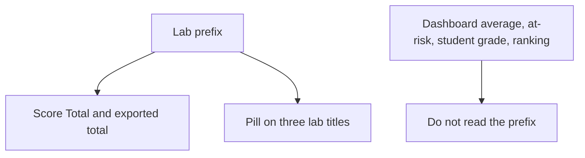
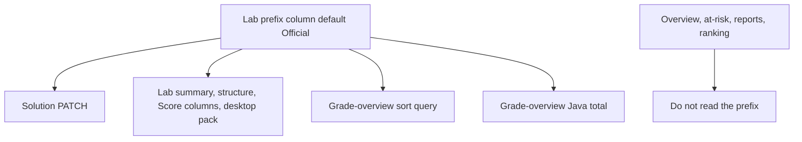

# Lab Practice Official Prefix - Plan

## Goal Capsule

- **Objective:** Let a lecturer mark each lab Practice or Official, show that word above the lab name, and count only Official labs in the lecturer Score total.
- **Product authority:** this plan (Product Contract below).
- **Product Contract preservation:** changed: R2, R7, AE4 — a cloned lab starts Official; an empty Official set shows the existing missing-number dash.
- **Execution profile:** software — lab prefix column, Score average filter, three title pills.
- **Stop conditions:** none outstanding.
- **Tail ownership:** implementer runs `mvn test` from `backend/` and `npm run build` from `frontend/`. Operator SQL is also applied by the non-desktop startup migrator.

## Product Contract

### Summary

Each lab carries a Practice or Official prefix. Lecturers set it in Solution. A pill sits at the top-right, above the lab name, on the student lab header, the Solution lab header, and the Score column. Score Total averages Official labs only. Ranking, the dashboard average, the at-risk list, and the grade a student sees do not read the prefix.

### Problem Frame

Every current-quarter lab enters the lecturer Score average today. A lab used for practice changes that official number the same way a graded lab does. Hiding the lab from students would also remove it from weekly ranking. Lecturers need a mark that drops a lab out of Score Total while students can still open it and ranking can still use it.

### Key Decisions

- **Official is the starting prefix.** (session-settled: user-directed — chosen over Practice and over a blank prefix: today's Score averages stay, and a newly created lab counts immediately.) Governs R2.
- **Practice stays on the Score grid.** (session-settled: user-directed — chosen over removing the column and over still including it in Total: the column remains visible and its scores stay out of Total.) Governs R6.
- **Only Score Total reads the prefix.** (session-settled: user-directed — chosen over every lecturer class total and over the grade the student sees: dashboard average, at-risk, and student grades stay unchanged.) Governs R8, R9.
- **Official labs are the whole average.** (session-settled: user-directed — chosen over keeping Practice as a zero slot: a skipped Practice lab does not lower Total.) Governs R6.
- **The pill is on three titles.** (session-settled: user-directed — chosen over every lab name and over lecturer-only: students see it on the open lab, and lists stay plain.) Governs R4, R5.
- **The pill ships with the Score rule.** (session-settled: user-approved — chosen over the Score rule without the pill: the placement sketch is part of the feature.) Governs R4.
- **Empty Total uses the existing missing-number dash.** (session-settled: user-approved — chosen over a fully empty cell: Score already shows that dash when a number is missing.) Governs R7.
- **A cloned lab starts Official.** (session-settled: user-approved — chosen over copying the source prefix: a clone is a new lab.) Governs R2.

### Actors

- A1. Lecturer — sets the prefix in Solution and reads Score.
- A2. Student — sees the pill on the open lab and still receives a grade for Practice labs.

### Requirements

**Prefix**

- R1. Each lab has one prefix, Practice or Official. The pill text is the word Practice or the word Official.
- R2. A lab that already exists, a lab a lecturer creates, and a lab produced by clone start as Official. Clone does not keep the source lab's prefix.
- R3. A lecturer can switch a lab between Practice and Official in Solution. Students cannot change it. The new prefix applies to Score as soon as Score is shown again, including scores already earned.

**Where it shows**

- R4. The prefix is a pill at the top-right, above the lab name, on the student selected-lab header, the Solution lab header, and each Score column header. Practice is an outlined pill. Official uses that same slot and shape in a distinct theme color.
- R5. Lab names in sidebars, history, reports, grading pickers, and other lists stay plain text.

**Score**

- R6. Score Total, Score's sort by that total, and the total in the Score export are the average of on-time highest scores on Official labs only. A missing Official lab counts as 0. A Practice lab is left out of the sum and out of the count. The Practice column stays on the grid and in the export, and its cell stays the per-lab score Score shows today.
- R7. When the quarter has no Official labs, Score Total shows the same dash the Score table already uses for a missing number. Practice columns still show.

**What does not change**

- R8. The dashboard class average, the at-risk list, the grade a student sees on a lab, and per-lab grading views do not read the prefix.
- R9. Weekly ranking does not read the prefix. It keeps the sum of on-time highest scores on student-visible current-quarter labs.

### Key Flows

- F1. Lecturer sets the prefix
  - **Trigger:** A lecturer opens a lab in Solution and switches Practice or Official.
  - **Actors:** A1
  - **Steps:** The lab saves the new prefix. The Solution header pill updates. The next Score view uses R6 for every student.
  - **Covered by:** R3, R4, R6
- F2. Student opens a lab
  - **Trigger:** A student selects a lab.
  - **Actors:** A2
  - **Steps:** The selected-lab header shows the pill from R4. The sidebar row shows only the lab name. The student's grade for that lab is unchanged.
  - **Covered by:** R4, R5, R8

### Acceptance Examples

- AE1. Official-only average
  - **Covers R6.**
  - **Given:** Labs 1 and 2 are Official and Lab 3 is Practice. A student scored 80 and 100 on the Official labs and never submitted Lab 3.
  - **When:** The lecturer opens Score.
  - **Then:** Total is 90. Lab 3 remains a column and does not change Total.
- AE2. Switching the prefix
  - **Covers R3, R6.**
  - **Given:** Lab 3 is Official and already has scores in Score Total.
  - **When:** The lecturer sets Lab 3 to Practice, then later sets it back to Official.
  - **Then:** Score Total drops Lab 3 as soon as Score is shown after the first change. After the second change, Lab 3 counts again, and a student who never submitted it contributes 0.
- AE3. New lab
  - **Covers R2, R6.**
  - **Given:** The quarter already has Official labs with scores.
  - **When:** The lecturer creates Lab 5 and leaves it Official, and nobody has submitted it.
  - **Then:** Lab 5 is Official, and every student's Total includes 0 for Lab 5.
- AE4. No Official labs
  - **Covers R7.**
  - **Given:** Every lab in the quarter is Practice.
  - **When:** The lecturer opens Score.
  - **Then:** Total shows the missing-number dash. Practice columns still show.
- AE5. Titles versus lists
  - **Covers R4, R5.**
  - **Given:** A lab is Practice.
  - **When:** A student opens it, and a lecturer opens it in Solution and on Score.
  - **Then:** The student header, the Solution header, and the Score column show the Practice pill above the name. The student sidebar, history, and reports show the plain name.
- AE6. Ranking and dashboard stay on every lab
  - **Covers R8, R9.**
  - **Given:** A student has a high Practice score and a low Official score, and the all-labs average is under 70 while the Official-only average is not.
  - **When:** Ranking, the dashboard at-risk list, and Score are shown.
  - **Then:** Ranking includes both labs. The student is still at risk on the dashboard. Score Total uses only the Official lab.

### Scope Boundaries

- Badges on sidebars, history, reports, and grading pickers.
- A third prefix, or a prefix that differs per student.
- Changing who can see a lab, the on-time cutoff, or whether a lab cell uses the highest score.
- Changing weekly ranking's sum, its student-visible filter, or its absence on desktop practice.
- Filtering the dashboard average, the at-risk list, or a student's own lab grade by prefix.

### Dependencies / Assumptions

- Score today averages on-time highest scores across current-quarter labs, with a missing lab as 0. This work changes which labs enter that average (R6) and does not change the per-lab number.
- Weekly ranking today sums those same per-lab highs for student-visible labs. R9 leaves that sum alone.
- The student selected-lab header is shared with desktop practice, so R4 applies there. A lab whose prefix was never stored shows Official, matching R2. Desktop practice still has no ranking.
- The prefix does not change `student_visible`. A hidden lab follows the same Score and ranking membership it follows today, then R6 applies inside Score.

### Sources / Research

- `backend/src/main/java/model/Lab.java` stores name, term, deadline, `studentVisible`, and `releaseDate`. No prefix exists yet.
- `docs/sql/2026-10-13-schema-baseline-reconstructed.sql` defines `lab` with those columns only.
- `backend/AGENTS.md` describes the grade matrix total as sum divided by lab count, using each lab's highest score before the deadline.
- `CONCEPTS.md` defines weekly ranking as the sum of on-time highest scores on student-visible current-quarter labs, distinct from Score's average.
- `frontend/src/components/student/StudentUI.jsx` renders the selected-lab header. `frontend/src/components/lecturer/structure/LabSchedulingPanel.jsx` renders the Solution lab header. `frontend/src/components/lecturer/GradeOverviewTable.jsx` renders Score column headers.
- `backend/src/main/java/analytics/service/LecturerAnalyticsService.java` rebuilds Score Total in Java after the repository returns per-lab scores. `findOverviewStudentsForTerm` uses the same average shape for the dashboard roster and at-risk and must stay on every lab.
- `backend/src/main/java/analytics/repository/WeeklyRankingRepository.java` includes labs only when `student_visible` is true.
- `docs/solutions/logic-errors/grading-tab-latest-vs-highest-score.md` — lecturer totals stay on on-time highest, not latest attempt. A prefix change is a read-time filter, not a regrade.
- `docs/solutions/architecture-patterns/lab-clone-across-terms.md` — clone creates a new lab and resets access fields. Prefix follows that create path (R2).

---

## Planning Contract

### Key Technical Decisions

- KTD1. **Stored prefix, default Official.** Add a non-null lab column whose default and JPA field default are Official. Ship operator SQL and a `@Profile("!desktop")` startup migrator that adds the column only when it is missing (`ADD COLUMN IF NOT EXISTS`). Desktop H2 picks the column up from the entity. Do not infer Practice from a missing or zero score. Governs R1, R2.
- KTD2. **Empty Official set is a null total.** Grade-overview SQL and the Java rollup return null when the Official count is 0. The Score table already renders null through `formatNumber` as the missing-number dash. Do not write 0. (session-settled: user-approved — chosen over a fully empty cell: the table already uses that dash.) Governs R7.
- KTD3. **Clone does not copy the prefix.** `createLab` leaves the entity default. Do not set the source lab's prefix on the cloned row. (session-settled: user-approved — chosen over copying Practice: a clone is a new lab.) Governs R2.
- KTD4. **Score Total changes in two grade-overview places only.** The term-scoped grade-overview sort query and the Java total in `getGradeOverview` average Official labs only, while still returning every lab column and every per-lab cell. Do not edit `findOverviewStudentsForTerm`, overview metrics, at-risk SQL, reports SQL, or weekly ranking. Do not fold those copies into one shared query. Governs R6, R8, R9.
- KTD5. **Immediate PATCH, same shape as deadline and student access.** A lecturer-only `PATCH` on the lab updates the prefix and returns the structure response. Unknown values are rejected. Students cannot call it. The change does not regrade submissions. Governs R3.
- KTD6. **Prefix rides existing lab payloads.** Student lab summary, structure response, and Score column DTO carry the prefix. Desktop pack lab meta carries it too. Import of a pack that omits the field stores Official. Governs R4.
- KTD7. **Pills reuse Badge variants.** Practice uses the outline badge. Official uses the default badge, above the lab name, in the three title surfaces. No new color token. Lists stay plain text. Governs R4, R5.

### High-Level Technical Design

The displayed Score Total and the sort-by-total order both count Official labs only. Per-lab cells, including Practice columns, stay the on-time highest score they show today.

### Assumptions

- `formatNumber` of null is the dash lecturers already see for a missing Score number.
- Grade-overview per-lab cells come from on-time `MAX(lab_submission.score)`, not `student_lab_progress.highest_score`. This work does not switch that source.
- Overview and at-risk today copy the all-labs average. Leaving those queries untouched satisfies R8.
- A prefix edit does not invalidate rubric cache contents that omit the prefix. Score reads the column from the database on the next grade-overview request.
- Native SQL must use `CAST`, not PostgreSQL `::` casts.

### Sequencing

1. U1 — column, defaults, PATCH, clone stays Official.
2. U2 — Official-only Score Total, sort, and the exported total.
3. U3 — three pills, Solution control, desktop pack.

### Risks

- **Shared average copies.** Editing the overview or at-risk query while changing Score would make Practice labs drop out of at-risk. Mitigate by touching only the grade-overview sort query and `getGradeOverview`.
- **Sort and display disagree.** If SQL still divides by every lab while Java divides by Official labs, paging order will not match the Total column. Mitigate by changing both in U2 and testing 80 and 100 with a skipped Practice lab.
- **Old desktop packs.** A pack written before this column has no prefix. Import must store Official, not fail and not become Practice.
- **No existing grade-overview total tests.** U2 has to add them. There is nothing to regress against today.

### System-Wide Impact

- Postgres `lab` gains one column. Existing rows become Official via the default.
- Lecturer Solution and the student lab header, including desktop practice, show a pill. Score column headers do too.
- Score Total, its sort, and its Excel/PDF/SVG export change. Dashboard, at-risk, student grades, and ranking do not.
- A new lecturer PATCH sits under the existing lecturer lab routes.

### Documentation / Operational Notes

- Add `docs/sql/` for the column and list it in the root `AGENTS.md` Child DOX Index.
- Update the grade-overview total sentence in `backend/AGENTS.md` so it says Official labs only, and mention the PATCH next to deadline and student-access.
- Note the three pill surfaces in `frontend/src/components/lecturer/AGENTS.md` and `frontend/src/components/student/AGENTS.md`.
- `CONCEPTS.md` Lab prefix already matches this Product Contract.

### Deferred to Follow-Up Work

- Collapsing the copied average queries into one shared query.
- Pills on sidebars, history, reports, or grading pickers.

---

## Implementation Units

### U1. Persist the prefix and let Solution save it

**Goal:** Every lab has an Official or Practice prefix, existing and new labs start Official, and a lecturer can switch it.

**Requirements:** R1, R2, R3

**Dependencies:** none

**Files:**
- `backend/src/main/java/model/Lab.java`
- `backend/src/main/java/config/` startup migrator, `@Profile("!desktop")`
- `docs/sql/` operator script for the column
- `backend/src/main/java/DTO/rubric/LabStructureResponse.java`
- `backend/src/main/java/service/LabStructureService.java`
- `backend/src/main/java/controller/LecturerRubricController.java`
- `backend/src/test/java/support/com/eiu/capstone/backend/service/LabStructureServiceSaveTest.java`
- `backend/src/test/java/authorization/com/eiu/capstone/backend/security/SecurityAuthorizationTest.java`
- `AGENTS.md`
- `backend/AGENTS.md`

**Approach:**
- Follow KTD1 and KTD3. `createLab` does not set a prefix, so the entity default applies to create and to clone.
- Follow KTD5. Mirror `updateLabDeadline`: load the lab, set the prefix, save, return `buildLabStructureResponse`.
- Reject a missing or unknown prefix. Do not regrade and do not touch submission rows.
- Add an authorization probe on the new PATCH: lecturer allowed, student forbidden, anonymous unauthorized. The route stays under `/api/lecturer/labs`, which is already lecturer-gated.

**Patterns to follow:** `StudentStreakSchemaMigrator` column add; `LecturerRubricController` deadline PATCH; `LabStructureServiceSaveTest` create-lab assertions.

**Test scenarios:**
- Covers AE3. Creating a lab with no prefix argument stores Official.
- Cloning a Practice lab stores Official on the new lab.
- PATCH from Official to Practice and back persists the new value and returns it on the structure response.
- PATCH with an unknown value is rejected and leaves the stored prefix unchanged.
- A student JWT and an anonymous caller cannot PATCH the prefix.

**Verification:** New tests pass under `mvn test` from `backend/`. Existing labs read as Official after the migrator runs.

### U2. Count only Official labs in Score Total

**Goal:** Score Total, sort by that total, and the exported total average Official labs only. Practice columns stay. Overview, at-risk, and ranking stay on every lab they use today.

**Requirements:** R6, R7, R8, R9

**Dependencies:** U1

**Files:**
- `backend/src/main/java/analytics/repository/LecturerAnalyticsRepository.java`
- `backend/src/main/java/analytics/service/LecturerAnalyticsService.java`
- `backend/src/main/java/analytics/dto/GradeOverviewLabColumnDTO.java`
- `backend/AGENTS.md`
- New unit test next to other analytics service tests under `backend/src/test/java/unit/`

**Approach:**
- Follow KTD4 and KTD2. In `findGradeOverviewStudentsForTerm`, count and sum Official labs only. Leave the unscoped and overview copies of that average alone.
- In `getGradeOverview`, still list every lab, still fill every per-lab cell from the existing on-time max query, and divide the total by the Official column count. A Practice cell is not added. An Official cell with no score adds 0. Official count 0 yields null.
- Put the prefix on `GradeOverviewLabColumnDTO` so the grid can badge the column in U3.
- Export already prints `totalScore` and every lab column from this response. Do not add a second total formula in `exportRoster.js`.
- Do not add a prefix predicate to `WeeklyRankingRepository`.

**Patterns to follow:** existing `CAST(l.deadline_date AS timestamp)` deadline filter; `getGradeOverview` Java rollup.

**Test scenarios:**
- Covers AE1. Official scores 80 and 100, Practice unsubmitted: total 90, and the Practice column is still present.
- Covers AE2. After the lab is Official again, a student with no submission on it contributes 0, and the total uses that 0.
- Covers AE4. Zero Official labs: total is null. Practice columns remain.
- Covers AE6. The overview student-total query is not given an Official filter. Ranking's visible-lab query is not given a prefix filter.
- Sort by total uses the Official-only average, so the 90 student orders as 90 rather than as a three-lab average.
- A missing Official lab still adds 0 when at least one Official lab exists.

**Verification:** The new analytics tests pass under `mvn test` from `backend/`. `backend/AGENTS.md` describes the grade-overview total as the Official-only average.

### U3. Show the pill and carry the prefix into desktop packs

**Goal:** The student lab header, the Solution lab header, and each Score column show the pill above the name. The lecturer switches it in Solution. Desktop packs round-trip the prefix, and an old pack shows Official.

**Requirements:** R3, R4, R5

**Dependencies:** U1, U2

**Files:**
- `frontend/src/pages/SolutionManagement.jsx`
- `frontend/src/components/lecturer/structure/LabSchedulingPanel.jsx`
- `frontend/src/components/student/StudentUI.jsx`
- `frontend/src/components/lecturer/GradeOverviewTable.jsx`
- `frontend/src/components/ui/badge.jsx`
- `backend/src/main/java/controller/LabController.java`
- `backend/src/main/java/desktop/pack/DesktopPackLabMeta.java`
- `backend/src/main/java/desktop/pack/DesktopPackExportService.java`
- `backend/src/main/java/desktop/DesktopPackStructureMapper.java`
- `backend/src/test/java/unit/com/eiu/capstone/backend/desktop/DesktopPackSerializerTest.java`
- `frontend/src/components/lecturer/AGENTS.md`
- `frontend/src/components/student/AGENTS.md`

**Approach:**
- Follow KTD6 and KTD7. Add the prefix to the student lab summary used by the selected-lab header. Do not render it in `StudentLabSidebar` or history.
- In Solution, put the control next to the existing Live and Hidden badges and PATCH on change, using the same optimistic-save pattern as student access. The header pill updates from the saved value.
- On Score, stack the badge above the column's lab name and keep the header sortable. The column set is still every lab.
- Export and import the prefix on pack lab meta. A missing field on read becomes Official.
- Do not add a pill to grading pickers, reports, or overview dialogs.

**Patterns to follow:** `LabSchedulingPanel` `Badge` variants; `SolutionManagement.jsx` student-access PATCH; `DesktopPackSerializerTest`.

**Test scenarios:**
- Covers AE5. A Practice lab serializes that prefix. A pack object without the field imports as Official.
- Manual Covers AE5: student header and Solution header show Practice above the name; the sidebar and history show the plain name.
- Manual: Score column header shows the pill and still sorts. Switching to Official in Solution updates the header pill and the next Score Total.
- Manual: an outlined Practice pill and a default Official pill are distinguishable. No raw hex colors.

**Verification:** `DesktopPackSerializerTest` passes under `mvn test` from `backend/`. `npm run build` from `frontend/` succeeds. The three titles show the pill and the lists named in R5 do not.

---

## Verification Contract

- Backend: `mvn test` from `backend/` includes U1 create, clone, PATCH, and authorization tests, U2 Official-only total tests, and U3 desktop pack serialize tests.
- Frontend: `npm run build` from `frontend/`.
- Operator: `docs/sql/` column script is safe to run on Postgres that the startup migrator also patches. Existing rows become Official.
- Manual: mark one lab Practice and confirm Score Total matches AE1 while the column remains; confirm the dashboard at-risk list and Ranking still include that lab; confirm the three pills and the plain sidebar name.

## Definition of Done

- Product Contract R1–R9 implemented as written, including the R2 clone rule and the R7 dash.
- U1–U3 complete per their Verification fields.
- Verification Contract gates pass.
- Operator SQL is listed in `AGENTS.md`. Grade-overview and PATCH docs in `backend/AGENTS.md` match KTD4 and KTD5. Lecturer and student component docs name the three pill surfaces.
- Overview, at-risk, student grades, weekly ranking, and list-style lab names do not read the prefix.
- No shared-query refactor and no new theme token.
