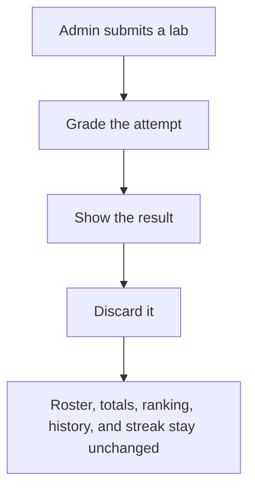
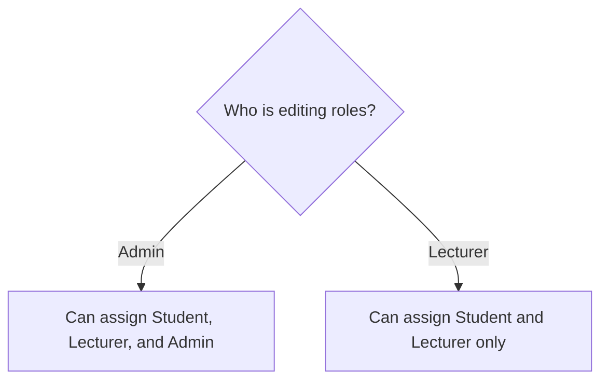
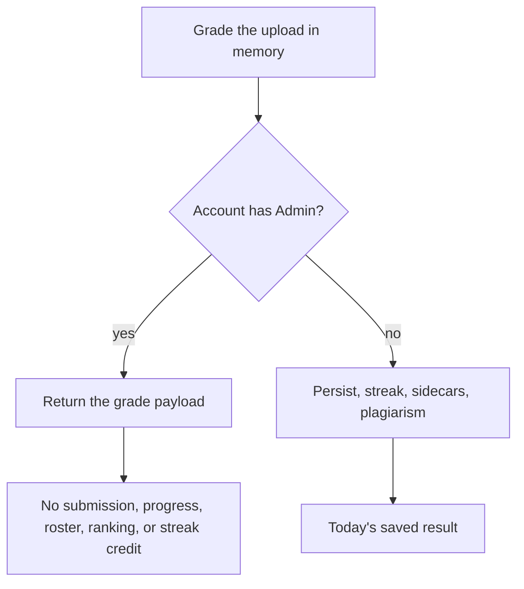
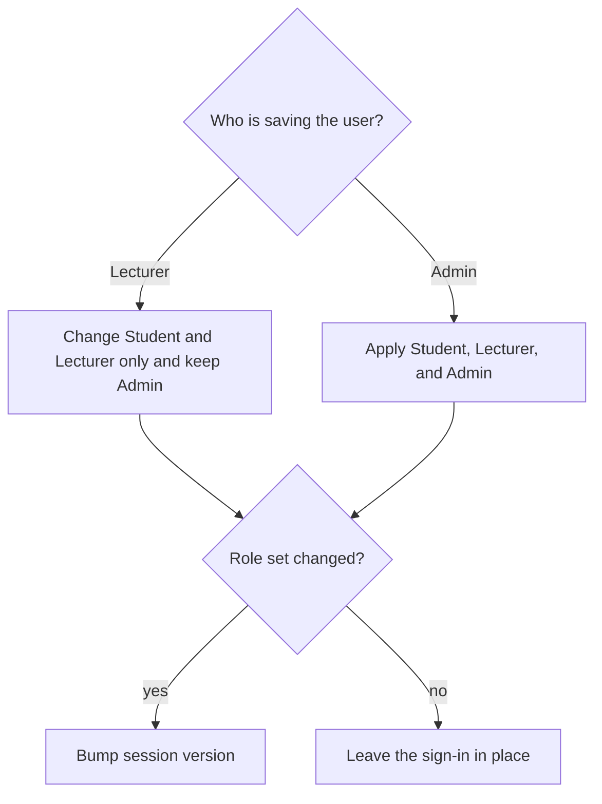

# Admin Role - Plan

## Goal Capsule

- **Objective:** Add an Admin role with student and lecturer access whose lab attempts are shown once and never saved, and who alone can grant or remove Admin.
- **Product authority:** The Product Contract wins on behavior. The Planning Contract wins on mechanism. A unit overrides neither.
- **Open blockers:** None.
- **Stop conditions:** Do not add a role hierarchy. Do not enroll an Admin to unlock student pages. Do not persist an Admin lab attempt. Do not change the desktop student session.
- **Execution profile:** Backend behavior is proven by the existing JUnit homes. The frontend is proven by a production build.
- **Tail ownership:** Implementation ends when the Definition of Done is met. Opening a pull request is a later choice.

---

## Product Contract

### Summary

Admin can use the student and lecturer sides of the app. A lab attempt from any account that has Admin is graded and shown, then discarded. Admins grant Student, Lecturer, and Admin. Lecturers keep granting Student and Lecturer, and cannot grant or remove Admin.

### Problem Frame

The app has Student and Lecturer. A person who needs both, who must appoint lecturers without lecturers being able to appoint them, and who must try labs without changing class scores, has no fitting role. A recorded student attempt would change totals, the roster, and ranking. A student cannot appoint lecturers.

### Key Decisions

- Show the attempt, then discard it. (session-settled: user-directed — chosen over blocking submission or keeping a private history: the grade should be visible for that attempt only.) Governs R4, R5.
- Admin on an account blocks saved lab results. (session-settled: user-directed — chosen over saving when Student is also present: a graded student uses a separate account.) Governs R5.
- Only an Admin grants or removes Admin. (session-settled: user-directed — chosen over hiding Admin from the app or taking user management away from lecturers: lecturers keep Student and Lecturer.) Governs R7, R8, R9.
- Admin alone opens both areas and lands on the lecturer home. (session-settled: user-approved — chosen over also requiring Student and Lecturer on the account: the synthesis confirmation.) Governs R1, R2, R3.
- An Admin account uses a lecturer IRN and does not need a student IRN. (session-settled: user-approved — chosen over requiring a student IRN: the synthesis confirmation.) Governs R10.
- A Lecturer cannot delete an account that has Admin. (session-settled: user-approved — chosen over letting a lecturer delete that account: the planning synthesis.) Governs R11.
- A role change signs that person out. (session-settled: user-approved — chosen over waiting until the existing sign-in expires: the planning synthesis.) Governs R12.

### Actors

- A1. **Admin** — signed-in account with Admin. Uses student and lecturer capabilities, grants roles, and submits labs that are not saved.
- A2. **Lecturer** — signed-in lecturer without Admin. Keeps user management for Student and Lecturer. Cannot grant or remove Admin.
- A3. **Graded student** — signed-in student without Admin. Lab results keep today's saved behavior.

### Requirements

**Access**

- R1. An Admin can use every student capability and every lecturer capability.
- R2. Admin alone is enough to open both areas. The account does not also need Student or Lecturer.
- R3. After sign-in, an Admin lands on the lecturer home. Student pages stay available.

**Lab results**

- R4. A lab attempt by an account with Admin is graded, shown as a student would see it, and then discarded so leaving the screen does not restore it. Nothing is saved: history, progress, roster, class totals, ranking, streak credit, or plagiarism records.
- R5. R4 holds when the account also has Student.
- R6. An account without Admin keeps today's saved lab results.

**Role assignment**

- R7. An Admin can grant and remove Student, Lecturer, and Admin.
- R8. A Lecturer can grant and remove Student and Lecturer, and cannot grant or remove Admin.
- R9. The first Admin is created outside the user screen.
- R10. An Admin account is identified with a lecturer IRN and does not require a student IRN.
- R11. A Lecturer cannot delete an account that has Admin. An Admin can delete accounts, including another Admin.
- R12. Granting or removing Student, Lecturer, or Admin signs that person out. The new roles apply on the next sign-in.

### Key Flows

- F1. Unsaved lab attempt
  - **Trigger:** An Admin submits a lab from the student side.
  - **Actors:** A1
  - **Steps:** The lab is graded. The result is shown for this attempt. Nothing is stored.
  - **Outcome:** The screen shows the grade. Roster, totals, ranking, history, and streak stay unchanged.
  - **Covered by:** R4, R5
- F2. Admin grants a role
  - **Trigger:** An Admin assigns Lecturer to one user and Admin to another.
  - **Actors:** A1
  - **Steps:** Both roles are available. Save applies them.
  - **Outcome:** One user has Lecturer. The other has Admin.
  - **Covered by:** R7
- F3. Lecturer cannot grant Admin
  - **Trigger:** A Lecturer edits a user's roles.
  - **Actors:** A2
  - **Steps:** Student and Lecturer can be changed. Admin cannot.
  - **Outcome:** The user does not gain or lose Admin from this edit.
  - **Covered by:** R8
- F4. Admin sign-in
  - **Trigger:** An account with only Admin signs in.
  - **Actors:** A1
  - **Steps:** Sign-in succeeds with a lecturer IRN and no student IRN.
  - **Outcome:** The lecturer home opens, and student pages are available.
  - **Covered by:** R2, R3, R10
- F5. Lecturer cannot delete Admin
  - **Trigger:** A Lecturer deletes a user who has Admin.
  - **Actors:** A2
  - **Steps:** The delete is rejected.
  - **Outcome:** The account remains.
  - **Covered by:** R11
- F6. Role change signs the person out
  - **Trigger:** An Admin grants or removes Student, Lecturer, or Admin on a signed-in user.
  - **Actors:** A1
  - **Steps:** The save applies. That person's current sign-in ends.
  - **Outcome:** The new roles apply on the next sign-in.
  - **Covered by:** R12

### Acceptance Examples

- AE1. Discarded attempt
  - **Covers R4.**
  - **Given:** An Admin account with no saved lab results.
  - **When:** They submit a lab and leave the result.
  - **Then:** They saw the grade, and that attempt has no history, roster row, class total, ranking entry, streak credit, or plagiarism record.
- AE2. Admin plus Student
  - **Covers R5.**
  - **Given:** An account with Admin and Student.
  - **When:** They submit a lab.
  - **Then:** The grade is shown once and nothing is saved.
- AE3. Graded student unchanged
  - **Covers R6.**
  - **Given:** A student account without Admin.
  - **When:** They submit a lab.
  - **Then:** The result is saved as it is today.
- AE4. Lecturer role limits
  - **Covers R8.**
  - **Given:** A Lecturer without Admin.
  - **When:** They manage users.
  - **Then:** They can assign Student and Lecturer, and cannot assign or remove Admin.
- AE5. Admin assigns both elevated roles
  - **Covers R7.**
  - **Given:** An Admin on the user screen.
  - **When:** They assign Lecturer to one user and Admin to another.
  - **Then:** Both assignments save.
- AE6. Admin-only sign-in
  - **Covers R2, R3, R10.**
  - **Given:** An account with only Admin, a lecturer IRN, and no student IRN.
  - **When:** They sign in.
  - **Then:** The account is valid, the lecturer home opens, and student pages are available.
- AE7. Lecturer delete blocked
  - **Covers R11.**
  - **Given:** An account with Admin, and a Lecturer without Admin.
  - **When:** The Lecturer deletes that account.
  - **Then:** The delete is rejected and the account remains.
- AE8. Role change ends the sign-in
  - **Covers R12.**
  - **Given:** A signed-in user.
  - **When:** An Admin grants or removes Student, Lecturer, or Admin on that user.
  - **Then:** The current sign-in ends, and the new roles apply on the next sign-in.

### Scope Boundaries

- The offline practice app stays a student session.
- Lecturers keep creating users and assigning Student and Lecturer.
- Admin attempts do not get a private saved history.
- Accounts without Admin follow R6.
- Suspend and quarter-purge rules stay as they are for accounts without Admin. An account with Admin is not treated as a student-only account for those rules.
- Opening the student side can still record a daily login and shop activity. Lab-attempt streak credit stays under R4.
- An Admin may remove the last Admin, including themselves. The next Admin follows R9.

### Dependencies / Assumptions

- Someone creates the first Admin outside the user screen before any Admin can be granted in the app. Governs R9.
- Bulk folder grading already avoids writing lab results. This plan does not change that workspace. Accounts with Admin still follow R4 if a later path would record a lab result for them.

### Sources / Research

- User management today is a lecturer screen and offers Student and Lecturer only.
- An account with both Student and Lecturer already lands on the lecturer home, with student pages still available.
- Saved lab outcomes an Admin attempt must not enter include student lab progress, the lecturer lab roster, grade overview, and weekly ranking.
- There is no role hierarchy. `backend/AGENTS.md` states a token needs each role the matcher names. `JwtRoleNames` has `STUDENT` and `LECTURER` only.
- `SubmissionController` grades, then `UploadPersistService.persist`, then streak credit, sidecars, plagiarism, and cache invalidation. The student screen renders `lab_result` from that response.
- `LabController.labsVisibleToCaller` returns every current-term lab when the caller is not student-only, and student-visible labs only when the caller is an enrolled student. Both dashboards call `GET /api/labs/list`.
- `updateUser` replaces the role set and does not bump `session_version`. Suspend does, via `SessionValidityService`.
- Learnings: `docs/solutions/architecture-patterns/spring-security-default-deny-matcher-table.md`, `docs/solutions/architecture-patterns/jwt-session-version-force-logout.md`, `docs/solutions/architecture-patterns/grading-result-jdbc-upsert-deferred-details.md`.

---

## Planning Contract

Product Contract changed: R11 and R12 added, plus scope lines for daily login, shop activity, and last-Admin removal. Confirmed in the planning synthesis. R1–R10 are unchanged.

### Key Technical Decisions

- KTD1. **Admit Admin on the existing matcher lists.** Do not add a Spring role hierarchy. A Lecturer authority does not open a student path, and a Student authority does not open a lecturer path. Governs R1, R2.
- KTD2. **Skip the post-grade write.** After the in-memory grade, an account with Admin does not call persist, streak credit, sidecar stores, plagiarism inspect, or the statistics and overview cache invalidation. Return the same grade payload the student screen already renders. Do not write the attempt and delete it later. The deferred detail and plagiarism jobs run only after persist. Governs R4, R5.
- KTD3. **Student pages without an enrollment row.** (session-settled: user-approved — chosen over requiring enrollment: the planning synthesis.) Login and term-access report the Admin as in the current quarter. `GET /api/labs/list` keeps the full current-term list for lecturer screens. The student screen requests the student-visible subset, including sidebar challenges, with no enrollment row and no saved stats. Upload of a lab that is closed to students is rejected. Ranking view and the practice download open. This work does not insert `term_enrollment`. Governs R1, R3, R4.
- KTD4. **The server enforces who may change Admin.** (session-settled: user-approved — chosen over letting a lecturer delete that account: the planning synthesis.) A Lecturer save may change Student and Lecturer only. An existing Admin role stays on the account. A Lecturer delete of an account with Admin is rejected. An Admin save may grant or remove all three roles. Governs R7, R8, R11.
- KTD5. **Bump the session when those roles change.** (session-settled: user-approved — chosen over waiting until the existing sign-in expires: the planning synthesis.) Use the same `session_version` bump suspend already uses. Governs R12.
- KTD6. **Admin uses a lecturer IRN.** When the account has Admin, require `teacher_code` and do not require `student_code`, even if Student is also present. Governs R10.
- KTD7. **The last Admin may be removed.** (session-settled: user-approved — chosen over blocking removal of the last Admin: the planning synthesis.) Do not add a last-Admin guard. Governs R7, R9.

### High-Level Technical Design

### Sequencing

1. U1 admits Admin on cloud matchers and removes Admin from the student-only checks used by suspend and quarter purge.
2. U2 and U3 can proceed after U1.
3. U4 depends on U3 so an unenrolled Admin reaches grading before the discard.
4. U5 depends on U2 and U3 so the screens match the server rules.

### Assumptions

- An account with Admin that a lecturer already enrolled can still appear on the ranking list. New attempts do not change that total. Per R4 and KTD3.
- Bulk folder grading stays ephemeral. Per the Product Contract dependency.

### System-Wide Impact

- Cloud authorization, session revoke, the upload tail, the shared lab list, and user management all change. The desktop profile does not.
- Ranking, roster, and grade overview change only by the absence of new Admin rows.

### Risks

- One lab-list endpoint serves both dashboards. The student-visible subset must not become the lecturer list, and the lecturer list must not become the student screen.
- Skipping only the submission insert would still leave streak credit, plagiarism, and progress. KTD2 owns the tail.
- A shared helper that grants every role to the desktop principal would turn practice into an Admin session. Do not do that.

### Documentation / Operational Notes

- Operator SQL creates the `ADMIN` role row. It does not insert a user or a password. The operator inserts the first account with a lecturer IRN, no student IRN, and the Admin role.
- Update the security, user, and upload contracts in the nearest AGENTS.md files, and add the SQL script to the root Child DOX Index.

---

## Implementation Units

### U1. Admit Admin on cloud access

- **Goal:** An Admin-only token can call student and lecturer APIs, and an account with Admin is not student-only for suspend or quarter purge.
- **Requirements:** R1, R2. KTD1.
- **Dependencies:** None.
- **Files:**
  - `backend/src/main/java/com/eiu/capstone/backend/security/JwtRoleNames.java`
  - `backend/src/main/java/com/eiu/capstone/backend/security/JwtUserPrincipal.java`
  - `backend/src/main/java/com/eiu/capstone/backend/config/SecurityConfig.java`
  - `backend/src/main/java/com/eiu/capstone/backend/service/StudentAccountExpiryService.java`
  - `backend/src/test/java/authorization/com/eiu/capstone/backend/security/SecurityAuthorizationTest.java`
  - `backend/src/test/java/authorization/com/eiu/capstone/backend/security/JwtAuthHelperTest.java`
  - `backend/AGENTS.md`
- **Approach:**
  - Add `ADMIN` beside `STUDENT` and `LECTURER`. Do not map it to Lecturer.
  - Add `ADMIN` to each cloud matcher that today allows Student, Lecturer, or either. Leave the desktop security config and the desktop principal as Student.
  - `isStudentOnly` is Student, and not Lecturer, and not Admin.
  - Quarter purge uses the same exclusion for any account that has Admin.
- **Patterns to follow:** The matcher table in `SecurityConfig` and `docs/solutions/architecture-patterns/spring-security-default-deny-matcher-table.md`.
- **Test scenarios:**
  - An Admin-only token is allowed on a student submission path and on a lecturer user path.
  - A Lecturer-only token is still forbidden on a student submission path.
  - A Student-only token is still forbidden on a lecturer user path.
  - Anonymous requests on those paths stay unauthenticated.
  - `isStudentOnly` is false for Admin-only and for Admin plus Student.
  - `isStudentOnly` stays true for Student without Lecturer or Admin.
- **Verification:** The authorization tests above pass. The desktop profile still authenticates as Student.

### U2. Role save, delete, and the first Admin

- **Goal:** Only an Admin can grant, remove, or delete Admin, and a role change ends that person's sign-in.
- **Requirements:** R7, R8, R9, R10, R11, R12. KTD4, KTD5, KTD6, KTD7.
- **Dependencies:** U1
- **Files:**
  - `backend/src/main/java/com/eiu/capstone/backend/service/UserService.java`
  - `backend/src/main/java/com/eiu/capstone/backend/controller/UserController.java`
  - `backend/src/test/java/support/com/eiu/capstone/backend/service/UserServiceTest.java`
  - `docs/sql/2026-10-22-admin-role.sql`
  - `AGENTS.md`
  - `backend/AGENTS.md`
  - `backend/src/main/java/com/eiu/capstone/backend/service/AGENTS.md`
- **Approach:**
  - Pass the caller into create, update, and delete.
  - Follow KTD4, KTD5, KTD6, and KTD7.
  - Reject suspend of an account with Admin the same way a lecturer account is rejected.
  - The SQL script inserts the `ADMIN` role if it is missing. It does not insert a user.
- **Patterns to follow:** `UserService.setStudentActive` for the session bump. `UserServiceTest` for role rejection.
- **Test scenarios:**
  - Covers AE4. A Lecturer save cannot add or remove Admin, and an existing Admin role remains.
  - Covers AE5. An Admin save can set Lecturer on one user and Admin on another.
  - Covers AE7. A Lecturer delete of an account with Admin is rejected. An Admin delete of that account succeeds.
  - Covers AE8. A save that changes Student, Lecturer, or Admin bumps the session. A save that does not change roles does not.
  - An Admin account with a lecturer IRN and no student IRN saves. A missing lecturer IRN is rejected.
  - Student without Admin still requires a student IRN.
  - Suspend of an account with Admin is rejected. A student-only suspend still succeeds.
- **Verification:** `UserServiceTest` passes. The SQL script is idempotent for the role row.

### U3. Student pages without enrollment

- **Goal:** An unenrolled Admin can open the current quarter's student-visible labs, the ranking board, and the practice download.
- **Requirements:** R1, R3. KTD3.
- **Dependencies:** U1
- **Files:**
  - `backend/src/main/java/com/eiu/capstone/backend/service/StudentTermAccessService.java`
  - `backend/src/main/java/com/eiu/capstone/backend/controller/LabController.java`
  - `backend/src/main/java/com/eiu/capstone/backend/controller/AuthController.java`
  - `backend/src/main/java/com/eiu/capstone/backend/controller/StudentRankingController.java`
  - `backend/src/main/java/com/eiu/capstone/backend/service/StudentDesktopPracticeBundleService.java`
  - `backend/src/test/java/support/com/eiu/capstone/backend/service/StudentTermAccessServiceTest.java`
  - `backend/AGENTS.md`
- **Approach:**
  - Follow KTD3.
  - The student-visible list is a mode on the existing lab list, used by the student screen. Lecturer callers keep today's full list.
  - Include sidebar challenges for an Admin on that student-visible mode.
  - Do not insert `term_enrollment`.
- **Patterns to follow:** `LabController.labsVisibleToCaller` and `StudentTermAccessServiceTest`.
- **Test scenarios:**
  - An unenrolled Admin is reported in the current quarter and can pass upload access for a student-visible lab.
  - That same Admin is rejected for a lab closed to students.
  - A student who is not enrolled is still rejected.
  - The student-visible list omits hidden labs and includes sidebar challenges for Admin.
  - The lecturer list for Admin still includes hidden labs.
  - Ranking current and the practice bundle succeed for an unenrolled Admin and do not add that Admin to the board.
  - An out-of-term student still receives an empty ranking board.
- **Verification:** `StudentTermAccessServiceTest` covers the access gate. The list, ranking, and bundle cases are covered in the same support home or the existing controller tests those classes already use.

### U4. Show the grade and discard the attempt

- **Goal:** An Admin upload returns the grade and writes none of the saved lab outcomes.
- **Requirements:** R4, R5, R6. KTD2.
- **Dependencies:** U1, U3
- **Files:**
  - `backend/src/main/java/com/eiu/capstone/backend/controller/SubmissionController.java`
  - `backend/src/test/java/support/com/eiu/capstone/backend/controller/AdminSubmissionDiscardTest.java`
  - `backend/src/main/java/com/eiu/capstone/backend/service/AGENTS.md`
  - `backend/AGENTS.md`
- **Approach:**
  - Grade as today.
  - Follow KTD2 when the account has Admin, including Admin plus Student.
  - Accounts without Admin keep the current tail.
  - The response still carries the score, challenge scores, and `lab_result` so the open screen can render the attempt.
  - Temp-folder cleanup still runs.
- **Patterns to follow:** The upload tail in `SubmissionController` and `docs/solutions/architecture-patterns/grading-result-jdbc-upsert-deferred-details.md`.
- **Test scenarios:**
  - Covers AE1. An Admin upload returns the grade. Persist, streak credit, plagiarism, and sidecar stores are not called.
  - Covers AE2. The same skip happens when the account also has Student.
  - Covers AE3. A student without Admin still persists.
  - A later history read for that Admin does not show the attempt.
- **Verification:** `AdminSubmissionDiscardTest` passes, and `UploadPersistServiceTest` still passes for the non-Admin path.

### U5. Screens for both areas and for role assignment

- **Goal:** Admin lands on the lecturer home, can open student pages, and is the only role that can assign Admin in the user screen.
- **Requirements:** R1, R2, R3, R7, R8, R10, R11. KTD3, KTD4, KTD6.
- **Dependencies:** U2, U3
- **Files:**
  - `frontend/src/App.jsx`
  - `frontend/src/App.desktop.jsx`
  - `frontend/src/utils/authRoutes.js`
  - `frontend/src/pages/StudentDashboard.jsx`
  - `frontend/src/components/UserModal.jsx`
  - `frontend/src/pages/UserManagement.jsx`
  - `frontend/src/utils/validation.js`
  - `frontend/AGENTS.md`
- **Approach:**
  - Treat Admin like Lecturer for the default home, and allow Admin on both lecturer and student routes.
  - The student screen asks for the student-visible lab list from U3.
  - Show the Admin role control only when the signed-in user has Admin. Lecturers still see Student and Lecturer.
  - Show the lecturer IRN when Admin or Lecturer is selected. Do not require a student IRN when Admin is selected.
  - Leave `App.desktop.jsx` on the synthetic Student session.
- **Patterns to follow:** `RequireRole` in `App.jsx` and `defaultDashboardPath` in `authRoutes.js`.
- **Test scenarios:**
  - Test expectation: none — the frontend has no test runner. `npm run build` must succeed.
  - Manual check for AE6: an Admin-only sign-in opens the lecturer home, and the student pages open onto the current quarter's visible labs.
  - Manual check: a Lecturer does not see an Admin role control. An Admin does, and can assign it.
  - Manual check for AE1: the grade is on screen after upload, and a later visit does not list that attempt.
- **Verification:** `npm run build` in `frontend/` succeeds. The desktop entry still seeds Student only.

---

## Verification Contract

| Gate | Command | Applies |
|---|---|---|
| Backend suite | `mvn test` from `backend/` | U1–U4 |
| Frontend build | `npm run build` from `frontend/` | U5 |
| Desktop entry | Confirm `App.desktop.jsx` still seeds Student only | U5 |

Focused failures should be rerun with the test class named in that unit before the full suite.

---

## Definition of Done

- U1–U5 meet their verification lines.
- R1–R12 and AE1–AE8 hold.
- An Admin lab attempt is absent from history, progress, roster, class totals, ranking, streak credit, and plagiarism.
- A Lecturer cannot grant, remove, or delete Admin. An Admin can.
- The desktop practice session is still Student.
- Abandoned-attempt code is not left in the diff.
- The AGENTS.md contracts and the root Child DOX Index mention the Admin role and the operator SQL script.
