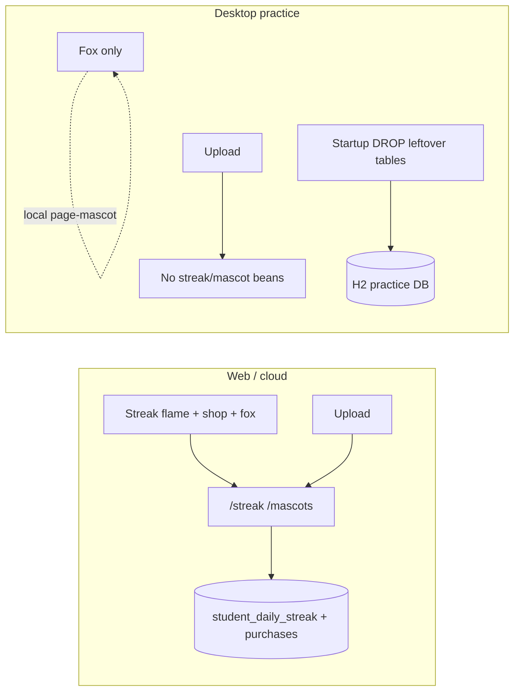

# Desktop Strip Streak Mascot Shop - Plan

## Goal Capsule

- **Objective:** Remove streak, daily missions, points, and mascot shopping from the offline practice app while keeping the default fox as a local pettable header mascot, and align the local practice database so it no longer stores that gamification data.
- **Product authority:** This plan owns offline practice (desktop profile / desktop SPA build) student header gamification and the local practice DB surface for streak/shop. Web/cloud streak, shop, ranking payouts, and shared fox assets for web remain out of scope.
- **Open blockers:** None.
- **Product Contract preservation:** restructured, no scope change: Outstanding Questions deferred items resolved into KTD1–KTD4 (no R-ID renumber).

## Product Contract

### Summary

Offline practice drops streak, missions, points, and the mascot shop.
The default fox stays in the header and remains pettable for fun with local-only animation.
The local practice database no longer keeps streak/mission/shop purchase data.

### Problem Frame

The offline practice header currently mirrors web gamification: streak flame, mission progress, point balance, and a mascot shop.
Those systems assume a durable multi-day student identity and cloud ledger, which do not fit a single local practice student.
They add UI noise and unused H2 tables without improving practice grading.

### Key Decisions

- **Desktop-only removal** — Strip gamification from offline practice only; web/cloud streak, shop, and ranking currency stay. Governs R1, R7.
- **Local fun petting** (session-settled: user-directed — chosen over decorative-only or removing the mascot: keep the fox interactive without mission counting). Governs R3, R4.
- **Practice DB cleanup** — Local practice storage must stop holding streak/mission/shop rows, including existing installs on next startup or equivalent wipe. Governs R5, R6.
- **Approach B** (session-settled: user-approved — chosen over UI-hide-only and product-wide deletion: matches “delete anything related” plus “update database to fit” without touching web). Governs R1–R7.

### Actors

- A1. Practice student — uses the offline EXE / desktop SPA; grades labs locally; sees the header fox.
- A2. Web student — unchanged; continues to use streak, missions, points, and shop online.

### Key Flows

- F1. Open practice home
  - **Trigger:** Student opens the offline practice app on the submit dashboard.
  - **Steps:** Header shows the default fox; streak flame, points chip, and shop entry are absent; no streak/mission/shop network calls run for practice.
  - **Outcome:** Practice UI is grading-focused with a decorative interactive fox only.
  - **Covers R1, R2, R3.**

- F2. Pet the fox for fun
  - **Trigger:** Student clicks the header fox.
  - **Steps:** Fox plays a local reaction/animation; no mission progress, pet goal, toast about streak/points, or shop state changes.
  - **Outcome:** Petting is unlimited local fun with no gamification side effects.
  - **Covers R3, R4.**

- F3. Existing practice DB upgrade
  - **Trigger:** Student restarts offline practice after this change with an older local DB that still has streak/shop tables or rows.
  - **Steps:** Practice startup removes leftover streak/shop tables so later practice runs do not depend on them; writers stay profile-gated off.
  - **Outcome:** Local DB has no live gamification state; grading/history data remains usable.
  - **Covers R5, R6.**

### Requirements

**Practice UI**

- R1. Offline practice removes streak flame, daily-mission UI, point balance, and mascot-shop entry points (header controls and account-menu shop command).
- R2. Offline practice keeps the default fox mascot visible in the student header on the submit dashboard.
- R3. Clicking the practice fox plays a local pet/reaction animation with no server mission count, pet goal, or points award.
- R4. Practice petting never opens the shop, never equips a non-fox mascot, and never shows streak/mission completion toasts.

**Practice data and APIs**

- R5. Offline practice no longer persists streak counts, mission counters, reward points, equipped-shop mascot state, or mascot purchases in the local practice database.
- R6. Existing local practice databases that already contain that gamification storage are cleaned up on startup (or equivalent one-time wipe) so leftover tables/rows do not remain as live practice state.
- R7. Offline practice does not expose or consume streak/mission/shop APIs for the local student; successful practice uploads do not advance any streak/mission ledger.

**Non-regression**

- R8. Web/cloud streak, daily missions, points, mascot shop, and weekly ranking payouts that credit points remain unchanged.
- R9. Offline practice grading, pack import/restart, history, and default-fox asset loading continue to work.

### Acceptance Examples

- AE1. Fresh practice install
  - **Given:** A new offline practice install with no prior streak data.
  - **When:** The student opens Home.
  - **Then:** Fox is visible; flame, points, and shop are absent; after startup ready, local DB has no live streak/shop gamification tables or rows.
  - **Covers R1, R2, R5.**

- AE2. Pet without missions
  - **Given:** Practice Home with the fox shown.
  - **When:** The student clicks the fox repeatedly.
  - **Then:** Local reactions play each time; no pet-goal aria copy, no streak/mission toast, no points change, no shop UI.
  - **Covers R3, R4.**

- AE3. Upgrade from older practice DB
  - **Given:** An existing practice H2 DB that still has streak/shop storage from before this change.
  - **When:** Practice starts after the update.
  - **Then:** That gamification storage is gone or retired; labs/submissions still load; flame/shop do not reappear.
  - **Covers R5, R6, R9.**

- AE4. Upload does not revive missions
  - **Given:** Practice student submits a lab successfully.
  - **When:** Grading completes.
  - **Then:** No streak/mission ledger update occurs for practice; UI still shows no flame/points/shop.
  - **Covers R7, R1.**

- AE5. Web unchanged
  - **Given:** A web student session.
  - **When:** They use streak, pet mission, points, and shop as today.
  - **Then:** Behavior matches the pre-change web product.
  - **Covers R8.**

### Success Criteria

- SC1. A practice student cannot discover streak, missions, points, or shop purchase flows from the offline UI.
- SC2. Practice petting feels interactive (local animation) without implying progress or currency.
- SC3. Local practice DB inspection after upgrade shows no live streak/mission/shop purchase state.
- SC4. Web regression smoke for streak/shop still passes.

### Scope Boundaries

**In scope**

- Desktop SPA student header gamification removal and local fox petting.
- Desktop-profile API and upload side effects that write streak/mission/shop state.
- Local practice DB cleanup for streak/shop storage.

**Out of scope**

- Removing or redesigning web streak, missions, shop, or weekly ranking.
- Deleting fox/other mascot assets from the repo (web still uses them).
- Changing practice grading, pack import, or launcher host behavior beyond what R7/R9 require.
- Adding a new practice-only pet-progress ledger.

### Deferred to Follow-Up Work

- Full Hibernate entity exclusion so streak/shop tables never exist even briefly during desktop EMF init (heavier than startup DROP + never-write).

### Dependencies / Assumptions

- Desktop mode continues to be detectable in the SPA via the desktop build flag, and backend practice continues to run under the `desktop` profile with a local file DB.
- The default mascot remains the starter fox; no alternate practice mascot selection exists after this change.
- Existing practice installs may already have created streak/shop tables via Hibernate `ddl-auto`; cleanup must handle that reality.
- Shared `@Entity` classes for streak/shop remain on the classpath; Hibernate `ddl-auto: update` may recreate empty tables at EMF init before the desktop DROP migrator runs.

### Outstanding Questions

**Resolve Before Planning**

- None.

**Deferred to Planning**

- None — resolved in Planning Contract KTD1–KTD4.

### Sources / Research

- Current practice header still mounts streak flame, points/shop, and pettable mascot without a desktop gate (`frontend/src/pages/StudentDashboard.jsx`).
- Cloud streak schema migrator is `!desktop`; desktop today creates streak/shop tables via Hibernate update (`StudentStreakSchemaMigrator`, `application-desktop.yml`).
- Streak and mascot controllers are profile-unrestricted and active on desktop; upload records submit missions via `SubmissionController` → `StudentStreakService.recordSubmission`.
- Weekly ranking UI/migrator/scheduler are already omitted on desktop; ranking payouts credit web streak points only.
- Practice distribution contract: `docs/DESKTOP_STUDENT_DIST.md`.
- Desktop UI gating precedent: `IS_DESKTOP_APP` early-returns and conditional chrome in `StudentDashboard.jsx`, `AppShell.jsx`, `Header.jsx`.
- Backend cloud-only precedent: `@Profile("!desktop")` plus optional injection of `StudentDailySubmissionQuotaService` in `SubmissionController`.
- Fox reactions are local via `page-mascot` inside `StudentFoxMascot.jsx`; mission pets are the dashboard `petFox` API wrapper.
- No solution docs cover this strip; CONCEPTS.md already treats ranking/retention/burst as desktop-disabled cloud features.

---

## Planning Contract

### Key Technical Decisions

- KTD1. **Profile-gate streak/mascot writers and controllers off desktop** (session-settled: user-approved — chosen over UI-hide-only: matches Approach B). Put `@Profile("!desktop")` on streak/mascot controllers and services (and supporting repositories if they would otherwise fail context load). Mirror the daily-quota optional-injection pattern in `SubmissionController` so `recordSubmission` is skipped when the service bean is absent. Governs R5, R7, R8.
- KTD2. **Desktop startup DROP of leftover streak/shop tables** (session-settled: user-approved — chosen over full Hibernate entity exclusion: cheaper carrying cost; empty recreate before DROP is acceptable). Add a `@Profile("desktop")` migrator that `DROP TABLE IF EXISTS` for `student_mascot_purchase` then `student_daily_streak` after schema update, so existing installs lose live gamification state. Do not rely on DROP alone without KTD1 writers off. Governs R5, R6.
- KTD3. **Desktop SPA gates chrome and uses local fox petting** — Gate flame, points/shop, streak fetches, and `MascotShop` behind `!IS_DESKTOP_APP`. Keep `StudentFoxMascot` with `mascotId="fox"` and let `page-mascot` own click reactions (no `POST /streak/pet`, no pet-goal aria). Governs R1–R4, R7.
- KTD4. **Dead `mascotShop` command branch is optional cleanup** — Header does not emit it today; remove only if touched while gating shop. Governs R1.

### Assumptions

- After EMF init, Hibernate may briefly recreate empty streak/shop tables under `ddl-auto: update`; the desktop DROP migrator removes them before the app serves practice traffic. Inspection for SC3/AE1 is after startup ready.
- Web streak/shop unit tests and ranking payout remain valid without change if desktop-only profiles are used correctly.
- `page-mascot` continues to react to clicks when not wrapped in a mission-counting button that swallows the library handler.

### High-Level Technical Design

### System-Wide Impact

- **Practice students:** lose streak/missions/points/shop; keep fox fun petting and grading.
- **Web students:** unchanged.
- **Developers:** desktop profile context and submission pipeline tests gain absence assertions; DOX for student components / backend API surface needs a desktop note.
- **Ops:** no Neon/operator SQL change; cloud migrator stays `!desktop`.

### Risks & Dependencies

| Risk | Mitigation |
|---|---|
| Marking `StudentStreakService` `@Profile("!desktop")` without optional injection breaks desktop context load | Same change-set as KTD1; extend `DesktopProfileContextTest` |
| SPA still calls streak APIs after controllers removed → 404 noise | Gate fetches in the same SPA change (U1 with U2) |
| DROP without writers off leaves recreate + accidental writes | KTD1 before or with KTD2 |
| `page-mascot` click blocked by wrapper button | Prefer non-counting surface; verify AE2 manually on desktop build |
| Docs drift (AGENTS claim desktop still uses streak) | U4 DOX pass |

---

## Implementation Units

### U1. Desktop SPA — strip gamification chrome, keep local fox

**Goal:** Practice build shows fox only; no flame, points, shop, streak fetches, or mission pet API.

**Requirements:** R1, R2, R3, R4, R7, R9 — F1, F2 — AE1, AE2

**Dependencies:** None

**Files:**
- Modify: `frontend/src/pages/StudentDashboard.jsx`
- Modify: `frontend/src/components/student/AGENTS.md`
- Modify: `frontend/src/pages/AGENTS.md`
- Modify: `frontend/AGENTS.md` (header chrome note if it still lists shop/flame for all modes)

**Approach:**
1. Gate `headerBeforeUserMenu` streak flame + points/shop behind `!IS_DESKTOP_APP` (null on desktop).
2. Skip `refreshStreak` / `petFox` / `restoreStreak` / shop state when `IS_DESKTOP_APP`; do not call streak after upload on desktop.
3. Keep `headerAddon` fox with `mascotId="fox"`; remove mission pet-goal aria; let `page-mascot` handle clicks (avoid API wrapper on desktop).
4. Mount `MascotShop` only when `!IS_DESKTOP_APP`.
5. Optionally drop dead `mascotShop` command branch (KTD4).

**Patterns to follow:** Existing `IS_DESKTOP_APP` early-returns for quota and ranking in the same file.

**Test scenarios:**
- Covers AE1. Desktop build Home: fox present; flame/points/shop absent.
- Covers AE2. Desktop fox click plays local reaction; no streak/mission toast; no shop.
- Web build still shows flame, points, shop, and API pet mission (smoke).

**Verification:** `npm run build:desktop` succeeds; manual desktop Home matches AE1/AE2; web Home still shows gamification chrome.

### U2. Backend desktop — disable streak/mascot APIs and upload side effects

**Goal:** Desktop profile does not expose streak/mascot endpoints and does not record submit missions on upload.

**Requirements:** R5, R7, R8 — F1 — AE4, AE5

**Dependencies:** None (ship with U1 in one change-set preferred)

**Files:**
- Modify: `backend/src/main/java/com/eiu/capstone/backend/controller/StudentStreakController.java`
- Modify: `backend/src/main/java/com/eiu/capstone/backend/controller/StudentMascotController.java`
- Modify: `backend/src/main/java/com/eiu/capstone/backend/service/StudentStreakService.java`
- Modify: `backend/src/main/java/com/eiu/capstone/backend/service/StudentMascotService.java`
- Modify: `backend/src/main/java/com/eiu/capstone/backend/controller/SubmissionController.java`
- Modify: `backend/src/test/java/integration/com/eiu/capstone/backend/desktop/DesktopProfileContextTest.java`
- Modify: `backend/src/test/java/integration/com/eiu/capstone/backend/desktop/DesktopSubmissionPipelineIntegrationTest.java` (or sibling under same package)
- Modify: `backend/AGENTS.md`
- Modify: `backend/src/main/java/com/eiu/capstone/backend/service/AGENTS.md`

**Approach:**
1. Annotate streak/mascot controllers and services `@Profile("!desktop")` (same family as quota / ranking).
2. Change `SubmissionController` to `@Autowired(required = false) StudentStreakService` and call `recordSubmission` only when non-null (mirror quota).
3. Ensure `WeeklyRankingPayoutService` remains `!desktop` and still compiles against the profiled streak service on cloud.
4. Assert in `DesktopProfileContextTest` that streak/mascot controller beans are absent.
5. Assert desktop upload path succeeds without requiring streak beans (AE4).

**Patterns to follow:** `StudentDailySubmissionQuotaService` + optional injection in `SubmissionController`.

**Test scenarios:**
- Desktop context loads; `StudentStreakController` / `StudentMascotController` beans missing.
- Covers AE4. Desktop upload succeeds; no streak service interaction required.
- Cloud/web profile still loads streak/mascot beans (existing tests or light context assertion).
- Optional: unit-level null-safe `recordSubmission` when service absent.

**Verification:** `mvn test` from `backend/` green for touched desktop/integration tests; desktop profile context loads.

**Execution note:** Implement optional injection in the same commit as `@Profile("!desktop")` on the service — never land the profile change alone.

### U3. Desktop H2 — DROP leftover streak/shop tables on startup

**Goal:** Existing and fresh practice DBs have no live streak/shop tables after desktop startup ready.

**Requirements:** R5, R6 — F3 — AE1, AE3 — SC3

**Dependencies:** U2 (writers must be off so DROPped tables are not needed at runtime)

**Files:**
- Create: `backend/src/main/java/com/eiu/capstone/backend/config/DesktopStreakSchemaCleanupMigrator.java` (name may vary; desktop `@Profile`)
- Modify: `backend/src/test/java/integration/com/eiu/capstone/backend/desktop/DesktopProfileContextTest.java` (or dedicated desktop integration test)
- Modify: `docs/DESKTOP_STUDENT_DIST.md` (API/DB note: no streak/shop on practice)
- Modify: `backend/AGENTS.md` (persistence note for desktop)
- Modify: root `AGENTS.md` only if Child DOX Index wording about desktop creating streak tables via ddl-auto becomes false

**Approach:**
1. Add `@Profile("desktop")` `@PostConstruct` migrator that drops `student_mascot_purchase` then `student_daily_streak` if present (H2-safe `DROP TABLE IF EXISTS`).
2. Document that Hibernate may recreate empty tables at EMF init; migrator runs after and removes them; practice never writes (KTD1+KTD2).
3. Integration assertion after context ready: tables absent (query `information_schema` or expect drop).

**Patterns to follow:** `DesktopSubmissionDisplaySchemaMigrator` for desktop `@PostConstruct` + `JdbcTemplate`; do not copy cloud additive-only migrator philosophy for this cleanup.

**Test scenarios:**
- Covers AE3. Seed H2 with streak/shop tables → start desktop context → tables gone after ready.
- Covers AE1. Fresh desktop mem/file DB after ready has no live streak/shop tables.
- Drop is idempotent on second startup.

**Verification:** Desktop integration test proves DROP; practice grading still loads after cleanup.

### U4. Docs closeout for practice vs web gamification

**Goal:** Durable DOX matches the stripped practice surface.

**Requirements:** R8, R9 (documentation truth)

**Dependencies:** U1, U2, U3

**Files:**
- Modify: `frontend/src/components/student/AGENTS.md`
- Modify: `frontend/src/pages/AGENTS.md`
- Modify: `frontend/AGENTS.md`
- Modify: `backend/AGENTS.md`
- Modify: `docs/DESKTOP_STUDENT_DIST.md`
- Modify: `CONCEPTS.md` only if Daily streak / desktop mode wording implies practice still runs missions
- Modify: root `AGENTS.md` Child DOX Index note if it still says desktop creates streak tables via ddl-auto as the live practice path

**Approach:**
1. State clearly: streak/shop/missions are web/cloud; desktop keeps decorative fox with local petting only.
2. Remove or correct claims that desktop uses streak controllers or ddl-auto streak tables as the practice feature path.
3. Leave web streak/shop docs intact.

**Test expectation:** none — documentation only.

**Verification:** DOX pass on changed paths; no contradictory “desktop uses streak” claims remain.

---

## Verification Contract

- Backend: `mvn test` from `backend/` (at least `DesktopProfileContextTest` and desktop submission/pipeline coverage touched by U2/U3).
- Frontend desktop: `npm run build:desktop` from `frontend/`.
- Manual smoke: practice Home AE1/AE2; practice upload AE4; web Home AE5 (streak/shop still present).
- DB: after desktop ready, no live `student_daily_streak` / `student_mascot_purchase` (SC3 / AE3).

## Definition of Done

- All units U1–U4 complete with their verification outcomes.
- Product requirements R1–R9 satisfied; acceptance examples AE1–AE5 covered by tests or named manual smoke.
- DOX updated for desktop vs web gamification split.
- No web streak/shop/ranking regression from profile gating.
- Plan execution leaves practice grading, pack import, and history working (R9).
