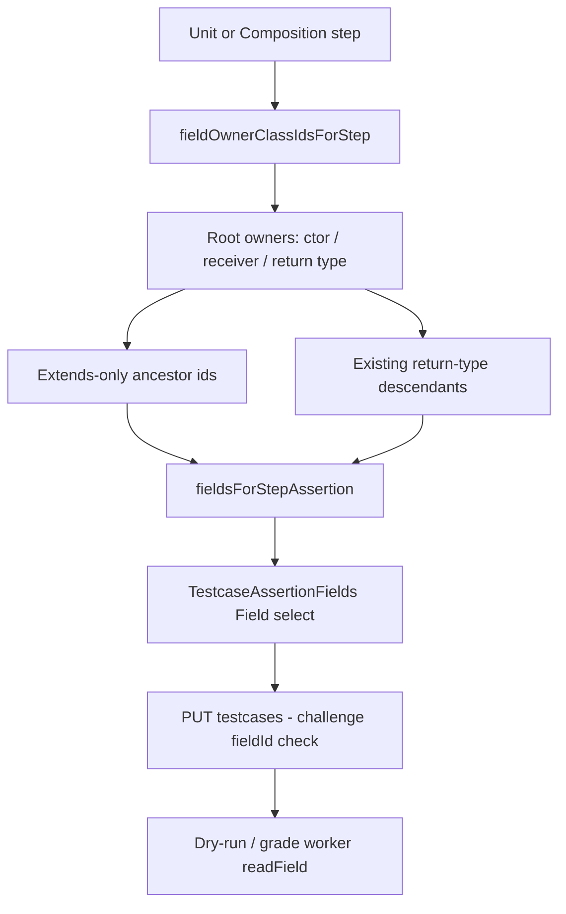

# OT Inherited Field State - Plan

## Goal Capsule

- **Objective:** Let lecturers assert FIELD_STATE on Extends-inherited fields in Unit and Composition operational testcases, matching Java’s “fields of the superclass are visible on the subclass instance” model.
- **Product authority:** This plan owns FIELD_STATE field eligibility for OT authoring (and the matching dry-run/grade path for those selected fields). Call-as, new assertion kinds, student OT UI, and declaring-class labels in the picker are out of scope.
- **Open blockers:** None.
- **Product Contract preservation:** restructured, no scope change: Outstanding Questions deferred items resolved into KTD1–KTD4 (no R-ID renumber).

## Product Contract

### Summary

Today a FIELD_STATE Field dropdown only lists fields owned by the step’s constructed, return, or receiver class.
After this work, the same dropdown also lists fields declared on every Extends ancestor of that target type, so a lecturer can check `Vehicle.height` / `Vehicle.weight` when `Car extends Vehicle`.

### Problem Frame

Inheritance labs put shared state on the superclass (`Vehicle.height`, `Vehicle.weight`) and specialized state on the subclass (`Car.plateNumber`).
Lecturers already model Extends in Structure and already use Call-as heritage for methods, but FIELD_STATE authoring cannot select ancestor fields.
There is no workaround: those assertions are impossible to author today.

### Key Decisions

- **Flat picker expansion** (session-settled: user-directed — chosen over a separate inherited-field control and over declaring-class labels: keep one Field dropdown and Java-default UX). Governs R1, R5.
- **Unit + Composition** (session-settled: user-directed — chosen over one type only: same inherited-field rule wherever FIELD_STATE picks a field). Governs R1, R3.
- **Full Extends ancestor chain** (session-settled: user-directed — chosen over immediate-parent-only: walk Extends until no parent / Object). Governs R2, R4.

### Actors

- A1. Lecturer — authors Unit/Composition operational testcases in Solution Management and dry-runs against reference Java.
- A2. Student — uploads and is graded by the same FIELD_STATE assertions; student OT UI stays dark and unchanged.

### Key Flows

- F1. Assert inherited field on a subclass instance
  - **Trigger:** Lecturer authors a Unit or Composition step whose FIELD_STATE target type is `Car`, and `Car` Extends `Vehicle` with fields on `Vehicle`.
  - **Steps:** Open FIELD_STATE Field dropdown; select an ancestor field (`height` or `weight`); set expected value; dry-run; save.
  - **Outcome:** Dropdown offers own + ancestor fields; dry-run and grade evaluate that field on the live instance.
  - **Covers R1, R2, R6, R7.**

- F2. Assert inherited field on a return-type target
  - **Trigger:** Lecturer authors a method step whose non-primitive return type is a rubric class that Extends another rubric class, and adds FIELD_STATE on the return.
  - **Steps:** Field dropdown includes the return type’s own fields and Extends-ancestor fields; lecturer selects one and dry-runs.
  - **Outcome:** Inherited return-type fields are selectable and evaluated like own-class fields.
  - **Covers R3, R6, R7.**

### Requirements

**Authoring eligibility**

- R1. In Unit and Composition, every FIELD_STATE Field dropdown whose target type is a rubric class includes that class’s own fields and fields declared on every Extends ancestor of that type.
- R2. Ancestor inclusion walks the full Extends chain from the target type until there is no Extends parent (implicit `Object` is never a field owner).
- R3. When FIELD_STATE targets a method’s non-primitive return type, R1–R2 apply to that return type (not only constructors/receivers).
- R4. Ancestor fields appear only when those ancestor classes, their fields, and the Extends links exist in the challenge structure.
- R5. The Field dropdown stays a single flat list of field options (no separate “inherited” control; no required declaring-class labels).

**Evaluation**

- R6. A saved FIELD_STATE assertion that references an Extends-ancestor field of the step’s target type is accepted on save and evaluated on dry-run and student grade the same way as an own-class field.
- R7. Student-facing Operational Test UI does not gain new labels or inherited-field teaching copy; behavior change is lecturer authoring plus existing pass/fail grading.

### Acceptance Examples

- AE1. Car / Vehicle inherited fields
  - **Covers:** R1, R2, R6
  - **Given:** Challenge structure has `Vehicle` with fields `height` and `weight`, `Car` with field `plateNumber`, and `Car` Extends `Vehicle`.
  - **When:** Lecturer opens FIELD_STATE on a Unit or Composition step whose target instance type is `Car`.
  - **Then:** The Field dropdown includes `plateNumber`, `height`, and `weight`; selecting `height` or `weight`, dry-running, and saving succeeds; student grade evaluates that assertion.

- AE2. No Extends — no ancestors
  - **Covers:** R4
  - **Given:** `Car` has no Extends parent in structure.
  - **When:** Lecturer opens FIELD_STATE on a `Car` target.
  - **Then:** Only `Car`’s own fields appear.

- AE3. Return-type inheritance
  - **Covers:** R3, R6
  - **Given:** A method returns `Car`, and `Car` Extends `Vehicle` as in AE1.
  - **When:** Lecturer adds FIELD_STATE on that method step targeting the return.
  - **Then:** Ancestor fields of `Car` are selectable and evaluate against the returned instance.

### Scope Boundaries

**Deferred for later**

- Declaring-class labels in the Field dropdown (e.g. `height (Vehicle)`).
- A separate inherited-field authoring control.
- Special UI for duplicate field names across the ancestor chain.

**Outside this product's identity**

- Call-as / method-override authoring changes.
- New assertion kinds or object-check shapes.
- Student Operational Test UI redesign.
- Implements-based “inheritance” of fields (fields come from Extends class ancestors only).

### Dependencies / Assumptions

- Extends relationships and ancestor field declarations are authored and saved in Structure before OT field pickers can list them.
- Runtime field reading already walks Java superclasses by name; this work’s product gap is authoring eligibility and accepting ancestor `field_id` selections end-to-end.
- Lecturer OT authoring remains the web Solution Management surface; student web and offline grading stay on the same assertion evaluation semantics for any saved FIELD_STATE row.

### Outstanding Questions

**Resolve Before Planning**

- None.

**Deferred to Planning**

- None — resolved in Planning Contract KTD1–KTD4.

### Sources / Research

- Field picker ownership today: `frontend/src/components/lecturer/structure/testcaseAuthoring.js` (`fieldOwnerClassIdsForStep`, `fieldsForStepAssertion`) — owners only, no Extends ancestors.
- Call-as already walks heritage: same file (`collectAncestorClassIds`, `callAsOptionsForReceiver`).
- Catalog field labels already include declaring class: `` `${cls.name}.${field.name}` `` (`buildMemberCatalog`).
- Worker already walks `getSuperclass()` for field reads: `backend/src/main/java/com/eiu/capstone/backend/grading/testcase/worker/WorkerInvokeEngine.java` (`readField`).
- Save validation accepts any challenge `fieldId` (no step-owner check): `TestcaseRubricService.validateAssertions`.
- Lecturer guide FIELD_STATE semantics: `docs/LECTURER_OPERATIONAL_TESTCASE_GUIDE.md`.
- Adjacent Call-as plan (methods, not field picker): `docs/plans/2026-09-25-001-feat-method-overriding-testcases-plan.md`.
- Learnings: `docs/solutions/architecture-patterns/operational-testcase-grading.md`, `docs/solutions/logic-errors/lecturer-testcase-save-persistence.md`.

---

## Planning Contract

### Key Technical Decisions

- KTD1. **Extends-only ancestor map for fields** (session-settled plan-time: user-approved — chosen over reusing Call-as Extends+Implements bag: product R2/R4 forbid Implements field ownership). Build a separate Extends-only parent/children map at catalog time (relation kind Extends only). Do not walk Call-as `childrenByParentId` and filter afterward — that map is kind-less heritage. Leave Call-as `collectAncestorClassIds` unchanged. Governs R2, R4.
- KTD2. **Expand `fieldOwnerClassIdsForStep` only** — For each root owner (constructor class, void/primitive receiver class, or object-return type), union Extends-ancestor class ids from KTD1’s map. Keep today’s object-return **descendant** union; add ancestors for AE3. Leave `fieldsForStepAssertion` as the single filter consumed by Unit and Composition. Governs R1, R3.
- KTD3. **No backend save ownership change** — `TestcaseRubricService` already accepts any challenge `fieldId` for FIELD_STATE. Ship a regression test that saves Unit/Composition with a parent-class `fieldId` on a subclass step. Do not add heritage-aware save tightening this ship. Governs R6.
- KTD4. **Catalog order + existing `ClassName.field` labels** — Keep `catalog.fields` filter order; do not invent a new sort chrome or declaring-class suffix. Labels already distinguish owners. Desktop: no OT authoring change; shared grader parity only; do not rebuild practice zip. Governs R5, R7.

### Assumptions

- Structure Extends edges and ancestor `field_declaration` rows exist in the challenge before OT can list them (R4).
- Worker `readField` / FIELD_STATE snapshots already resolve inherited Java fields by simple name; duplicate simple names across the chain remain a deferred UX risk.
- CONCEPTS.md Assertion-kind wording already describes Extends-inherited FIELD_STATE eligibility; lecturer guide still needs an authoring update to match shipped UX.

### High-Level Technical Design

### System-Wide Impact

- **Lecturers:** can author inheritance-state checks without workarounds.
- **Students:** same OT pass/fail semantics once assertions are saved; no new OT chrome.
- **Desktop practice:** no authoring UI; packs that already store ancestor `fieldId` continue to grade via shared worker.
- **Call-as:** unchanged (still Extends+Implements for methods).

### Risks & Dependencies

| Risk | Mitigation |
|---|---|
| Reusing Call-as heritage map pulls Implements “ancestors” into FIELD_STATE | KTD1 Extends-only walk |
| Dropping return-type descendants while adding ancestors regresses current labs | KTD2 keep descendants + add ancestors |
| Future save validation tightens to step-owner-only and breaks ancestor fields | U2 regression test locks challenge-scoped acceptance |
| Duplicate field names across chain → ambiguous worker name match | Deferred UI; rare if Structure avoids same name on parent/child |
| Extends unlinked in Structure while OT still references ancestor `fieldId` | No Structure→OT auto-clear this ship (U1 step 5); lecturer retarget/clear; save still challenge-scoped |

---

## Implementation Units

### U1. Frontend — Extends-ancestor FIELD_STATE eligibility

**Goal:** Unit and Composition Field dropdowns list Extends-ancestor fields for constructor, receiver, and object-return targets.

**Requirements:** R1, R2, R3, R4, R5 — F1, F2 — AE1, AE2, AE3

**Dependencies:** None

**Files:**
- Modify: `frontend/src/components/lecturer/structure/testcaseAuthoring.js`
- Modify: `frontend/src/components/lecturer/AGENTS.md` (one-line note that FIELD_STATE owners include Extends ancestors)
- Optional touch only if needed for purge behavior: `frontend/src/components/lecturer/structure/UnitTestcaseWorksheet.jsx` (already clears disallowed `fieldId` via `fieldsForStepAssertion`)

**Approach:**
1. Build an Extends-only children/parents map at catalog time, distinct from Call-as Extends+Implements heritage (KTD1).
2. In `fieldOwnerClassIdsForStep`, after computing root owner id(s), union Extends ancestors for each root (KTD2).
3. For object-return methods, keep existing descendant union; add Extends ancestors of the return type.
4. Keep `fieldsForStepAssertion` as the sole filter; do not change `TestcaseAssertionFields.jsx` structure.
5. Rely on existing Unit member-change purge (`fieldsForStepAssertion`) to drop disallowed `fieldId`s when the member/target changes. Do **not** invent Structure→OT auto-clear when Extends is unlinked in the class editor this ship — stale ancestor `fieldId`s remain until the lecturer retargets the step or clears the assertion (same as today’s loose challenge-scoped save).

**Patterns to follow:** Call-as ancestor BFS pattern in the same file (but Extends-only map); catalog labels `` `${cls.name}.${field.name}` ``.

**Test scenarios:**
- Covers AE1. With `Car extends Vehicle`, Car-target FIELD_STATE options include `Car.plateNumber`, `Vehicle.height`, `Vehicle.weight` (labels).
- Covers AE2. Without Extends, only `Car` own fields.
- Covers AE3. Method returning `Car` offers Vehicle ancestor fields.
- Multi-hop Extends: `Car extends Vehicle extends Transport` — Car-target options include Transport fields as well as Vehicle/Car (R2).
- Implements-only parent with fields does **not** appear solely via Implements (Extends-only).
- Composition and Unit both see the expanded list (shared helper).

**Verification:** `npm run build` from `frontend/`; manual AE1–AE3 in Solution Management Operational Testcases.

### U2. Backend — save regression for ancestor fieldId

**Goal:** Prove PUT testcases accepts FIELD_STATE `fieldId` owned by an Extends parent of the step’s target class; no production validation change unless a gap is found.

**Requirements:** R6 — AE1, AE3

**Dependencies:** None (can parallel U1)

**Files:**
- Modify: `backend/src/test/java/support/com/eiu/capstone/backend/service/TestcaseRubricServiceTest.java`
- Optional defense-in-depth: `backend/src/test/java/unit/com/eiu/capstone/backend/grading/testcase/worker/WorkerInvokeEngineTest.java` (subclass instance + superclass field name snapshot)
- Touch production `TestcaseRubricService.java` **only if** a test reveals a hidden owner check (research expects none)

**Approach:**
1. Add Unit (and ideally Composition) save/round-trip case: subclass step + parent-class field id → success.
2. Optionally assert worker snapshot includes superclass field value by name (existing `readField` walk).
3. Do not add heritage-aware save tightening (KTD3).

**Patterns to follow:** Existing FIELD_STATE fixtures in `TestcaseRubricServiceTest`.

**Test scenarios:**
- Covers AE1/R6. Save Unit FIELD_STATE with Extends-parent `fieldId` succeeds and round-trips.
- Composition variant with same parent `fieldId` succeeds.
- Unrelated challenge field still rejected only if not in challenge member set (existing rule unchanged).

**Verification:** `mvn test` from `backend/` (or Surefire on the touched test classes).

### U3. Docs — lecturer guide + DOX closeout

**Goal:** Document that FIELD_STATE can select Extends-inherited fields; keep CONCEPTS/AGENTS aligned with shipped behavior.

**Requirements:** R1, R5, R7 — AE1

**Dependencies:** U1 (behavior must match docs)

**Files:**
- Modify: `docs/LECTURER_OPERATIONAL_TESTCASE_GUIDE.md` (FIELD_STATE / assertions section)
- Modify: `frontend/src/components/lecturer/AGENTS.md` if not already updated in U1
- Confirm: `CONCEPTS.md` Assertion kind Extends-inherited wording (already present from brainstorm) — adjust only if implementation differs

**Approach:**
1. Add a short note under FIELD_STATE: subclass target can pick fields declared on Extends ancestors (Java-like); list is one flat Field dropdown.
2. Note Extends must be saved in Structure first.
3. Do not document declaring-class suffixes or Implements field inheritance.

**Test scenarios:**
- Guide example matches AE1 Car/Vehicle wording.
- No student-facing OT copy changes.

**Verification:** Manual read of guide section; DOX pass on touched AGENTS paths.

---

## Verification Contract

| Gate | Command / action | Applies to |
|---|---|---|
| Frontend build | `npm run build` from `frontend/` | U1 |
| Backend tests | `mvn test` from `backend/` (or targeted Surefire for `TestcaseRubricServiceTest` / optional worker test) | U2 |
| Manual OT authoring | Solution Management → Operational Testcases: AE1–AE3 dry-run + Save Testcases | U1, U2 |
| Docs | Lecturer guide FIELD_STATE section matches shipped dropdown | U3 |
| Desktop | No practice zip rebuild; optional smoke that existing shared grader still evaluates FIELD_STATE | KTD4 |

## Definition of Done

- R1–R7 satisfied; AE1–AE3 pass manually.
- U1–U3 complete; Verification Contract gates green.
- Call-as behavior unchanged; student OT UI unchanged.
- No abandoned experimental code left in the diff.
- DOX/guide notes updated for Extends-inherited FIELD_STATE eligibility.
