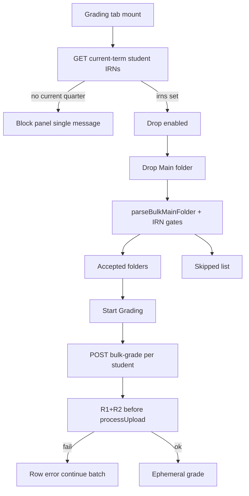

# Bulk Grading IRN Term Gate - Plan

## Goal Capsule

- **Objective:** Before Bulk Grading accepts a student folder, require a 10-digit IRN that belongs to a student enrolled in the system current quarter; invalid folders skip with a clear reason while valid folders still grade. When no current quarter is set, block the Bulk Grading workspace with a single message.
- **Product authority:** This Product Contract. Extends ephemeral Bulk Grading; does not change student self-upload or Score persistence.
- **Open blockers:** None.
- **Stop conditions:** Do not reuse active-only roster/score IRN lists for membership (would break suspended enrolled students). Do not match by teacher code. Do not persist bulk grades. Do not change desktop practice.
- **Execution:** Code.
- **Tail ownership:** Implementer owns unit verification; lecturer smoke of drop → skip reasons → grade accepted closes the feature.

---

## Product Contract

**Product Contract preservation:** changed: added R11 + AE7/F4 — no current quarter blocks Bulk Grading (user confirmed in plan scoping); resolved deferred “how SPA obtains IRNs” into Key Decisions / KTDs (on-demand fetch, not bootstrap).

### Summary

On Main-folder drop in lecturer Bulk Grading, each `IRN_Name` folder must have an IRN of exactly 10 digits and that IRN must identify a student enrolled in the current quarter. Failures join the existing skipped list immediately; Start Grading only runs on accepted folders. Suspended/inactive accounts still pass when enrolled. If no current quarter is set, Bulk Grading is blocked with one message (no drop/grade).

### Problem Frame

Bulk Grading today accepts any digit-length IRN from the folder name and never checks current-quarter enrollment. Lecturers can grade dumps that include mistyped IDs or students outside the active quarter, which wastes grade time and mixes invalid rows into the ephemeral results table.

### Key Decisions

- **Skip invalid folders; grade the rest** (session-settled: user-directed — chosen over block-the-whole-run: one bad folder must not stop the batch). Governs R3, R6.
- **Enrollment is the membership gate; active/suspended does not matter** (session-settled: user-directed — chosen over skip-inactive: if enrolled in the current quarter, accept). Governs R2, R5.
- **Both checks surface on drop** (session-settled: user-directed — chosen over Grade-click-only and over split timing: lecturer sees skips before Start Grading). Governs R3, R4.
- **Drop-time filter against current-quarter enrolled student IRNs** (session-settled: user-approved — chosen over a dedicated validate-folder endpoint and over check-only-inside-each-grade-call). Governs R1–R4, R7.
- **Student IRN means `student_code` in the system current quarter** (session-settled: user-approved — confirmed in synthesis call-outs). Governs R2.
- **Display identity still comes from the folder name** — roster membership gates acceptance only; Student/ID columns stay parsed from `IRN_Name`. Governs R8.
- **Fetch a small IRN list when the Grading tab/drop needs it** (session-settled: user-directed — chosen over bundling into bootstrap/grading). Governs R3, R11.
- **No current quarter → block Bulk Grading with one message** (session-settled: user-directed — chosen over accepting the drop and skipping every folder as not-enrolled). Governs R11, F4, AE7.

### Requirements

**Acceptance gates**

- R1. The IRN taken from an `IRN_Name` student folder must be exactly 10 digit characters (`0`–`9`). Any other length fails the gate.
- R2. That IRN must match a student enrolled in the system current quarter (`is_current`), by student IRN (`student_code`). Teacher-code-only matches do not satisfy the gate.
- R3. Both R1 and R2 are evaluated as soon as the Main folder is dropped/parsed, before Start Grading is available for those folders (requires the IRN membership set already loaded, or load-then-reparse on drop).
- R4. Folders that fail R1 or R2 appear in the existing skipped list with a distinct, lecturer-readable reason for format vs not-enrolled.
- R5. An enrolled student who is suspended or inactive still passes R2 and may be graded.
- R6. Start Grading grades only accepted folders. Skipped folders are never graded in that run.
- R7. The same acceptance rules are enforced when a grade request is made, so a client that bypasses the drop UI cannot grade a failing IRN.
- R8. For accepted folders, Student name and ID in the confirm/results UI continue to come from the `IRN_Name` folder name (membership does not rewrite display identity).

**Unchanged bulk behavior**

- R9. Bulk grading remains ephemeral: no submission, progress, Score, or plagiarism-DB writes from this path.
- R10. Existing folder-shape skips (wrong Lab/Exam layout, missing `.java`/`.mmd`, unparseable `IRN_Name` shape) keep working alongside the new gates.

**Current-quarter precondition**

- R11. When no system current quarter is set, Bulk Grading shows a single blocking message and does not allow folder drop or Start Grading until a current quarter exists.

### Actors

- A1. Lecturer — drops Main folder, sees accepted vs skipped, starts grading on the accepted set.
- A2. Current-quarter enrolled student (by IRN) — identity used only for membership; not an interactive actor in this flow.

### Key Flows

- F1. Drop → gate → confirm: Lecturer selects lab + mode, drops Main folder → each student folder is checked for shape, 10-digit IRN (R1), and current-quarter enrollment (R2) → UI shows accepted + skipped (R3, R4) → lecturer may Start Grading on accepted only (R6).
- F2. Grade run: Start Grading posts only accepted students; server re-applies R1/R2 before grading each (R7); results remain ephemeral (R9).
- F3. Suspended enrolled student: Folder IRN is 10 digits and enrolled but account inactive → folder is accepted (R5) and grades normally if shape is valid.
- F4. No current quarter: Lecturer opens Grading → single message; drop zone and Start Grading disabled (R11).

### Acceptance Examples

- AE1. When a folder is named `2331200057_DOAN TUAN KIET` and `2331200057` is enrolled in the current quarter, the folder is accepted (Covers R1, R2).
- AE2. When a folder IRN is `233120005` (9 digits) or `23312000571` (11 digits), it is skipped for IRN length even if a matching enrollment exists (Covers R1, R4).
- AE3. When a folder IRN is 10 digits but that student is not enrolled in the current quarter, it is skipped as not enrolled (Covers R2, R4).
- AE4. When a 10-digit IRN is enrolled and suspended/inactive, the folder is accepted and graded if shape is valid (Covers R5).
- AE5. When a drop mixes valid and invalid folders, Start Grading grades only the accepted set and skipped rows never receive scores (Covers R3, R6).
- AE6. When a grade request is made for an IRN that fails R1 or R2, grading is refused for that student (Covers R7).
- AE7. When no current quarter is set, Bulk Grading shows one blocking message and drop/Start are unavailable (Covers R11, F4).

### Scope Boundaries

- In scope: lecturer Bulk Grading drop acceptance + server enforcement for the two gates + no-current-quarter block.
- Out of scope: student self-upload IRN validation changes; desktop offline practice; rewriting Score/roster from bulk; requiring active status; matching by teacher code; blocking the entire batch on one bad folder; bundling the IRN set into `GET /api/lecturer/bootstrap/grading`.

### Dependencies / Assumptions

- “Current term” means the system current quarter (`term.is_current`), not merely the selected lab’s term label.
- Extends the existing Bulk parse skipped list; does not require a new lecturer-facing validate-folder workflow.
- Existing term roster / score APIs filter `is_active` and must not be reused for R2/R5.

---

## Planning Contract

### Key Technical Decisions

- KTD1. **On-demand IRN membership GET** (session-settled: user-directed — chosen over extending bootstrap/grading) — Lecturer JWT endpoint returns current-quarter enrolled `student_code` values including inactive accounts; SPA fetches when the Grading tab needs it (mount and/or first drop). Prefer a small DTO list of strings, not full roster rows. Governs R2, R3, R5, R11.
- KTD2. **No current quarter is a hard UI/API gate** (session-settled: user-directed — chosen over skip-all-as-not-enrolled) — Membership GET signals absence of current quarter; SPA blocks the panel with one message. `gradeOne` also refuses when no current quarter exists. Governs R11, AE7.
- KTD3. **Do not reuse active-only IRN sources** — `TermService` roster snapshots and analytics `COALESCE(student_code, teacher_code)` lists are wrong for R2/R5. Add a dedicated query of non-blank `user_account.student_code` for enrollments where `term.current = true`, with **no** `is_active` filter and **no** teacher_code fallback. Governs R2, R5.
- KTD4. **Server gate after extractIrn, before processUpload** — In `LecturerBulkGradingService.gradeOne`, after remap/extract: require `^\d{10}$`; resolve user by `student_code` only; require `existsByUser_IdAndTerm_CurrentTrue` (or equivalent EXISTS); HTTP 400 with lecturer-readable reason; never call `processUpload`/`gradeSubmission` on failure. Governs R7, R1, R2.
- KTD5. **Client gate in parse path** — Extend `parseBulkMainFolder` (or a thin post-pass used by `BulkGradingPanel.applyEntries`) to take an enrolled-IRN `Set` and push length / not-enrolled skips into the existing `skipped` array; keep shape skips unchanged. Governs R1–R6, R10.
- KTD6. **Skip reason copy** — Distinct reasons, e.g. IRN must be exactly 10 digits vs IRN is not enrolled in the current quarter. Server 400 reasons should be mappable by the existing sequential grade error row path without inventing a new results column. Governs R4, R7.

### High-Level Technical Design

### Assumptions

- Enrollment race between drop and Start is acceptable: server 400 becomes a per-row error and the batch continues (existing BulkGradingPanel loop behavior).
- Exact English skip/block copy may be tightened in UI polish without changing R-IDs.
- Frontend has no automated test runner; parse/gate coverage is backend-focused plus manual smoke.

### Implementation Constraints

- Controllers stay thin; membership query lives in repository/service.
- Spring Security default-deny: new GET must be under existing lecturer matcher coverage (`/api/lecturer/**`).
- Do not add burst exemption unless the new GET is shown to break the read budget (unlikely for one small list).
- Desktop profile: no Bulk Grading UI; no desktop mirror required unless implementer finds a shared code path that would break practice builds.

### Sequencing

1. U1 — membership query + GET + auth test  
2. U2 — `gradeOne` server gate + remapper/service tests  
3. U3 — SPA fetch, no-quarter block, parse gates, wire into BulkGradingPanel  
4. U4 — AGENTS.md / CONCEPTS closeout (CONCEPTS already partially updated)

### Research Notes

- Drop/parse/skipped already exist: `frontend/src/utils/bulkFolderParse.js`, `BulkGradingPanel.applyEntries` / Start Grading over `accepted` only.
- Server remapper uses `^(\\d+)_...` today; `LecturerBulkGradingService.gradeOne` has no enrollment check.
- Roster `enrolledSnapshot` requires `isActive` — unsafe for R5.
- Reuse primitives: `TermEnrollmentRepository.existsByUser_IdAndTerm_CurrentTrue`, `UserAccountRepository.findByStudentCode` / `findByStudentCodeLowerIn`; add a dedicated current-term `student_code` list query.

---

## Implementation Units

### U1. Current-term enrolled student IRN membership API

- **Goal:** Lecturer can fetch the set of current-quarter enrolled student IRNs (including inactive) and detect when no current quarter exists.
- **Requirements:** R2, R5, R11
- **Dependencies:** None
- **Files:**
  - `backend/src/main/java/com/eiu/capstone/backend/repository/TermEnrollmentRepository.java` (or `UserAccountRepository.java`) — new query
  - New small DTO under `backend/src/main/java/com/eiu/capstone/backend/DTO/`
  - Service method (prefer `LecturerBulkGradingService` or a thin helper next to term bulk concerns)
  - Controller route under `/api/lecturer/...` (lecturer JWT)
  - `backend/src/test/java/unit/...` and/or `authorization/...` for role + payload
- **Approach:**
  - Query non-blank `student_code` for enrollments on `term.current = true`; no `is_active` filter; no teacher_code.
  - If `TermRepository.findCurrent()` is empty, return a clear no-current-quarter signal (HTTP 409 or structured body the SPA can branch on — pick one and stick to it in tests).
  - Otherwise 200 with the IRN list (deduped). Case: store/compare consistently with folder IRNs (digits-only codes today).
- **Test scenarios:**
  - Current term with active + inactive enrolled students → both `student_code`s present.
  - Teacher-code-only account enrolled → not in list.
  - No current term → no-current signal (not an empty success list alone).
  - Student JWT → 403; anonymous → 401.
- **Verification:** Targeted `mvn test` for the new unit/auth tests.

### U2. Server bulk-grade IRN + enrollment gate

- **Goal:** `POST .../bulk-grade` refuses invalid IRNs before compile/grade.
- **Requirements:** R1, R2, R5, R7, R9, R11
- **Dependencies:** U1 query/helper reusable for single-IRN check (or shared private method)
- **Files:**
  - `backend/src/main/java/com/eiu/capstone/backend/service/bulk/LecturerBulkGradingService.java`
  - Optionally tighten docs/comments on `BulkFolderPathRemapper.java` (length gate may live in service even if remapper still accepts `\d+` roots)
  - `backend/src/test/java/unit/com/eiu/capstone/backend/service/bulk/LecturerBulkGradingServiceTest.java`
  - Optionally `BulkFolderPathRemapperTest.java` if remapper pattern is tightened
- **Approach:**
  - After `extractIrn`, validate `^\d{10}$`.
  - Resolve by `student_code` only; require current-term enrollment; ignore `isActive`.
  - No current term → 400/409 before upload.
  - On failure, never call `processUpload` / `gradeSubmission` (mirror existing exam multi-challenge test style).
- **Test scenarios:**
  - 9-digit / 11-digit IRN → 400; no processUpload.
  - Unknown / not enrolled 10-digit → 400; no processUpload.
  - Enrolled inactive 10-digit → proceeds to grade path (mock happy path).
  - No current term → refused; no processUpload.
  - Existing happy-path exam test still passes with enrolled IRN stubs.
- **Verification:** `mvn test` focusing `LecturerBulkGradingServiceTest` (+ remapper if changed).

### U3. SPA drop-time gates and no-quarter block

- **Goal:** Grading tab fetches IRNs on demand; blocks when no current quarter; skips bad folders on drop.
- **Requirements:** R1–R6, R8, R10, R11
- **Dependencies:** U1
- **Files:**
  - `frontend/src/utils/bulkFolderParse.js`
  - `frontend/src/components/lecturer/BulkGradingPanel.jsx`
  - Friendly error mapping if needed: `frontend/src/config/apiErrorMessages.js` / `apiError.js` (only if new status needs a message)
  - `frontend/src/components/lecturer/AGENTS.md` (behavior note)
- **Approach:**
  - On Grading tab / panel mount (and refresh if useful), GET membership list.
  - No-current signal → single banner/message; disable drop input and Start Grading.
  - When IRN set is ready, `parseBulkMainFolder(..., { enrolledIrns })` (or post-filter): length ≠ 10 → skip; not in set → skip; preserve existing shape skips.
  - If drop happens before fetch completes, wait/retry fetch then parse (do not accept without membership).
  - Start Grading remains sequential over `accepted` only; server 400 still becomes a row error.
- **Test scenarios:** (manual — no FE runner)
  - Drop with 9-digit and valid enrolled → one skipped (length), one accepted.
  - Drop with valid length not enrolled → skipped not-enrolled.
  - Suspended enrolled → accepted.
  - No current quarter → blocked message; cannot drop/start.
  - Mixed drop → Start grades only accepted.
- **Verification:** `npm run build` from `frontend/`; manual smoke on lecturer Grading tab.

### U4. Docs closeout

- **Goal:** Durable docs match the gates.
- **Requirements:** R1–R11 (documentation only)
- **Dependencies:** U1–U3 behavior settled
- **Files:**
  - `backend/AGENTS.md` and/or `backend/src/main/java/com/eiu/capstone/backend/service/AGENTS.md` — bulk-grade + new GET
  - `frontend/src/components/lecturer/AGENTS.md` — drop gates + no-quarter block
  - `CONCEPTS.md` Bulk Grading — confirm no-quarter block sentence if missing
- **Approach:** Update Child DOX Index / Local Contracts only where behavior changed; no diary.
- **Test scenarios:** N/A (doc review)
- **Verification:** DOX pass — nearest AGENTS updated; no stale “folder name only / no roster” wording for acceptance.

---

## Verification Contract

- **Backend:** From `backend/`, run targeted tests for U1–U2 (`LecturerBulkGradingServiceTest`, remapper if changed, new membership unit/auth tests). Prefer `mvn test` when convenient; at minimum the new/changed test classes must pass.
- **Frontend:** `npm run build` from `frontend/` must succeed.
- **Manual:** Lecturer Grading — no current quarter block; drop mixed folders; confirm skipped reasons; Start Grading only accepted; suspended enrolled grades; bypass attempt still 400 from server.
- **Desktop:** Not in scope; no practice zip rebuild unless a shared module change forces it.

## Definition of Done

- All R1–R11 behaviors implemented and covered by U1–U3 tests/manual scenarios.
- Product Contract meaning preserved; KTD1–KTD6 reflected in code.
- AGENTS/CONCEPTS updated (U4); no active-only roster reuse for membership.
- Abandoned experimental endpoints/helpers removed from the diff.
- Ephemeral bulk path still does not persist submissions/progress.
