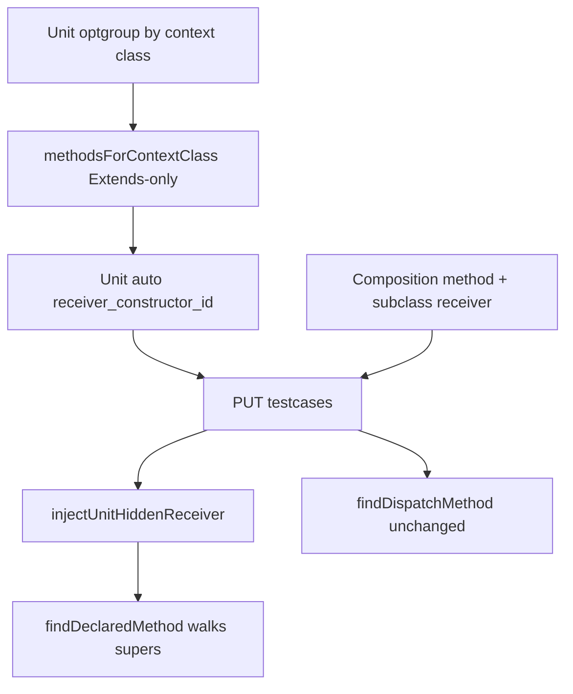

# OT Inherited Method Invoke - Plan

## Goal Capsule

- **Objective:** Let lecturers author Unit and Composition operational steps that mean `Square s = new Square(); s.draw()` when `draw` is declared only on an Extends ancestor, without using Call as.
- **Product authority:** This plan owns subclass-context method eligibility in OT authoring (web lecturer UI) and concrete-path evaluation of those inherited methods (shared grader / desktop practice parity). Call as redesign, Implements-in-picker, Structure schema changes, and student OT UI teaching copy are out of scope.
- **Open blockers:** None.
- **Product Contract preservation:** restructured, no scope change: Outstanding Questions deferred items resolved into KTD1–KTD5; R9 clarified as shared grading parity (desktop has no lecturer OT editor); Unit optgroup decision recorded under Key Decisions.

## Product Contract

### Summary

Today a Unit method pick binds the hidden receiver to the method’s declaring class, so `Shape.draw` always means `new Shape()`. Composition can already pair `Shape.draw` with a Square-named receiver, but concrete lookup documentation and edge paths still treat missing subclass declarations as failure-prone. After this work, Unit members are optgrouped by context class and include Extends-ancestor methods (labels like `Shape.draw`), Unit hidden receivers use that context class, concrete invoke resolves Extends-inherited methods on the receiver, and Call as stays the parent-typed tool.

### Problem Frame

Inheritance labs put shared behavior on the superclass (`Shape.draw`) and specialization on the subclass (`Square`).
Lecturers already model Extends in Structure and already use Call as for `Shape s = new Square(); s.draw()`.
They cannot author the parallel Java form `Square s = new Square(); s.draw()` as a Unit concrete step: the flat member list has no subclass context, and the hidden receiver follows the declaring class.
Call as is the wrong tool for that story because it changes the lookup type to the parent.

### Key Decisions

- **Subclass-context authoring (Option 1)** (session-settled: user-directed — chosen over Option 2 “keep picking Shape.draw only with no picker expansion”: inherited methods appear when authoring against the subclass). Governs R1, R5.
- **Unit + Composition** (session-settled: user-directed — chosen over one type only). Governs R1, R3.
- **Full Extends chain only** (session-settled: user-directed — chosen over immediate-parent-only and over Extends+Implements in the picker). Governs R2, R4.
- **Hide overridden ancestors** (session-settled: user-directed — chosen over showing both declarations: when a closer class declares the same signature, omit the ancestor row). Governs R6.
- **Declaring-class labels (`Shape.draw`)** (session-settled: user-directed — chosen over `draw (from Shape)` and Square-with-inherited-badge). Governs R5.
- **Web authoring + desktop grading parity** (session-settled: user-directed — chosen over web-only; desktop has no lecturer OT editor, so R9 is shared grader parity, not a second authoring UI). Governs R1, R8, R9.
- **Authoring + concrete inherited resolve** (session-settled: user-directed — chosen over authoring-only and over authoring+guide-only). Governs R7, R8.
- **Unit optgroups by context class** (session-settled: user-directed — chosen over flat duplicate labels and over Unit declaring-class-only). Governs R1, R3, R5.

### Actors

- A1. Lecturer — authors Unit/Composition operational testcases in web Solution Management and dry-runs against reference Java.
- A2. Student — uploads and is graded by the same method steps (web and offline/desktop practice); student OT UI stays dark and unchanged.

### Key Flows

- F1. Concrete inherited method on a subclass receiver
  - **Trigger:** Lecturer authors a Unit or Composition step whose receiver/constructed type is `Square`, and `Square` Extends `Shape` with `draw` declared only on `Shape`.
  - **Steps:** Open the method picker in Square context; select `Shape.draw`; leave Call as off / Concrete; dry-run; save.
  - **Outcome:** Picker offers `Shape.draw`; dry-run and grade invoke `draw` on the Square instance without Call as.
  - **Covers R1, R2, R5, R7, R8.**

- F2. Override hides ancestor
  - **Trigger:** `Square` also declares `draw` with the same signature as `Shape.draw`.
  - **Steps:** Open the method picker in Square context.
  - **Outcome:** Only the closer `Square.draw` appears; ancestor `Shape.draw` is omitted. Call as remains available for parent-typed lookup when desired.
  - **Covers R6.**

- F3. Call as unchanged
  - **Trigger:** Lecturer wants `Shape s = square; s.draw()`.
  - **Steps:** Pick `Shape.draw` (or equivalent) with Call as / dispatch type `Shape` on a Square-compatible receiver.
  - **Outcome:** Behavior stays parent-typed lookup; this work does not change Call as semantics.
  - **Covers R10.**

### Requirements

**Authoring eligibility**

- R1. In Unit and Composition (web lecturer UI), every concrete method picker whose context class is a rubric class includes that class’s own methods and methods declared on every Extends ancestor of that class.
- R2. Ancestor inclusion walks the full Extends chain from the context class until there is no Extends parent (implicit `Object` is never a method owner).
- R3. Unit hidden-receiver construction for an inherited method selected in subclass context uses the subclass (context) type, not the method’s declaring ancestor type.
- R4. Ancestor methods appear only when those ancestor classes, their method declarations, and the Extends links exist in the challenge structure.
- R5. Inherited method options keep declaring-class labels already used for methods (e.g. `Shape.draw`), not subclass-renamed labels.
- R6. When a closer class in the Extends chain (including the context class) already declares a method with the same signature, the farther ancestor’s method is omitted from the picker.

**Evaluation**

- R7. A saved concrete method step that references an Extends-ancestor method of the receiver’s concrete type is accepted on save and evaluates on dry-run and student grade by resolving that method on the concrete receiver (Java inheritance), without requiring Call as.
- R8. Concrete inherited resolve applies wherever grading evaluates that saved step (student dashboard, bulk grading, offline/desktop practice) so scoring stays identical across those paths.
- R9. Desktop practice uses the same shared grader path as web for R7–R8; there is no separate desktop lecturer OT authoring surface in this product.

**Boundaries preserved**

- R10. Call as / parent-typed dispatch semantics stay as today; this feature does not replace Call as for `Shape s = …; s.draw()`.
- R11. Student-facing Operational Test UI does not gain new inherited-method teaching copy; behavior change is lecturer authoring plus existing pass/fail grading.

### Acceptance Examples

- AE1. Square / Shape concrete `s.draw()`
  - **Covers:** R1, R2, R5, R7
  - **Given:** Challenge structure has `Shape` with method `draw()`, `Square` with no `draw`, and `Square` Extends `Shape`.
  - **When:** Lecturer opens a Unit or Composition method picker in `Square` context, selects `Shape.draw`, leaves Call as off, dry-runs, and saves.
  - **Then:** The picker includes `Shape.draw`; dry-run and student grade invoke `draw` on a Square instance and pass when the student implements the inherited behavior correctly.

- AE2. Override hides ancestor
  - **Covers:** R6
  - **Given:** AE1 structure plus `Square.draw()` declared in Structure.
  - **When:** Lecturer opens the method picker in `Square` context.
  - **Then:** `Square.draw` appears and ancestor `Shape.draw` does not.

- AE3. No Extends — no ancestors
  - **Covers:** R4
  - **Given:** `Square` has no Extends parent in structure.
  - **When:** Lecturer opens the method picker in `Square` context.
  - **Then:** Only `Square`’s own methods appear.

- AE4. Call as still parent-typed
  - **Covers:** R10
  - **Given:** AE1 structure and a Square receiver available.
  - **When:** Lecturer authors `Shape.draw` with Call as / dispatch `Shape`.
  - **Then:** Evaluation uses parent-typed lookup as today (distinct from AE1’s concrete path).

### Scope Boundaries

**Deferred for later**

- Implements / interface-default methods in the subclass method picker.
- Picker labels of the form `draw (from Shape)` or inherited badges on subclass-named rows.
- Showing both an override and its ancestor method row in the same concrete picker.
- Unit inherited rows for context classes that have no Structure constructor (use Composition for those labs this ship).

**Outside this product's identity**

- Call as redesign or collapsing Call as into concrete inheritance.
- Structure schema changes for methods or Extends.
- Student Operational Test UI redesign.
- Authoring `new Square().draw()` without a named/constructed receiver when the product already requires a receiver/step binding.
- Changing FIELD_STATE rules (already covered by the sibling inherited-field plan).
- Building a desktop lecturer OT authoring UI.

### Dependencies / Assumptions

- Extends relationships and ancestor method declarations are authored and saved in Structure before OT method pickers can list them.
- Composition can already select a declaring-class method with a descendant named receiver; Unit is the main authoring gap for subclass context.
- Grading parity across student dashboard, bulk grading, and offline practice remains a standing project constraint (R8).
- CONCEPTS.md already describes Extends-ancestor method lists and subclass Unit receivers; lecturer guide and worker DOX still need updates to match shipped behavior.

### Outstanding Questions

**Resolve Before Planning**

- None.

**Deferred to Planning**

- None — resolved in Planning Contract KTD1–KTD5.

### Sources / Research

- Method catalog / Unit targets: `frontend/src/components/lecturer/structure/testcaseAuthoring.js` (`buildMemberCatalog`, `unitSelectableTargets`, `applyUnitTarget`).
- Extends-only field pattern to mirror: same file (`extendsChildrenByParentId`, `withExtendsAncestors`, `fieldOwnerClassIdsForStep`).
- Composition receiver match already allows subclass instances for parent methods: `namedInstanceMatchesMethodReceiver`.
- UNIT bans `receiver_constructor_id` today: `backend/.../service/TestcaseRubricService.java` (`validateUnitSteps`).
- Hidden receiver inject uses declaring `className` when no receiver: `backend/.../grading/pipeline/TestcaseGrader.java` (`injectUnitHiddenReceiver`).
- Concrete vs Call as lookup: `backend/.../grading/testcase/worker/WorkerInvokeEngine.java` (`findDeclaredMethod`, `findDispatchMethod`); worker AGENTS.md concrete `getDeclaredMethod` note.
- Desktop: `frontend/src/App.desktop.jsx` is student-only; shared worker grades offline packs.
- Tests to mirror: `WorkerInvokeEngineTest` Call as / concrete scenarios; `TestcaseGraderTest` Unit hidden receiver; `TestcaseRubricServiceTest` Extends-parent FIELD_STATE saves.
- Guide: `docs/LECTURER_OPERATIONAL_TESTCASE_GUIDE.md` §5.2 / §6.5 (notes concrete may fail without subclass declaration).
- Sibling plan: `docs/plans/2026-11-13-001-feat-ot-inherited-field-state-plan.md`.

<!-- ce-section: work-relationships -->
### Work Relationships

- **Sibling (shipped / separate plan):** `docs/plans/2026-11-13-001-feat-ot-inherited-field-state-plan.md` — Extends-ancestor FIELD_STATE eligibility. This plan mirrors Extends-chain eligibility for methods and does not reopen field scope.
- **Preserved adjacent capability:** Call as Extends/Implements dispatch for parent-typed method lookup remains the tool for `Shape s = …; s.draw()`.

---

## Planning Contract

### Key Technical Decisions

- KTD1. **Extends-only method eligibility helper** — Reuse the catalog’s Extends-only map (`extendsChildrenByParentId` / `withExtendsAncestors`). Build `methodsForContextClass(contextClassId, catalog)` = own concrete non-abstract methods ∪ Extends-ancestor methods, applying R6 signature collapse. Do not walk Call-as Extends+Implements heritage. Governs R1, R2, R4, R6.
- KTD2. **Unit optgroups + context-keyed targets** (session-settled: user-directed — chosen over flat duplicate `Shape.draw` rows and over Unit declaring-only). `<optgroup label="{Class}">` per concrete class; options use keys `METHOD:{methodId}@{contextClassId}` (constructors stay `CONSTRUCTOR:{id}`). Labels remain declaring-class form (`Shape.draw(...)`). `applyUnitTarget` / `selectedUnitTarget` / `unitTargetKey` learn the `@context` suffix. Governs R1, R3, R5.
- KTD3. **Persist Unit subclass context via `receiver_constructor_id`** — When the selected method’s declaring class is an Extends ancestor of the context class, auto-set `receiver_constructor_id` to the context class’s preferred Structure constructor (no-arg if present, else shortest). Relax `UNIT cannot set receiver_constructor_id` only for that Extends-ancestor case (still reject lecturer-authored arbitrary receiver ctors for ordinary own-class Unit methods). Assembler already maps receiver ctor → `receiverClassName`; `injectUnitHiddenReceiver` keeps a non-blank receiver. If the context class has no Structure constructor, omit that inherited Unit option this ship (deferred; Composition remains available). Governs R3, R7.
- KTD4. **Concrete lookup walks Extends superclasses** — Change `findDeclaredMethod` (no-dispatch path) to walk `getSuperclass()` after the concrete class’s own declared methods, matching Java inheritance for bodies declared only on ancestors. Leave `findDispatchMethod` / Call as unchanged. Shared worker covers web + desktop practice (R8, R9). Governs R7, R8, R9, R10.
- KTD5. **R6 signature equality** — Same simple name + same ordered parameter `dataType` list as catalog `paramSignature` / method parameter types. Overloads with different params both appear. Governs R6.

### Assumptions

- Structure Extends edges and ancestor method rows exist before OT can list them (R4).
- Composition AE1 often already evaluates when `className` is the declaring class and the named receiver is the subclass; KTD4 still ships so concrete lookup on the receiver class cannot fail when the method is only on an ancestor.
- No new DB column this ship; Unit context rides `receiver_constructor_id` (KTD3).
- CONCEPTS.md vocabulary already matches the intended product; guide + worker AGENTS need alignment.

### High-Level Technical Design

### System-Wide Impact

- **Lecturers:** Unit can express subclass + inherited method; Composition gains reliable concrete inherited resolve and clearer guide copy.
- **Students:** same OT pass/fail once steps are saved; no new OT chrome.
- **Desktop practice:** no authoring UI change; shared worker parity for saved steps.
- **Call as:** unchanged.

### Risks & Dependencies

| Risk | Mitigation |
|---|---|
| Reusing Call-as heritage pulls Implements methods into the concrete picker | KTD1 Extends-only |
| Unit `receiver_constructor_id` ban blocks subclass context | KTD3 scoped relax + auto-bind only |
| Context class with no Structure constructor | Omit Unit inherited option; use Composition (deferred boundary) |
| Worker walk changes override / bridge method selection | Prefer exact declared match on closest class; skip synthetic/bridge; tests for override + inherited-only |
| Guide still says concrete may fail without subclass declaration | U4 docs rewrite |
| Optgroup + `@context` key breaks selection restore | Update `unitTargetKey` / `selectedUnitTarget` / `applyUnitTarget` together; round-trip test via save |

### Implementation Units

### U1. Frontend — Extends-ancestor method eligibility + Unit optgroups

**Goal:** Unit member select is optgrouped by context class and lists Extends-ancestor methods with declaring-class labels; Composition keeps descendant receivers and can share the eligibility helper.

**Requirements:** R1, R2, R3, R4, R5, R6 — F1, F2 — AE1, AE2, AE3

**Dependencies:** None

**Files:**
- Modify: `frontend/src/components/lecturer/structure/testcaseAuthoring.js`
- Modify: `frontend/src/components/lecturer/structure/UnitTestcaseWorksheet.jsx`
- Modify: `frontend/src/components/lecturer/structure/CompositionTestcaseScript.jsx` only if needed to consume shared helper / ordering
- Modify: `frontend/src/components/lecturer/AGENTS.md` (one-line: Unit/Composition method eligibility includes Extends ancestors; Unit optgroups by context)

**Approach:**
1. Add `methodsForContextClass` (KTD1, KTD5) using Extends-only ancestors and signature collapse.
2. Rebuild Unit selectable targets as per-context rows with `METHOD:{id}@{contextClassId}` keys; own-class methods use context = declaring class.
3. On inherited selection, auto-set `receiver_constructor_id` to preferred Structure constructor of the context class; clear it for ordinary own-class methods (KTD3).
4. Render `<optgroup>` in `UnitTestcaseWorksheet` (KTD2).
5. Skip inherited Unit options when the context class has no Structure constructor.

**Patterns to follow:** FIELD_STATE Extends helpers in the same file; catalog labels `` `${cls.name}.${method.name}(...)` ``.

**Test scenarios:**
- Covers AE1. Under Square optgroup, `Shape.draw(...)` appears; selecting it sets Square context receiver ctor.
- Covers AE2. With `Square.draw` declared, Square optgroup hides `Shape.draw`.
- Covers AE3. No Extends → Square optgroup only own methods.
- Multi-hop Extends: methods from intermediate + root ancestors appear under the leaf context.
- Implements-only “parent” methods do not appear via Implements alone.
- Own-class Unit method clears `receiver_constructor_id`.

**Verification:** `npm run build` from `frontend/`; manual AE1–AE3 in Solution Management.

### U2. Backend — Unit context save + hidden receiver

**Goal:** Accept Unit METHOD rows that set `receiver_constructor_id` when the method is an Extends-ancestor of that constructor’s class; grade/dry-run builds the subclass hidden receiver.

**Requirements:** R3, R7 — AE1

**Dependencies:** None (can parallel U1; needs U1 shape for end-to-end)

**Files:**
- Modify: `backend/src/main/java/com/eiu/capstone/backend/service/TestcaseRubricService.java`
- Modify: `backend/src/test/java/support/com/eiu/capstone/backend/service/TestcaseRubricServiceTest.java`
- Modify: `backend/src/test/java/unit/com/eiu/capstone/backend/grading/pipeline/TestcaseGraderTest.java` (Unit hidden receiver on subclass for ancestor method)
- Touch assembler/grader production only if a gap appears (research expects existing `receiverClassName` path to work once save allows the ctor)

**Approach:**
1. Replace blanket UNIT `receiver_constructor_id` ban with KTD3 rule (Extends-ancestor method of receiver ctor’s class).
2. Reject UNIT `receiver_constructor_id` when the method is declared on the same class as the ctor (ordinary Unit path stays hidden-inject via declaring class).
3. Save/round-trip regression: Unit `Shape.draw` + Square receiver ctor succeeds.
4. Assert prepared Unit step carries `receiverClassName` Square (or equivalent) before worker send.

**Patterns to follow:** Extends-parent FIELD_STATE save tests; Unit hidden-receiver grader tests.

**Test scenarios:**
- Covers AE1/R3. Unit save with ancestor `methodId` + subclass `receiver_constructor_id` succeeds and round-trips.
- Ordinary Unit own-class method with `receiver_constructor_id` still rejected.
- Unrelated challenge method/ctor still rejected by existing membership checks.

**Verification:** Targeted Surefire on touched test classes / `mvn test` from `backend/`.

### U3. Worker — concrete inherited method resolve

**Goal:** No-dispatch method lookup finds Extends-inherited methods on the concrete class.

**Requirements:** R7, R8, R9, R10 — AE1, AE4

**Dependencies:** None (can parallel U1/U2)

**Files:**
- Modify: `backend/src/main/java/com/eiu/capstone/backend/grading/testcase/worker/WorkerInvokeEngine.java`
- Modify: `backend/src/main/java/com/eiu/capstone/backend/grading/testcase/worker/AGENTS.md`
- Modify: `backend/src/test/java/unit/com/eiu/capstone/backend/grading/testcase/worker/WorkerInvokeEngineTest.java`

**Approach:**
1. Extend `findDeclaredMethod` to walk superclasses after the concrete class (KTD4); skip synthetic/bridge; stop before `Object` if no match.
2. Do not change `findDispatchMethod`.
3. Add AE1-style test: Square instance, method `draw` declared only on Shape, no dispatch → NORMAL.
4. Add override contrast: Square overrides `draw`, concrete lookup on Square still preferred; Call as Shape path unchanged (existing test).

**Patterns to follow:** Existing Call as Circle/Shape tests; `scenarioWithoutDispatchUsesConcreteClassLookup`.

**Test scenarios:**
- Covers AE1. Concrete inherited-only method on subclass receiver succeeds.
- Covers AE4. Dispatch path still uses parent-typed lookup.
- No regression: method declared on concrete class still resolves without walking.

**Verification:** Surefire `WorkerInvokeEngineTest` / `mvn test` from `backend/`.

### U4. Docs — lecturer guide + DOX closeout

**Goal:** Document Unit optgroup inherited methods and concrete `Square s; s.draw()`; remove stale “concrete may fail” wording where KTD4 fixes it.

**Requirements:** R1, R5, R7, R10, R11 — AE1, AE4

**Dependencies:** U1–U3 behavior must match docs

**Files:**
- Modify: `docs/LECTURER_OPERATIONAL_TESTCASE_GUIDE.md` (§5.2 Unit member / §6.5 Call as contrast)
- Modify: `backend/src/main/java/com/eiu/capstone/backend/grading/AGENTS.md` if Unit hidden-receiver contract text still says declaring-class-only
- Confirm: `CONCEPTS.md` Unit/Composition/Call as wording — adjust only if implementation differs

**Approach:**
1. Unit: member list grouped by class; Extends-ancestor methods appear under the subclass with declaring-class labels; hidden receiver is the context class.
2. Call as: still parent-typed; contrast with concrete inherited invoke.
3. No student OT copy changes.

**Test scenarios:**
- Guide example matches AE1 Square/Shape wording.
- Mistake table no longer pushes lecturers to Call as solely because the subclass did not redeclare the method.

**Verification:** Manual read of guide sections; DOX pass on touched AGENTS paths.

---

## Verification Contract

| Gate | Command / action | Applies to |
|---|---|---|
| Frontend build | `npm run build` from `frontend/` | U1 |
| Backend tests | `mvn test` from `backend/` (or Surefire on `TestcaseRubricServiceTest`, `TestcaseGraderTest`, `WorkerInvokeEngineTest`) | U2, U3 |
| Manual OT authoring | Solution Management → Operational Testcases: AE1–AE4 dry-run + Save | U1–U3 |
| Docs | Lecturer guide §5.2 / §6.5 match shipped behavior | U4 |
| Desktop | No practice zip rebuild required unless worker JAR packaging for desktop dist is part of the usual release path; shared worker semantics cover R8/R9 | U3, R9 |

## Definition of Done

- R1–R11 satisfied; AE1–AE4 pass manually where authoring applies.
- U1–U4 complete; Verification Contract gates green.
- Call as behavior unchanged; student OT UI unchanged.
- Unit own-class methods still reject stray `receiver_constructor_id`.
- No abandoned experimental code left in the diff.
- DOX/guide notes updated for Extends-inherited concrete method invoke.
