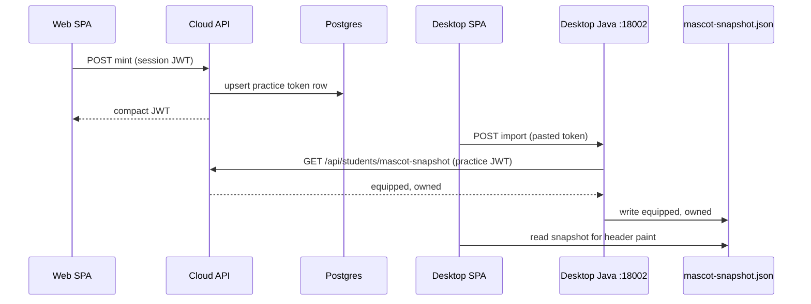

# Desktop Mascot Practice Token - Plan

## Goal Capsule

- **Objective:** Let a web student copy a mascot-only practice token from the avatar menu, paste it into the desktop practice app, and pull equipped plus owned mascot ids from cloud so the local header paints that mascot from bundled sheets.
- **Product authority:** This Product Contract. Web shop, gacha, points, and official submissions stay as they are. Desktop still does not log in with Google and still does not sync grades.
- **Open blockers:** None.
- **Stop conditions:** Do not accept a web session JWT as the practice code. Do not attach `ROLE_STUDENT` or `ROLE_ADMIN` to a practice token. Do not re-create `student_daily_streak` / `student_mascot_purchase` on H2. Do not call `GET /api/students/streak` (that path writes the login mission). Do not fetch production from the desktop SPA (CORS).
- **Execution:** Code.
- **Tail ownership:** Implementer owns unit tests and DOX. Manual smoke: copy token on web, import on desktop with network, then reopen offline.

---

## Product Contract

**Product Contract preservation:** n/a — `ce-plan-bootstrap` (no upstream brainstorm). Scoping confirmed in-session 2026-11-14.

### Summary

Web students get a copyable practice token under Change Password.
Desktop import posts that token to the local practice API; Java calls production with `Authorization: Bearer`, writes a snapshot file, and the header paints the equipped mascot from files already in the install.
Shop, gacha, points, and grading stay web-only.

### Problem Frame

Practice identity is `desktop-local` and the desktop profile drops shop tables, so the header is always the fox.
Students already own mascots on web.
A full Google login inside the EXE, or reusing the session JWT, would expose upload and shop writes from a copied secret.

### Key Decisions

- **Practice token, not session JWT** (session-settled: user-directed — chosen over Google login in the EXE and over pasting the web session JWT: a code under the avatar, sent like a Bearer token, scoped to mascot read). Governs R1, R2, R6, R7.
- **One-way mascot snapshot** (session-settled: user-directed — chosen over online practice that syncs scores: pull equipped and owned ids only). Governs R3, R4, R8.
- **Pull on import/sync only** (session-settled: user-approved — chosen over auto-refresh on every launch). Governs R5.
- **Baked cloud API URL** (session-settled: user-approved — chosen over asking the student to type a URL). Governs R9.

### Actors

- A1. Web student — signed-in student (or dual-role / Admin on the student shell) who copies or regenerates the code.
- A2. Practice student — uses the Windows EXE; pastes the code; grades locally as today.
- A3. Lecturer-only account — no student shell token UI.

### Requirements

- R1. The student avatar menu, below Change Password, offers Copy and Regenerate for one live practice token. Desktop has no avatar menu; import lives next to pack import.
- R2. Copy returns a dedicated token. A web session JWT used as the desktop code is rejected.
- R3. A successful desktop sync stores `{ equipped, owned[] }` locally and does not persist points, tickets, or crystals.
- R4. The desktop header paints `equipped` from bundled sheets. Unknown or missing id paints fox. Click reactions stay local.
- R5. Sync runs only when the student pastes and confirms. Launch does not call production.
- R6. The practice token authorizes only `GET /api/students/mascot-snapshot`. It must fail on shop list, streak, purchase, equip, upload, ranking, and every other cloud route. The shop `GET /api/students/mascots/list` stays session JWT only.
- R7. Regenerating the token, changing password, suspending, or deleting the user invalidates the previous practice token. Web session `sv` is not bumped by regenerate.
- R8. Failed or offline sync leaves the last good snapshot in place. Invalid paste does not overwrite it.
- R9. Desktop uses a production API base baked at assemble / config time. Missing URL shows a clear import error.
- R10. Lecturer-only users do not see the token UI; mint returns 403. Dual-role Student+Lecturer and Admin on the student shell may mint.
- R11. Desktop profile still drops leftover H2 streak/shop tables. The snapshot is a file under the practice home, not those tables.

### Key Flows

- F1. Copy token
  - **Trigger:** A1 opens the avatar menu and copies the practice token.
  - **Outcome:** One live token; clipboard holds the secret; web session unchanged.
  - **Covers R1, R2, R10.**
- F2. Regenerate
  - **Trigger:** A1 chooses Regenerate.
  - **Outcome:** New secret; old `jti` dead; desktop must paste again.
  - **Covers regenerate in R7.** Password change, suspend, and delete are U1, not this flow.
- F3. Paste and sync
  - **Trigger:** A2 pastes the code in the practice app while online.
  - **Steps:** UI posts to local desktop API; Java calls production `GET /api/students/mascot-snapshot`; writes snapshot file.
  - **Outcome:** Header uses `equipped` from that file.
  - **Covers R3, R4, R5, R9.**
- F4. Offline reopen
  - **Trigger:** A2 opens the app with no network after a good sync.
  - **Outcome:** Header still paints the snapshot mascot; no production call.
  - **Covers R5, R8.**
- F5. Reject session JWT
  - **Trigger:** A2 pastes their web login token.
  - **Outcome:** Cloud 401/403; snapshot unchanged.
  - **Covers R2, R6.**

### Acceptance Examples

- AE1. Covers R2, R6. Given a valid session JWT, when it is sent to `GET /api/students/mascot-snapshot` or pasted as the desktop code, then 401/403 and the snapshot file is not written.
- AE2. Covers R6. Given a valid practice token, when it is used on `GET /api/students/mascots/list`, `POST .../purchase`, or `GET /api/students/streak`, then 401/403.
- AE3. Covers R3, R4. Given cloud equipped `linh_loc` and bundled sheets, when sync succeeds, then the practice header paints Linh Lộc, not fox.
- AE4. Covers R4. Given equipped `unknown_id`, when sync succeeds, then the header paints fox.
- AE5. Covers R7, R8. Given a desktop that already synced, when the student regenerates on web and desktop retries with the old code, then the pull fails and the previous snapshot remains.
- AE6. Covers R10. Given a lecturer-only JWT, when mint is called, then 403 and no token row.

### Success Criteria

- A student who owns a non-fox mascot on web can show it on practice after one copy-and-paste, then keep it offline.
- A stolen or reused session JWT cannot shop, submit, or read streak through this path.
- Practice H2 still has no streak/shop tables after startup.

### Scope Boundaries

**In scope:** mint/copy/regenerate on web; scoped cloud GET; desktop import UI; Java-side pull; snapshot file; header paint from catalog sheets already in the desktop UI build.

**Out of scope:** Google login in the EXE; shop, gacha, crystals, points on desktop; pushing equip back to web; auto-sync on launch; score/history sync; packing new mascot art (assumes sheets already ship in `frontend/public/mascots/` and `studentMascots.js`).

### Deferred to Follow-Up Work

- Windows Credential Manager for the pasted secret (file snapshot of ids is enough; the token can live only in memory during the pull).
- Auto-updater for new mascot sheets without a new practice zip.

---

## Planning Contract

### Key Technical Decisions

- KTD1. **Claims and filter** (session-settled: user-directed on dedicated token). Mint a separate HS256 JWT with `typ=mascot_practice`, `aud=desktop-mascot`, `scope=mascot:read`, `jti`, `sub`=user id, `email` for burst keying, `exp` 90 days. Omit `roles`. `JwtAuthenticationFilter` treats this type as mascot-read only (no `ROLE_STUDENT` / `ROLE_ADMIN`). Session JWTs keep current `sv` behavior. Governs R2, R6.
- KTD2. **Dedicated snapshot GET** (deepened: dual-auth on `GET /mascots/list` would let a pasted session JWT succeed and write a snapshot). New `GET /api/students/mascot-snapshot` (`!desktop`) accepts only `typ=mascot_practice` and returns `{ equipped, owned[] }` — no points. Shop `GET /api/students/mascots/list` remains session JWT only. Specific matcher above `/api/students/**`. Governs R3, R6, AE1.
- KTD3. **One row per user.** Table `student_mascot_practice_token` (`user_id` PK, `jti`, compact token for re-copy, `expires_at`, `created_at`). Copy returns the stored compact JWT until expiry. Regenerate replaces the row and does not bump web session `sv`. Password change, suspend, and user delete delete the row; password-change `sv` follows existing user-update behavior. Governs R1, R7.
- KTD4. **Desktop pull is Java, not the SPA.** `desktop-dist` excludes jjwt and CORS does not allow `http://127.0.0.1:18002` to call production. Local desktop API accepts the pasted token and `HttpClient`s production. Snapshot path: `{APP_DESKTOP_HOME}/data/mascot-snapshot.json`. Governs R3, R5, R9, R11.
- KTD5. **Slim snapshot DTO.** Snapshot GET returns only `equipped` and owned ids. Do not call streak GET. Shop list payload stays as today. Governs R3.
- KTD6. **Cloud base URL.** `app.desktop.cloud-api-url` / `APP_DESKTOP_CLOUD_API_URL` baked at assemble (same host the web SPA uses as `VITE_API_URL`). Empty → import fails with a config message, no guess. Governs R9.

### High-Level Technical Design

Practice JWT on `/api/students/mascots/list` or any write path stops in the filter or matcher.
Web shop continues to call `/api/students/mascots/list` and other shop routes with the session JWT; it never sends the practice token.

### Assumptions

- Bundled desktop UI already contains the sheet files for ids the student might own. Missing file → fox (R4).
- Production TLS is valid on student PCs.
- One live token is shared across machines; the second PC pastes the same code until regenerate.

### Implementation Constraints

- Default-deny: only `JwtAuthenticationFilter` parses JWTs (`backend/AGENTS.md`).
- New cloud routes need CORS only for the **web** mint/copy calls (existing frontend origins). Desktop Java is not a browser origin.
- Burst GET lane still keys by email when the practice JWT authenticates.
- Authorization tests live under `backend/src/test/java/authorization/` with the nested `@SpringBootApplication` slice pattern.
- Desktop writers for streak/shop stay off (`@Profile("!desktop")`); `DesktopStreakSchemaCleanupMigrator` still drops those tables.

### Sequencing

U1 token persistence and mint → U2 snapshot GET + matcher split → U3 web menu → U4 desktop import/snapshot/header → U5 DOX.

---

## Implementation Units

### U1. Practice token mint and storage

- **Goal:** Students with a session JWT can mint, re-copy, and regenerate one 90-day mascot-practice JWT stored in Postgres.
- **Requirements:** R1, R2, R7, R10
- **Dependencies:** none
- **Files:**
  - `backend/src/main/java/com/eiu/capstone/backend/service/JwtService.java`
  - new model + repository + service + `!desktop` controller under `backend/src/main/java/com/eiu/capstone/backend/`
  - startup migrator next to `StudentStreakSchemaMigrator`
  - `docs/sql/` operator script
  - `backend/src/test/java/unit/.../MascotPracticeTokenServiceTest.java`
  - `backend/src/test/java/authorization/...` mint 401/403 probes
- **Approach:**
  1. Extend `JwtService` with a mascot-practice builder (claims per KTD1). Keep session `createToken` unchanged.
  2. `POST /api/students/mascot-practice-token` (session Student or Admin) returns `{ token, expiresAt }`, creating the row if missing.
  3. `POST .../regenerate` replaces `jti` and compact token.
  4. Hook password-change / suspend / delete user to delete the row.
  5. Lecturer-only → 403.
- **Patterns to follow:** `AuthController` mint; `StudentStreakSchemaMigrator` `CREATE TABLE IF NOT EXISTS`; `SessionValidityService` for active-user checks on mint, not on `sv` bump for regenerate.
- **Test scenarios:**
  - Covers AE6. Student JWT mints; lecturer-only JWT 403; anonymous 401.
  - Second copy without regenerate returns the same compact token and same `jti`.
  - Regenerate returns a new `jti`; old compact token is not in the row.
  - Password change deletes the row; session `sv` still follows existing user-update behavior (do not bump `sv` solely because of regenerate).
- **Verification:** unit + authorization tests green; table exists on cloud migrator path.

### U2. Snapshot GET and matcher split

- **Goal:** Practice tokens can read only `GET /api/students/mascot-snapshot`. Session JWTs keep the shop list. Each credential fails on the other path.
- **Requirements:** R3, R6
- **Dependencies:** U1
- **Files:**
  - `backend/src/main/java/com/eiu/capstone/backend/security/JwtAuthenticationFilter.java`
  - `backend/src/main/java/com/eiu/capstone/backend/config/SecurityConfig.java`
  - `backend/src/main/java/com/eiu/capstone/backend/controller/StudentMascotController.java` or a small sibling controller
  - `backend/src/test/java/authorization/.../MascotPracticeTokenAuthorizationTest.java`
  - `backend/src/test/java/authorization/.../security/SecurityAuthorizationTest.java` if the matcher table is asserted there
- **Approach:**
  1. After parse, if `typ=mascot_practice`, require live `jti` row, active user, matching `aud`/`scope`; authorities = mascot-read only.
  2. Snapshot GET returns `{ equipped, owned[] }` from streak + purchase rows. No points.
  3. Practice token on `/api/students/mascots/list`, purchase, streak, submissions, ranking → 401/403.
  4. Session JWT on snapshot GET → 401/403. Session JWT on shop list unchanged.
  5. Do not enable `access_token` query on the snapshot GET.
- **Patterns to follow:** `docs/solutions/architecture-patterns/spring-security-default-deny-matcher-table.md`; `JwtAuthenticationFilter` swallows bad tokens as anonymous.
- **Test scenarios:**
  - Covers AE1. Session JWT GET snapshot 403; practice token GET snapshot 200 with equipped and owned only.
  - Covers AE2. Practice token GET `/api/students/mascots/list` 403; POST purchase 403; GET streak 403; POST upload 403.
  - Expired or regenerated `jti` GET snapshot 401; shop session JWT GET `/api/students/mascots/list` still 200.
- **Verification:** authorization suite proves the two GETs do not accept each other's credential.
- **Execution note:** Start with failing authorization tests for snapshot GET vs shop list vs POST purchase.

### U3. Web avatar copy UI

- **Goal:** Student (and Admin student-shell) avatar menu copies and regenerates the token below Change Password.
- **Requirements:** R1, R7, R10
- **Dependencies:** U1
- **Files:**
  - `frontend/src/components/Header.jsx`
  - `frontend/src/utils/apiFetch.js` (only if a dedicated helper is cleaner; otherwise inline `apiFetch`)
    - (DOX files live in U5)
- **Approach:**
  1. Web-only menu item (hidden when `VITE_APP_MODE === 'desktop'`).
  2. Copy calls mint/get endpoint, writes clipboard, toast on success/fail.
  3. Regenerate confirms, then copies the new secret.
  4. Lecturer dashboard header omits the item.
- **Patterns to follow:** existing Change Password row; Toast; `apiFetch` 401/403 mapping.
- **Test scenarios:**
  - Test expectation: none automated — frontend has no runner. Prove with `npm run build` and manual copy/regenerate.
- **Verification:** student menu shows the control; desktop header still Exit-only; lecturer header unchanged.

### U4. Desktop import, snapshot, header paint

- **Goal:** Practice app imports the code through local Java, writes the snapshot file, and paints equipped mascot offline.
- **Requirements:** R3, R4, R5, R8, R9, R11
- **Dependencies:** U2
- **Files:**
  - new `@Profile("desktop")` controller + service under `backend/src/main/java/com/eiu/capstone/backend/desktop/`
  - `backend/src/main/resources/application-desktop.yml`
  - `frontend/src/App.desktop.jsx` / `frontend/src/components/Header.jsx` desktop branch / pack-import neighbor
  - `frontend/src/pages/StudentDashboard.jsx` equipped source when desktop
  - `scripts/assemble-student-desktop.ps1` (pass through `APP_DESKTOP_CLOUD_API_URL` if required)
  - `backend/src/test/java/integration/com/eiu/capstone/backend/desktop/` snapshot/import tests
  - `frontend/src/components/student/studentMascots.js` (read equipped id only; no catalog change required)
- **Approach:**
  1. `POST /api/desktop/mascot-sync` with the pasted token. Reject blank input. Do not persist the pasted secret; keep it in memory for the outbound call.
  2. HttpClient GET `{cloud}/api/students/mascot-snapshot` with Bearer. 2xx → write `{ equipped, owned }` JSON. Non-2xx (including session JWT 403) → keep previous file.
  3. Header reads snapshot at launch; unknown id → fox via existing `mascotArt`.
  4. Import control next to **Import rubric pack**. No production fetch from `apiFetch` in the SPA.
- **Patterns to follow:** `DesktopPackStageService` multipart import errors; `DesktopStreakSchemaCleanupMigrator` still drops shop tables; `StudentFoxMascot` `mascotId` prop.
- **Test scenarios:**
  - Covers AE3, AE4, AE5. Successful snapshot JSON `{ equipped, owned }` writes the snapshot file; unknown equipped → UI fox.
  - Cloud 401/429/timeout: previous snapshot retained; empty first-run stays fox.
  - Covers R11. After desktop startup, `student_mascot_purchase` still absent; snapshot file exists independently.
  - Missing `app.desktop.cloud-api-url`: 503/422 with config error, no outbound call.
- **Verification:** desktop integration test for file write/retain; `npm run build:desktop`; manual paste online then reopen offline.
- **Execution note:** This is mostly desktop wiring; prefer integration/smoke over mocking HttpClient in unit tests where a WireMock/local stub already fits.

### U5. DOX and CONCEPTS

- **Goal:** Document the token, the snapshot file, and the exception to “practice is always fox.”
- **Requirements:** R1–R11 (contract text)
- **Dependencies:** U1–U4
- **Files:**
  - `CONCEPTS.md` (Local student desktop mode + new Practice mascot token)
  - `backend/AGENTS.md` (new endpoints, matcher, desktop pull)
  - `frontend/AGENTS.md` / `frontend/src/components/student/AGENTS.md` / `frontend/src/pages/AGENTS.md`
  - `docs/DESKTOP_STUDENT_DIST.md`
  - `AGENTS.md` Child DOX Index if a new SQL file is added
- **Approach:** Update “practice keeps the default fox” to “fox until a successful mascot snapshot; shop still web-only.” Index the operator SQL.
- **Test scenarios:**
  - Test expectation: none — documentation.
- **Verification:** DOX chain matches behavior; no leftover “always fox, no alternate mascot” without the snapshot exception.

---

## Verification Contract

- `mvn test` from `backend/` including new authorization tests for practice vs session JWTs and desktop snapshot tests.
- `npm run build` and `npm run build:desktop` from `frontend/`.
- Manual: web copy → desktop import on a machine that can reach production → header mascot matches equipped → disconnect network → mascot remains → regenerate on web → old code fails → prior mascot remains until a new successful sync.
- Confirm `GET /api/students/streak` and `GET /api/students/mascots/list` with a practice token are 403 and streak does not increment login mission.
- Confirm a session JWT against `GET /api/students/mascot-snapshot` is 403.

---

## Definition of Done

- R1–R11 have a unit, authorization test, or named manual check.
- Practice token cannot purchase, equip, pet-mission, or upload.
- Desktop H2 still has no streak/shop tables; snapshot is only the JSON file.
- CONCEPTS + nearest AGENTS.md + `docs/DESKTOP_STUDENT_DIST.md` describe copy, import, and fox fallback.
- Abandoned spikes (CORS on 18002, jjwt on desktop-dist, re-enabled shop beans) are not in the diff.

---

## System-Wide Impact

- **Auth boundary:** second JWT profile on the same `JWT_SECRET`. Filter must branch on `typ` before granting roles.
- **Burst:** practice pulls count as authenticated GETs keyed by email.
- **Desktop product:** 2026-11-10 plan said practice has no alternate mascot. This plan is an explicit exception for a **cloud-sourced snapshot**, not a return of the shop.

## Risks & Dependencies

- **Role leak:** copying `roles` into the practice JWT would reopen `/api/students/**` and possibly lecturer APIs for Admin. Mitigation: KTD1 omit roles; authorization tests AE2.
- **Show-again secret in Postgres:** compact JWT in the token row is a stored bearer. Mitigation: one row, delete on password/suspend/delete; HTTPS; no logs of the compact token.
- **Stale snapshot:** student equips a new mascot on web and never re-syncs. Accepted (R5).
- **Sheet lag:** new mascot on web, old practice zip. Fox fallback (R4).
- **Cloud URL wrong in a zip:** import errors until assemble sets `APP_DESKTOP_CLOUD_API_URL`.

## Alternatives Considered

- **Opaque `oop_mct_` PAT hashed in DB** — safer than a re-copyable JWT; rejected because the user asked for a JWT-shaped Bearer code they can copy from the avatar again.
- **SPA fetch to production with CORS for 18002** — extra origin on `CorsConfig` and cookies/credentials risk; rejected for Java-side pull (KTD4).
- **Re-enable H2 shop tables** — contradicts desktop strip plan; rejected for a JSON snapshot.

## Documentation / Operational Notes

- Operator SQL for the new table ships under `docs/sql/` and in the `!desktop` startup migrator (same pattern as streak).
- Assemble must receive the production API base; document it in `docs/DESKTOP_STUDENT_DIST.md`.
- Do not add `http://127.0.0.1:18002` to cloud CORS for this feature.

## Sources & Research

- `JwtService`, `JwtAuthenticationFilter`, `SecurityConfig` `/api/students/**`, `StudentMascotController` `GET /list`, `MascotShopView`.
- `DesktopSecurityConfig`, `desktop-dist` jjwt exclusion, `CorsConfig` origins, `App.desktop.jsx` `desktop-local`.
- `docs/solutions/architecture-patterns/jwt-session-version-force-logout.md`
- `docs/solutions/architecture-patterns/spring-security-default-deny-matcher-table.md`
- `docs/plans/2026-11-10-001-feat-desktop-strip-streak-mascot-shop-plan.md`
- RFC 8725 / RFC 9700 / OWASP JWT cheat sheet (scoped `aud` + `scope`, reject session JWT reuse).
- Load-bearing external research: PAT-style scope and revoke; GitHub 90-day default. Show-again is a product exception (KTD3).
