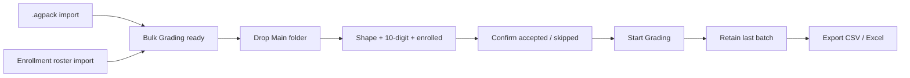
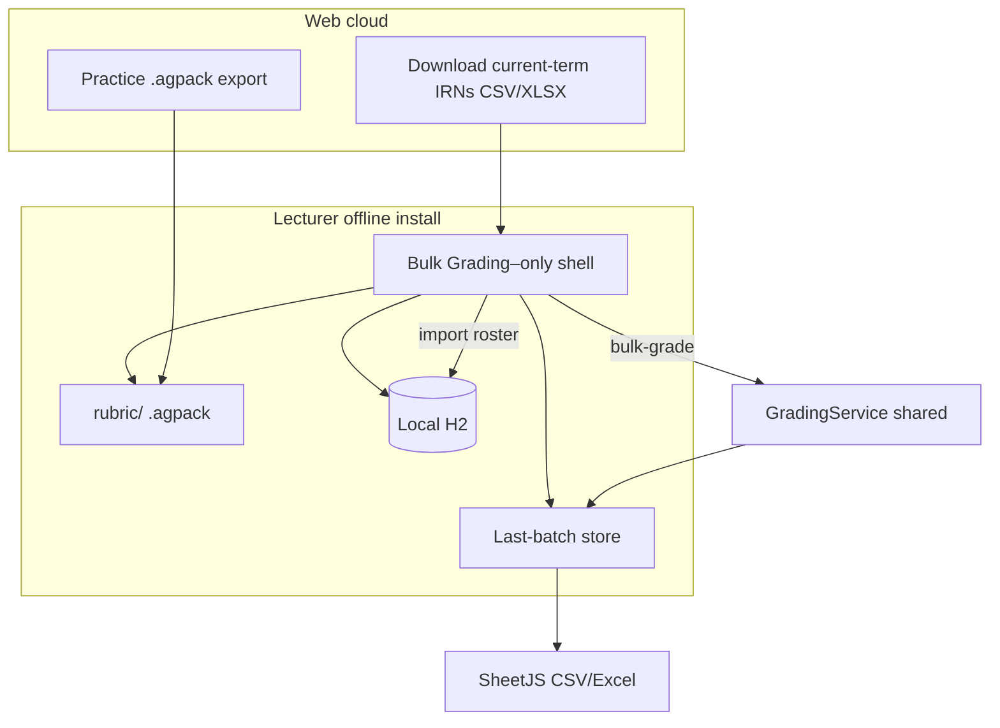
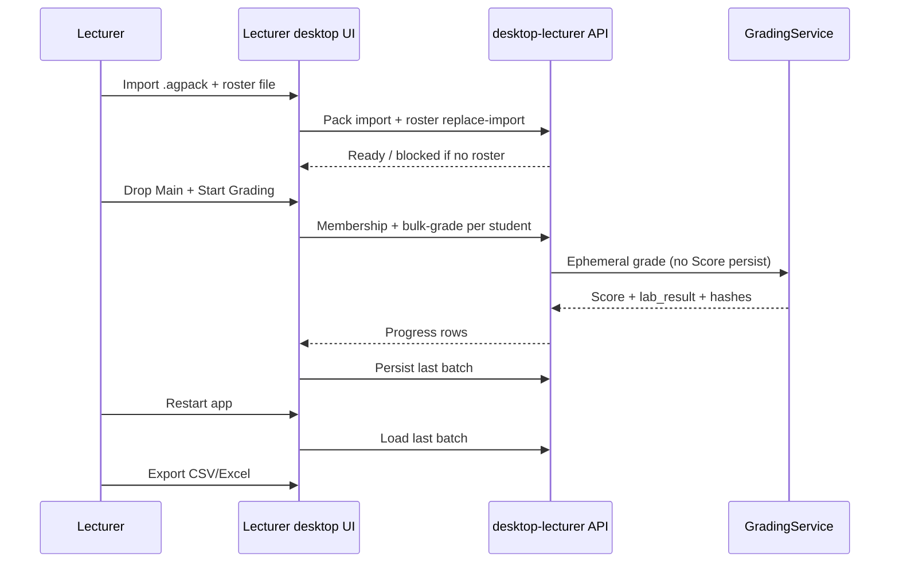

# Lecturer Offline Bulk Grading - Plan

## Goal Capsule

- **Objective:** Deliver a separate Windows lecturer offline distribution whose sole grading job is today’s web Bulk Grading — full parity, no internet — including 10-digit IRN and current-term enrollment gates, local last-batch retention, and CSV/Excel export.
- **Product authority:** This Product Contract. Student practice desktop and web Bulk Grading remain separately owned; this work adds a lecturer-only offline counterpart and must not change student practice behavior.
- **Open blockers:** None.
- **Stop conditions:** Do not change student practice identity/UI/assemble. Do not sync offline bulk results to Score/roster/submissions. Do not share one install with student practice.
- **Execution:** Code.
- **Tail ownership:** Implementer owns unit/integration verification; lecturer smoke of pack+roster import → grade → restart retain → export closes the feature.

---

## Product Contract

**Product Contract preservation:** unchanged (R1–R19, F1–F3, AE1–AE7, Key Decisions preserved). Deferred-to-planning items D1–D4 resolved as KTDs below.

### Summary

Ship a self-contained lecturer offline install (own folder/EXE, parallel to student practice) that opens a Bulk Grading–only shell. Lecturers import the same signed `.agpack` rubric packs and a separate current-term enrollment roster, then run the full web Bulk Grading flow locally. The last finished batch stays on the machine until a new run or explicit clear, and results can be exported to CSV and Excel. Grades never sync to the website Score/roster.

### Problem Frame

Lecturers who need to grade multi-student folder dumps in an exam/lab hall or at home without reliable internet today have no supported path: web Bulk Grading requires connectivity, and the existing desktop product is student practice only. They wait until good internet returns, which delays feedback after offline sessions.

### Key Decisions

- **Separate lecturer distribution** (session-settled: user-directed — chosen over one shared student/lecturer offline app: different job, different install). Governs R1, R2.
- **Bulk Grading–only shell** (session-settled: user-directed — chosen over slim lecturer desk and over multi-batch history: smallest surface that still delivers “current Bulk Grading offline”). Governs R3, R4.
- **Full web Bulk Grading parity** (session-settled: user-directed — chosen over scores-only / thinner cut). Governs R5–R10.
- **Both IRN gates offline** (session-settled: user-directed — chosen over 10-digit-only or neither: exactly 10 digits and enrolled in current term). Governs R11–R14.
- **Separate roster import** (session-settled: user-directed — chosen over embedding IRNs in `.agpack`: packs stay rubric-only; enrollment can refresh independently). Governs R12, R13, R15.
- **Same practice `.agpack` packs for labs** (session-settled: user-directed). Governs R16.
- **Last finished batch retained until new run or clear** (session-settled: user-directed — chosen over web-style ephemeral discard as the durability model). Governs R17.
- **CSV and Excel export** (session-settled: user-approved — added after the “results elsewhere” call-out; revises the earlier no-export durability cut while keeping local retention). Governs R18.
- **No website sync** (session-settled: user-directed — chosen over optional later upload or must-sync: local-only, same product rule as web Bulk Grading for Score/roster). Governs R19.
- **Hall and home/office in one app** (session-settled: user-directed). Framing only.

### Requirements

**Distribution and shell**

- R1. Deliver a Windows x64 lecturer offline distribution as its own install folder/EXE, distinct from the student practice distribution.
- R2. The lecturer distribution must not require the student practice EXE or share a single dual-mode install with students.
- R3. The app opens into a Bulk Grading–focused shell (pack import, roster import, Bulk Grading workspace) without Score, roster management, or other lecturer web nav.
- R4. Student practice desktop behavior and packaging remain unchanged by this work.

**Bulk Grading parity**

- R5. Offline Bulk Grading matches today’s web Bulk Grading flow: select lab, choose Lab or Exam mode, drop Main folder, parse-then-confirm, Start Grading with live progress, results table (Student, ID, Score, Plagiarism, View Submission), within-batch plagiarism, and Score-style submission drawer.
- R6. Lab / Exam folder shapes and mode rules match web Bulk Grading (Lab: `IRN_Name` → `challenge_n`; Exam: flat files under `IRN_Name` for a one-challenge lab).
- R7. Display identity (Student, ID) continues to come from the `IRN_Name` folder name for accepted folders.
- R8. Malformed/skipped folders surface with clear reasons; Start Grading runs only on accepted folders.
- R9. Offline grading uses the same grading logic contract as web Bulk Grading and student practice (declaration / MMD / operational testcases).
- R10. Bulk grades must not create or update lab submissions, progress, Score matrix cells, or reports on any website.

**IRN and term gates**

- R11. On drop/parse, each student folder’s IRN must be exactly 10 digit characters (`0`–`9`); any other length is skipped with a distinct reason.
- R12. That IRN must match a student IRN (`student_code`) in the locally imported current-term enrollment set; not enrolled is skipped with a distinct reason.
- R13. Suspended/inactive enrolled students still pass the membership gate when present in the imported enrollment set (parity with web).
- R14. The same R11–R12 acceptance rules are enforced when a grade request is made, so a client that bypasses the drop UI cannot grade a failing IRN.
- R15. When no usable current-term enrollment roster is imported, the Bulk Grading workspace is blocked with a single clear message (no drop / Start Grading), analogous to web Bulk Grading with no current quarter.

**Packs, retention, export**

- R16. Labs/rubrics load from the same signed practice `.agpack` naming and import rules used by student practice (`Rubric_{yearLabel}_Q{n}.agpack`, `Rubric_{labName}.agpack`).
- R17. After a grade run finishes, that batch’s results remain available across app restart until the lecturer starts a new grade run that replaces them or explicitly clears them.
- R18. From a finished (or retained) batch, the lecturer can export results to both CSV and Excel files on disk.
- R19. There is no path to upload or sync offline bulk results to the production website.

### Actors

- A1. Lecturer — installs the offline app, imports packs and roster, grades a Main folder dump, inspects results, clears or replaces the retained batch, exports CSV/Excel.
- A2. Current-term enrolled student (by IRN) — membership identity only via the imported roster; not an interactive actor.

### Key Flows

- F1. First-time offline ready
  - **Trigger:** Lecturer has the offline install but no usable packs and/or no roster.
  - **Actors:** A1
  - **Steps:** Import `.agpack` packs → import current-term enrollment roster → Bulk Grading becomes available when both labs and roster are usable.
  - **Outcome:** Workspace ready for drop; missing roster keeps Bulk Grading blocked per R15.
  - **Covered by:** R3, R15, R16

- F2. Grade a hall/office dump
  - **Trigger:** Lab + mode set; usable roster present; lecturer drops Main folder.
  - **Actors:** A1, A2
  - **Steps:** Parse folders → apply shape + R11/R12 gates → confirm accepted/skipped → Start Grading → live progress → results with plagiarism and drawer.
  - **Outcome:** Finished batch retained locally (R17); no website writes (R10, R19).
  - **Covered by:** R5–R14, R17, R19

- F3. Take results off the machine
  - **Trigger:** Finished or retained batch is available.
  - **Actors:** A1
  - **Steps:** Lecturer chooses export → writes CSV and/or Excel to a chosen location.
  - **Outcome:** Files usable outside the app without syncing to Score.
  - **Covered by:** R18, R19

### Acceptance Examples

- AE1. Given usable packs and an imported current-term roster, when the lecturer runs Lab/Exam Bulk Grading offline, the flow matches web parity through results, plagiarism, and drawer (Covers R5–R9).
- AE2. Given a folder IRN of 9 or 11 digits, when the Main folder is dropped, that folder is skipped for IRN length even if a matching enrollment exists (Covers R11, R8).
- AE3. Given a 10-digit IRN not present in the imported roster, when dropped, the folder is skipped as not enrolled (Covers R12, R8).
- AE4. Given no imported roster (or an unusable one), when the lecturer opens Bulk Grading, the workspace is blocked and drop/Start Grading are unavailable (Covers R15).
- AE5. Given a finished batch, when the lecturer restarts the app without clearing or starting a new run, the same batch results are still available (Covers R17).
- AE6. Given a retained batch, when the lecturer exports, both CSV and Excel outputs can be produced (Covers R18).
- AE7. Given a finished offline batch, when the lecturer looks for a sync-to-website action, none exists (Covers R10, R19).

### Success Criteria

- A lecturer can complete full-parity Bulk Grading of a multi-student dump with no internet after importing packs + roster.
- IRN length and enrollment gates behave like web Bulk Grading, using the local roster instead of a live API.
- Last batch survives restart until replaced or cleared; CSV and Excel export work from that batch.
- Student practice distribution and website Score/roster remain unaffected.

### Scope Boundaries

**In scope**

- Separate lecturer offline Windows distribution (Bulk Grading–only shell)
- Full web Bulk Grading parity offline, including IRN/term gates
- Same `.agpack` packs; separate current-term enrollment import
- Last-batch local retention; CSV + Excel export
- Hall and home/office use of the same app
- Web lecturer download of current-term enrollment for offline import (enabler)

**Deferred for later**

- Multi-batch local history
- Slim lecturer offline dashboard beyond Bulk Grading
- Optional later upload/sync to the website
- Optional PDF export (web Bulk may offer PDF; R18 is CSV+Excel only)

**Out of scope / non-goals**

- Changing student practice desktop behavior or identity
- Writing offline results into Score, roster, submissions, progress, or reports
- Shared single install for student practice and lecturer bulk grading
- Replacing web Bulk Grading for online use

<!-- ce-section: work-relationships -->
### How This Work Fits Together

This plan owns the **lecturer offline Bulk Grading distribution**. Broader offline/grading surfaces stay separate:

- Student practice desktop (`docs/DESKTOP_STUDENT_DIST.md`, student desktop plans)
  - **Can proceed independently of** this work; **Shares** `.agpack` pack format and grading-engine parity expectation; must not change for this feature.
- Web lecturer Bulk Grading (including IRN/term gates)
  - **Enables** product parity target for this work; remains the online path; **Shares** flow/gates semantics; this plan does not rewrite web Score persistence rules.
- Lecturer pack export on the website
  - **Enables** offline labs via existing practice packs.
- Web current-term enrollment download
  - **Enables** offline roster import (U3); part of this plan, not a follow-up.

### Dependencies / Assumptions

- **Assumption:** Primary actor is any lecturer who already uses web Bulk Grading (persona deep-dive was skipped by request).
- **Assumption:** “Current term” offline means membership in the imported enrollment set the lecturer loaded as the current-term roster.
- **Dependency:** Existing practice pack signing/export continues to supply labs for the lecturer offline app.
- **Constraint:** Grading logic between student dashboard, bulk grading, and offline practice must remain the same; lecturer offline bulk must honor that parity.

### Outstanding Questions

**Resolve Before Planning**

- None.

**Deferred to Implementation**

- I1. Exact lecturer desktop listen port default (recommend **18003** to avoid colliding with student **18002** when both run on one PC) — tune if launcher wiring prefers another free port.
- I2. Whether lecturer offline zip is also streamed from a web download button in v1 or assemble/IT distribution first (assemble script is required; web zip mirror is nice-to-have if practice-bundle pattern is cheap to clone).

### Sources / Research

- `docs/DESKTOP_STUDENT_DIST.md` — student offline distribution contract
- `docs/plans/2026-10-06-001-feat-lecturer-bulk-folder-grading-plan.md` — web Bulk Grading product contract
- `docs/plans/2026-11-13-002-feat-bulk-grading-irn-term-gate-plan.md` — 10-digit IRN + current-term enrollment gates
- `CONCEPTS.md` — Bulk Grading, Local student desktop mode, Local lecturer offline bulk grading, Rubric pack
- Repo research: only student `desktop` profile / `App.desktop.jsx` / `assemble-student-desktop.ps1` exist; Bulk Grading via `BulkGradingPanel` + `LecturerBulkGradingService`; SheetJS `xlsx` already used in `frontend/src/components/lecturer/exportRoster.js` / `frontend/src/utils/studentImport.js` (no Apache POI)

---

## Planning Contract

### Key Technical Decisions

- KTD1. **Parallel `desktop-lecturer` profile + lecturer UI build** (session-settled: user-approved — chosen over one shared `desktop` profile that switches roles: protects R4 and keeps student practice untouched). Separate Spring profile, synthetic local **LECTURER** principal, `App` lecturer-desktop entry, and `scripts/assemble-lecturer-desktop.ps1` producing a distinct EXE/folder. Expand shared desktop infrastructure beans currently `@Profile("desktop")` (H2, pack bootstrap, local security) so they also activate for the lecturer desktop profile (or an explicit shared profile group) — do not duplicate that stack. Governs R1–R4.
- KTD2. **Reuse pack pipeline as-is** — Lecturer install uses the same `DesktopPack*` import/bootstrap/fingerprint contract and `.agpack` names; do not invent a second pack format. Governs R16.
- KTD3. **Materialize imported roster into local H2 as term + stub accounts + enrollments** so existing `GET /api/lecturer/bulk-grading/current-term-student-irns` and `LecturerBulkGradingService.requireValidBulkIrn` keep working offline. Replace-import: ensure a local current term exists; upsert stub `user_account` rows keyed by `student_code`; replace enrollment rows for that term; IRNs listed as inactive/suspended still pass membership. Do **not** call cloud `TermService.importStudents` unchanged (it matches pre-existing cloud accounts). Governs R11–R15.
- KTD4. **Web download of current-term IRNs** (session-settled: user-approved — chosen over hand-made-file-only): lecturer JWT endpoint or file download (CSV + Excel) from the same membership set as `listCurrentTermStudentIrns`, placed on Term/Grading UI. Offline app imports that file. Governs R12, R15; enables F1.
- KTD5. **Roster file contract** — Primary column `student_code` (10-digit IRN); extra columns ignored. Accept CSV and Excel via existing frontend SheetJS patterns (`studentImport.js` / lecturer `exportRoster.js`). **Unparseable import:** reject and keep the prior roster unchanged. **Successful import of zero IRNs:** clear membership and block Bulk (R15). Never leave a half-applied roster. Governs R12, R15 (roster download/import shape; not results export R18).
- KTD6. **Reuse `BulkGradingPanel` + bulk parse/grade APIs** inside the lecturer-desktop shell (labs from pack-loaded local DB; membership from local roster). Strip/hide web-only chrome (Score nav, sync affordances). Governs R5–R10, R19.
- KTD7. **Retained last batch as local durable store** under `APP_DESKTOP_HOME` (H2 table or JSON file — pick one in implementation; prefer one blob keyed as “last batch”). Load on shell open; **Start Grading** that completes replaces it; explicit **Clear** removes it. Not a multi-run history. Governs R17.
- KTD8. **CSV + Excel export via existing SheetJS helpers** (session-settled: user-approved — chosen over adding Apache POI): reuse/adapt `frontend/src/components/lecturer/exportRoster.js` against retained/in-memory results; PDF out of scope for R18. Governs R18.
- KTD9. **Unlock-free local lecturer identity** — parallel to student `DesktopLocalIdentity`, but `LECTURER` role and distinct email/IRN constants so UI role gates work without Google/JWT cloud. Governs R3; supports R10/R19.

### High-Level Technical Design

### Assumptions

- Web Bulk Grading PDF export (if present) is not required offline.
- Lecturer desktop may use a different default port than student practice (recommend 18003) so both can run on one machine.
- Frontend still has no automated test runner; FE verification is `npm run build` + manual smoke.
- External Excel library on the backend is unnecessary if download/export stay SheetJS on the SPA (cloud download can generate CSV server-side and Excel client-side, or both client-side from the IRN JSON list).

### Alternatives Considered

- **Shared desktop profile with role switch** — Rejected (KTD1): higher risk of breaking student practice; conflicts with separate-distribution product decision.
- **Embed IRNs inside `.agpack`** — Rejected at brainstorm: packs stay rubric-only; enrollment refreshes independently.
- **Apache POI on backend for Excel** — Rejected (KTD8): repo already has SheetJS CSV/Excel paths; avoids new Java dependency.

### Implementation Constraints

- Controllers stay thin; grading stays in `GradingService` / `LecturerBulkGradingService` (no Score persist).
- Student `desktop` profile beans, `App.desktop.jsx`, and `assemble-student-desktop.ps1` must remain behavior-compatible (R4).
- Spring Security default-deny on cloud unchanged; lecturer desktop mirrors student desktop’s local permit model but with lecturer principal.
- DOX: update nearest AGENTS.md / `docs/DESKTOP_*` when distribution contracts change; keep grading parity note across dashboards.

### Sequencing

1. U1 — lecturer desktop shell scaffold (profile, identity, SPA entry, assemble stub)  
2. U2 — pack import parity on lecturer home  
3. U3 — web roster download + offline roster replace-import + Bulk block when empty  
4. U4 — wire Bulk Grading panel + gates on lecturer desktop  
5. U5 — retained last batch + clear/replace  
6. U6 — CSV/Excel export from retained/live results  
7. U7 — docs + assemble finalize / smoke checklist  

### Risks & Mitigations

| Risk | Mitigation |
|---|---|
| Shared code changes break student practice | Keep profile/entry/assemble separate; regression smoke student practice after pack-path edits |
| Roster import creates fake Score users | Materialize only what membership/grade gates need; never expose Score UI; no cloud sync |
| Retained batch grows huge | Store one last batch only; clear/replace semantics; avoid multi-history |
| Port collision with student desktop | Default distinct port; document in assemble/README |

### Research Notes

- Student assemble: `scripts/assemble-student-desktop.ps1`; UI `frontend/src/App.desktop.jsx`; identity `DesktopLocalIdentity` / `DesktopAuthenticationFilter`.
- Bulk: `BulkGradingPanel.jsx`, `bulkFolderParse.js`, `LecturerBulkGradingService`, membership GET already exists on cloud.
- Export/import SheetJS: `frontend/src/components/lecturer/exportRoster.js`, `frontend/src/utils/studentImport.js`.

---

## Implementation Units

### U1. Lecturer desktop shell scaffold

- **Goal:** Separate unlock-free lecturer offline host that boots a Bulk Grading–oriented SPA without touching student practice.
- **Requirements:** R1–R4
- **Dependencies:** None
- **Files:**
  - New lecturer-desktop Spring config / profile beans parallel to `application-desktop.yml` and `Desktop*` auth (do not overwrite student identity constants)
  - `frontend` lecturer-desktop entry (`App` + vite mode/env parallel to `build:desktop`)
  - `scripts/assemble-lecturer-desktop.ps1` (stub → full in U7)
  - Tests under `backend/src/test/java/integration/...` for lecturer-desktop profile context
- **Approach:**
  - Synthetic local LECTURER principal (KTD9).
  - Remap shared `@Profile("desktop")` infrastructure to also include the lecturer desktop profile (KTD1); keep student identity constants separate.
  - Distinct install home / EXE name / default port from StudentPractice (KTD1, I1).
  - Shell chrome: Exit, theme, pack import, roster import placeholders, Bulk Grading mount point — no Score/Ranking/shop.
- **Execution note:** Smoke-first for assemble/profile wiring; unit-test identity/role exposure.
- **Test scenarios:**
  - Lecturer-desktop profile starts and serves UI status ready endpoint shape (H2 + pack stack loaded).
  - Principal has LECTURER (not STUDENT-only practice identity).
  - Student `desktop` profile still boots and its context/pack tests pass unchanged.
- **Verification:** Targeted `mvn test` for new integration/context tests; student desktop context test still green.

### U2. Pack import on lecturer install

- **Goal:** Same `.agpack` import/bootstrap as student practice, on the lecturer home folder.
- **Requirements:** R16, R4
- **Dependencies:** U1
- **Files:**
  - Reuse `DesktopPackController` / stage/bootstrap services under lecturer-desktop profile (or shared beans activated for both desktop profiles)
  - Lecturer shell pack-import UI (mirror student import UX: Okay → restart if required by existing pack contract)
  - Integration tests parallel to `DesktopPackImportIntegrationTest` scoped to lecturer-desktop where needed
- **Approach:**
  - KTD2: no new pack format; fingerprint/eager materialize rules unchanged.
  - Ensure student assemble path and student pack tests remain untouched.
- **Test scenarios:**
  - Valid quarter/lab pack imports and labs appear for Bulk lab picker.
  - Invalid pack rejected with specific reason.
  - Student pack import regression still passes.
- **Verification:** `mvn test` pack import/integration subset.

### U3. Current-term roster download (web) + offline import

- **Goal:** Lecturers can download current-term enrolled IRNs online and import them offline; Bulk blocks without a usable roster.
- **Requirements:** R12, R13, R15
- **Dependencies:** U1 (offline import); web half can proceed in parallel after KTD4
- **Files:**
  - Cloud: download endpoint or SPA export from existing membership list (`LecturerBulkGradingMembershipController` / service)
  - Term or Grading UI control for download (CSV + Excel)
  - Offline: roster import API that replace-imports into local H2 current-term enrollment (KTD3, KTD5)
  - `backend/src/test/java/unit/...` and/or `authorization/...` for download + offline import
  - Frontend SheetJS parse reuse from `studentImport.js` patterns
- **Approach:**
  - Download content = non-blank `student_code` for current-term enrollments including inactive (same set as membership GET); 409 when no current quarter.
  - Offline replace-import per KTD3 (local current term + stub accounts + enrollments).
  - Import failure rules per KTD5: unparseable → keep prior; successful zero-IRN file → clear membership and block Bulk.
  - Do not use cloud `TermService.importStudents` matching logic for offline materialization.
- **Test scenarios:**
  - Cloud: current term with active+inactive → both IRNs in download; no current term → 409/blocked; student JWT → 403.
  - Offline: import file with IRNs → stub accounts + enrollments exist; membership GET returns them; Bulk unblocked; grade gate accepts those IRNs.
  - Offline: no roster → Bulk blocked single message (AE4).
  - Offline: re-import replaces previous set.
  - Offline: unparseable file → prior roster unchanged; successful empty IRN list → membership cleared and Bulk blocked.
- **Verification:** `mvn test` for membership/import tests; `npm run build`; manual download→copy→import smoke.

### U4. Bulk Grading parity on lecturer desktop

- **Goal:** Full web Bulk Grading flow offline against pack labs + local roster gates.
- **Requirements:** R5–R14, R19
- **Dependencies:** U2, U3
- **Files:**
  - `frontend/src/components/lecturer/BulkGradingPanel.jsx` (reuse; desktop wiring)
  - `frontend/src/utils/bulkFolderParse.js` (already has IRN gates — feed local membership set)
  - Lecturer-desktop lab list / bootstrap equivalent for grading labs from local DB
  - Ensure `LecturerBulkGradingService` + remapper available on lecturer-desktop profile
  - Unit tests already covering gates remain green; add desktop-profile smoke/integration if needed
- **Approach:**
  - KTD6: mount Bulk panel as the primary workspace; hide sync/Score affordances.
  - Membership fetch uses local API; no-roster uses same block UX as no-current-quarter on web.
  - Grade path remains ephemeral (no UploadPersist/Score); within-batch plagiarism only.
- **Execution note:** Characterization-friendly — reuse existing `LecturerBulkGradingServiceTest` gate cases; add desktop wiring smoke.
- **Test scenarios:**
  - AE1 happy path Lab and Exam shapes.
  - AE2/AE3 skip reasons on drop; server refuses bad IRN (R14).
  - Suspended/inactive IRN in imported set grades (R13).
  - No website persist side effects (R10/R19) — assert service still skips persist collaborators.
- **Verification:** `mvn test` bulk service tests; `npm run build`; manual grade smoke.

### U5. Retain last finished batch

- **Goal:** Finished batch survives restart until new completed run or explicit clear.
- **Requirements:** R17
- **Dependencies:** U4
- **Files:**
  - New local store service under lecturer-desktop (H2 or file under `APP_DESKTOP_HOME`)
  - Bulk panel load/save/clear hooks
  - Unit tests for replace/clear/load
- **Approach:**
  - KTD7: one last-batch blob; completing Start Grading replaces; Clear empties; shell open hydrates results table when present.
  - Do not imply multi-batch history UI.
- **Test scenarios:**
  - AE5: finish → restart → same rows available.
  - New completed run replaces previous retained batch.
  - Clear → empty state; Bulk still usable for a new drop.
- **Verification:** Unit tests for store; manual restart smoke.

### U6. CSV and Excel export

- **Goal:** Export retained or just-finished results to CSV and Excel.
- **Requirements:** R18, R19
- **Dependencies:** U4 (live rows); U5 (retained rows)
- **Files:**
  - `frontend/src/components/lecturer/exportRoster.js` (reuse/adapt columns for bulk results)
  - `BulkGradingPanel.jsx` export actions (CSV + Excel; omit PDF if present on web)
- **Approach:**
  - KTD8: reuse the existing Bulk Grading Export menu path for CSV and Excel on live and retained rows; hide/omit PDF offline.
  - Columns at least Student, ID, Score, Plagiarism (web pillar columns may stay if already present).
  - No upload/sync control adjacent to export.
- **Test scenarios:**
  - AE6: export CSV and Excel from retained batch produce downloadable files.
  - Export disabled/hidden when no batch.
  - Offline shell does not offer PDF export.
  - Manual: open Excel/CSV and confirm IRN/score rows.
- **Verification:** `npm run build`; manual export smoke.

### U7. Assemble finalize + durable docs

- **Goal:** Shipable lecturer folder/zip and docs matching the new distribution.
- **Requirements:** R1, R4 (docs); system-wide discoverability
- **Dependencies:** U1–U6 behavior settled
- **Files:**
  - `scripts/assemble-lecturer-desktop.ps1` complete (JDK, jars, UI dist, EXE name)
  - `docs/DESKTOP_LECTURER_DIST.md` (or extend desktop docs with a lecturer section)
  - `docs/DESKTOP_STUDENT_DIST.md` — cross-link only; no behavior change
  - `backend/AGENTS.md`, `frontend/AGENTS.md`, root `AGENTS.md` Child DOX Index as needed
  - `CONCEPTS.md` Local lecturer offline bulk grading — align with shipped behavior
- **Approach:**
  - Document pack + roster prerequisites, port, import/restart, retain/clear/export.
  - Note grading parity invariant across web bulk, student practice, lecturer offline.
- **Test scenarios:** N/A (doc + assemble dry-run)
- **Verification:** Assemble script completes; unzip + smoke F1–F3; student assemble still works.

---

## Verification Contract

- **Backend:** From `backend/`, run targeted `mvn test` for new/changed lecturer-desktop, roster, bulk, and pack tests; full `mvn test` before merge when feasible.
- **Frontend:** `npm run build` and lecturer-desktop build script (parallel to `npm run build:desktop`).
- **Assemble:** `scripts/assemble-lecturer-desktop.ps1` produces a runnable folder; student `assemble-student-desktop.ps1` still produces practice zip.
- **Manual smoke:** Import pack + roster → grade Lab dump → restart → retained results → export CSV/Excel → Clear; confirm student practice EXE unchanged.
- **Quality gates:** No Score/roster sync affordance; R4 student practice regression.

---

## Definition of Done

- All U1–U7 complete with their verification steps green.
- R1–R19 satisfied; AE1–AE7 demonstrable on the lecturer offline install.
- Product Contract IDs unchanged; docs/DOX updated for the new distribution.
- Student practice desktop behavior unchanged.
- Ready for `ce-work` / PR without unresolved Resolve-Before-Planning questions.
