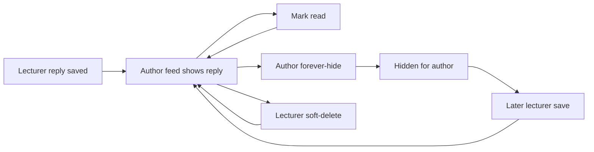
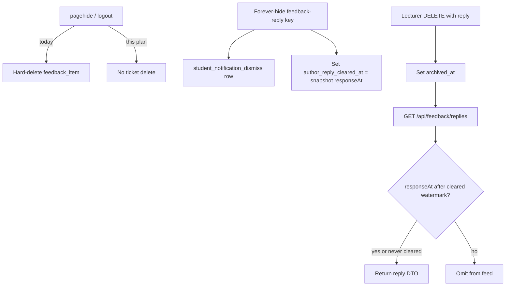

# Feedback Reply Independence - Plan

## Goal Capsule

- **Objective:** Keep lecturer feedback tickets and author-facing reply notifications on independent lifecycles so mark-read, student clear, and lecturer delete no longer destroy each other.
- **Product authority:** this plan (Product Contract below).
- **Open blockers:** none.
- **Stop conditions:** Do not detach replies into a separate delivery table. Do not add a new student delete button beyond forever-hide. Do not change who may reply, reply length, or Resolved-only reply rules. Do not mount Feedback or the bell on desktop. Do not purge soft-archived attachment bytes.
- **Execution profile:** software — operator SQL + startup migrator + FeedbackService watermark + dismiss hook + SPA leave-path removal.
- **Tail ownership:** implementer runs `mvn test` from `backend/` and `npm run build` from `frontend/`; operator SQL is mirrored by the startup migrator on PostgreSQL.
- **Product Contract preservation:** unchanged — planning adds HOW sections; deferred Outstanding Questions resolved into KTDs.

<!-- ce-section: work-relationships -->
## How This Work Fits Together

This plan owns **independent feedback ↔ reply lifecycles** (stop leave-path hard-delete, author-cleared watermark, forever-hide → clear).

- Soft-archive durability (`docs/plans/2026-10-20-003-feat-feedback-reply-durability-plan.md`)
  - **Depends on:** `archived_at` and author `GET /replies` including archived rows already shipped.
  - **Shares:** Lecturer delete soft-archive vs hard-delete rules (unchanged here except leave-path no longer undoes them).
- Student notification dismiss (`docs/plans/2026-11-15-002-feat-student-notif-delete-read-plan.md`)
  - **Depends on:** Durable dismiss keys and forever-hide UX already on the bell.
  - **Supersedes:** That plan’s stop-condition “do not change feedback-reply consume-on-leave” — this work intentionally replaces consume-on-leave hard-delete.
- Student notification read receipts (`docs/plans/2026-11-15-001-feat-student-notif-read-receipts-plan.md`)
  - **Shares:** Mark-read stays durable and does not remove listed items; this plan relies on that for R1.

---

## Product Contract

### Summary

Mark-read keeps a reply notification listed.
Student clear removes that reply snapshot from the author’s feed only and leaves the feedback ticket alone.
Lecturer soft-delete hides the ticket from the inbox without wiping the author’s still-uncleared reply.
A later lecturer save on the same ticket can notify the author again.

### Problem Frame

Today the author’s leave path hard-deletes feedback rows that carry a lecturer reply.
Marking a reply read, then reloading, removes the notification and the ticket together.
Lecturer soft-archive already preserves replies after inbox delete, but the leave-path hard-delete undoes that durability and also deletes tickets the lecturer still needed.

### Key Decisions

- **Author-cleared watermark over detached reply store.** (session-settled: user-approved — chosen over a separate reply-delivery table and over forever-hide-only: clears the student feed for that snapshot without deleting the ticket, with less carrying cost than dual-write of a second reply entity.) Governs R3–R6.
- **Clear covers that reply snapshot only.** (session-settled: user-directed — chosen over never-notify-again for that ticket: a later lecturer save can reappear.) Governs R5, R6.
- **Student clear uses the bell’s existing forever-hide control for feedback replies.** (session-settled: user-approved — confirmed with the scoping synthesis call-out: no new delete button.) Governs R3.
- **Full independent lifecycle, not a leave-path-only patch.** (session-settled: user-directed — chosen over “just stop reload wipe + reuse forever-hide.”) Governs R1–R8.

### Actors

- A1. **Author** — usually a student; any signed-in user who submitted the feedback item and sees lecturer replies in the student notification bell.
- A2. **Lecturer** — resolves feedback, writes a short reply, may soft-delete Resolved items from the inbox.
- A3. **System** — lists uncleared replies for the author; records author clear without deleting the ticket; keeps soft-archived replies available until cleared.

### Requirements

**Notification durability**

- R1. Marking a feedback-reply notification read does not remove it from the author’s bell list.
- R2. Reloading, navigating away, or logging out does not delete the feedback ticket and does not remove an uncleared reply from the author’s feed.

**Author clear**

- R3. When the author forever-hides a feedback-reply notification, that reply snapshot leaves their feed and does not return until R5.
- R4. Author clear never deletes, archives, or otherwise removes the lecturer’s feedback ticket (including attachments and reply text the lecturer still sees on a non-archived item).
- R5. After an author clear, if the lecturer later saves a new reply on the same ticket, the author sees a new notification for that new reply.
- R6. Author clear applies only to the reply snapshot that was cleared; an earlier clear must not block R5.

**Lecturer delete**

- R7. When a lecturer deletes a Resolved item that has a reply, the item leaves the lecturer inbox and any still-uncleared author reply remains available in the author’s feed until R3.
- R8. Lecturer delete of a Resolved item with no reply may hard-delete as today; this work does not change that no-reply path beyond preserving R2’s leave-path rule.

**Unchanged lecturer reply rules**

- R9. Reopen-to-Open that clears the reply on a still-visible inbox item stays as today.

### Key Flows

- F1. **Mark read, then reload**
  - **Trigger:** Author marks a reply notification read, then reloads or returns later.
  - **Actors:** A1, A3
  - **Steps:** Notification stays listed (read); feedback ticket still exists for the lecturer if it was not soft-deleted; reply remains in the author feed until clear.
  - **Covered by:** R1, R2

- F2. **Author clears a reply**
  - **Trigger:** Author uses the bell forever-hide control on a feedback-reply notification.
  - **Actors:** A1, A3
  - **Steps:** That reply snapshot disappears from the author feed; lecturer ticket and reply text remain for the lecturer.
  - **Covered by:** R3, R4, R7

- F3. **Lecturer soft-deletes after reply**
  - **Trigger:** Lecturer deletes a Resolved item that has a reply while the author has not cleared it.
  - **Actors:** A2, A1, A3
  - **Steps:** Item leaves the lecturer inbox; author’s bell still shows the reply until clear.
  - **Covered by:** R7

- F4. **New reply after clear**
  - **Trigger:** After F2, lecturer saves a new reply on the same ticket (still visible or after reopen/resolve as allowed today).
  - **Actors:** A2, A1, A3
  - **Steps:** Author receives a new notification for the new reply snapshot.
  - **Covered by:** R5, R6

### Acceptance Examples

- AE1. **Covers R1, R2.** Given a reply in the bell, when the author marks it read and reloads, then the notification is still listed (read) and the lecturer still has the ticket if they have not soft-deleted it.
- AE2. **Covers R3, R4.** Given a reply in the bell, when the author forever-hides it, then it is gone from their feed and the lecturer’s feedback item still exists with its reply text.
- AE3. **Covers R7.** Given a Resolved item with reply text, when the lecturer deletes it and the author has not cleared that reply, then the lecturer inbox no longer lists it and the author’s bell still shows the reply.
- AE4. **Covers R5, R6.** Given the author cleared reply snapshot A, when the lecturer saves a new reply B on the same ticket, then the author’s bell shows B and does not resurrect A.

### Scope Boundaries

**In scope**

- Stop leave-path hard-delete of feedback tickets for shown replies.
- Author clear of a reply snapshot without deleting the ticket.
- Preserve lecturer soft-archive durability for uncleared replies.
- Re-notify on a later lecturer save after clear.
- Map author clear to the existing forever-hide control for feedback-reply notifications.

**Out of scope**

- Lecturer restore UI for soft-archived items.
- Detached reply-delivery tables beyond the watermark approach.
- Changing who may reply, reply length limits, or Resolved-only reply rules.
- Desktop Feedback (still absent).
- Email or other out-of-app channels.
- Purging attachment `bytea` on soft-archived rows.

### Deferred to Follow-Up Work

- Opportunistic hard-delete of soft-archived rows after the author has cleared the latest reply snapshot (storage reclaim).
- Align soft-archive with a startup migrator (today operator SQL only); this plan’s watermark column uses the newer migrator style without backfilling that gap for `archived_at`.

### Dependencies / Assumptions

- Builds on existing soft-archive (`archived_at`) for lecturer delete with a reply.
- Builds on durable student notification read/dismiss APIs already used by the bell.
- Prior plan `docs/plans/2026-10-20-003-feat-feedback-reply-durability-plan.md` delivered soft-archive and short `Re:` titles; this work replaces the leave-path hard-delete contract that still couples reply consumption to ticket deletion.

### Outstanding Questions

None blocking. Former deferred items resolved in KTD1–KTD4.

### Sources / Research

- Leave-path hard-delete: `FeedbackService.consumeRepliesForAuthor` and SPA `frontend/src/utils/feedbackReplyConsume.js` (pagehide / logout).
- Soft-archive delete: `FeedbackService.deleteResolved`; author list includes archived rows via `listRepliesForAuthor`.
- Bell read/dismiss: `frontend/src/components/student/StudentNotificationBell.jsx`; reply notification ids include `responseAt` in `buildFeedbackReplyNotifications`.
- Current domain note still documents consume-on-leave hard-delete: `CONCEPTS.md` Feedback status.
- No `docs/solutions/` entries for this area; 001/002 stop-conditions explicitly left consume-on-leave alone until this plan.

---

## Planning Contract

### Key Technical Decisions

- KTD1. **Nullable `feedback_item.author_reply_cleared_at` watermark.** Store the cleared reply snapshot’s `response_at` (UTC `OffsetDateTime`). `listRepliesForAuthor` returns rows with non-blank `lecturer_response` where `author_reply_cleared_at` is null or `response_at` is after that watermark. A later `saveResponse` (new `response_at`) reappears. Governs R3–R6. (Resolves deferred persistence shape.)
- KTD2. **Clear advances the watermark from the forever-hide key’s snapshot, not from item id alone.** Parse `feedback-reply-{itemId}-{responseAt}` on dismiss; set `author_reply_cleared_at` to that snapshot’s `responseAt` for an owned item. Clearing by item UUID alone cannot satisfy R5/R6 under concurrent new replies. Governs R5, R6.
- KTD3. **Dual-write on forever-hide: dismiss key + watermark.** (Chosen on continue after scoping call-out — preferred over watermark-only: forever-hide already writes dismiss keys for all bell types; watermark is the server feed truth for `GET /replies`.) Keep existing dismiss-after-read rules. Governs R3.
- KTD4. **Stop leave-path hard-delete.** Remove SPA `consumeFeedbackRepliesOnLeave` callers (`pagehide`, logout). `consumeRepliesForAuthor` must not `deleteAll` tickets; prefer no-op or remove the hard-delete path while keeping auth coverage for any retained DELETE if still needed. Governs R1, R2, R4, R8.
- KTD5. **Startup migrator + operator SQL for the watermark column.** Mirror `LabPrefixSchemaMigrator` / `StudentNotificationDismissSchemaMigrator` (`@Profile("!desktop")`, `ADD COLUMN IF NOT EXISTS`) plus `docs/sql/` operator file and `SchemaMigratorCatalogTest` entry. Soft-archive remains operator-only; do not expand that gap here. Governs R3–R6.
- KTD6. **Compare `OffsetDateTime` on the entity for list/clear.** Do not re-stringify Jackson `Asia/Ho_Chi_Minh` wall clocks when deciding visibility. Governs R5, R6.

### High-Level Technical Design

### Assumptions

- User “continue” after the dual-write vs watermark-only call-out accepts dual-write (KTD3).
- Soft-archive (`archived_at`) remains applied on Neon/local; this work does not add a migrator for that column.
- Desktop Feedback stays absent; watermark column may exist unused under desktop Hibernate if the entity is scanned.

### Sequencing

1. U1 — Stop leave-path hard-delete (SPA + service).
2. U2 — Watermark column, list filter, dismiss → clear hook, unit tests.
3. U3 — DOX / CONCEPTS / AGENTS alignment.

### Risks

- **Clear-by-item-id race:** setting watermark to `now()` or ignoring snapshot `responseAt` can hide a newer reply — mitigated by KTD2.
- **Forgotten SPA leave callers:** `App.jsx` and `StudentNotificationBell.jsx` both register consume — both must stop calling hard-delete.
- **Jackson offset drift in keys:** dismiss keys embed serialized `responseAt`; parse carefully and prefer entity `OffsetDateTime` equality when matching the live row’s current snapshot for clear eligibility.
- **001/002 stop-condition drift:** docs and future readers may still assume consume-on-leave — U3 updates CONCEPTS and AGENTS.

### System-Wide Impact

- Schema: one nullable timestamptz on `feedback_item`.
- Author `DELETE /api/feedback/replies` semantics change from hard-delete to no-op or unused; forever-hide becomes the clear path.
- Lecturer soft-archive and reopen-clear-reply paths unchanged.
- Intentionally supersedes the consume-on-leave freeze in student notif plans 001/002.

### Documentation / Operational Notes

- New operator SQL under `docs/sql/`; Child DOX Index row in root `AGENTS.md` and notes in `backend/AGENTS.md`.
- Rewrite `CONCEPTS.md` Feedback status: remove consume-on-leave hard-delete; describe watermark clear + soft-archive durability.
- Update `frontend/src/components/student/AGENTS.md` and `backend/.../service/AGENTS.md` FeedbackService rows.
- Update soft-archive SQL comment that still mentions reload/logout consume.

---

## Implementation Units

### U1. Stop leave-path hard-delete

**Goal:** Reloading, navigating away, or logging out never hard-deletes feedback tickets that carry lecturer replies.

**Requirements:** R1, R2, R4, R8; F1; AE1

**Dependencies:** none

**Files:**
- `frontend/src/utils/feedbackReplyConsume.js`
- `frontend/src/components/student/StudentNotificationBell.jsx`
- `frontend/src/App.jsx`
- `backend/src/main/java/com/eiu/capstone/backend/service/FeedbackService.java`
- `backend/src/main/java/com/eiu/capstone/backend/controller/FeedbackController.java` (only if DELETE contract comments/docs change)
- `backend/src/test/java/unit/com/eiu/capstone/backend/service/FeedbackServiceInboxTest.java`
- `backend/src/test/java/authorization/com/eiu/capstone/backend/controller/FeedbackCreateAuthorizationTest.java`

**Approach:**
1. Remove or no-op `consumeFeedbackRepliesOnLeave` and unregister `pagehide` / logout callers that fire it.
2. Change `consumeRepliesForAuthor` so it never `deleteAll` owned replied items (no-op is enough if the SPA stops calling; keep auth test green if the route remains).
3. Replace the inbox test that expects hard-delete with “consume does not delete.”

**Patterns to follow:** Existing Mockito style in `FeedbackServiceInboxTest`; SPA leave helpers that must not block unload.

**Test scenarios:**
- Covers AE1. Given owned replied items (including soft-archived), when `consumeRepliesForAuthor` runs with those ids, then repository `deleteAll` is never called and rows remain.
- Empty ids remain a no-op.
- Authorization: student JWT can still hit DELETE `/api/feedback/replies` if the route is retained (no 403 regression).

**Verification:** Updated unit/auth tests pass under `mvn test` from `backend/`; SPA no longer registers leave-path consume.

---

### U2. Author-cleared watermark and forever-hide clear

**Goal:** Forever-hiding a feedback-reply notification clears that reply snapshot from `GET /replies` without deleting the ticket; a later lecturer save reappears.

**Requirements:** R3–R7; F2–F4; AE2–AE4

**Dependencies:** U1 (leave-path must not wipe tickets before clear can matter)

**Files:**
- `docs/sql/2026-11-15-feedback-author-reply-cleared.sql` (new)
- `docs/sql/2026-10-13-schema-baseline-reconstructed.sql` (add column if `feedback_item` listed)
- `docs/sql/2026-10-20-feedback-inbox.sql` and/or soft-archive sibling comments as needed for greenfield
- `backend/src/main/java/com/eiu/capstone/backend/config/FeedbackAuthorReplyClearedSchemaMigrator.java` (new; name may vary)
- `backend/src/test/java/unit/com/eiu/capstone/backend/config/SchemaMigratorCatalogTest.java`
- `backend/src/main/java/com/eiu/capstone/backend/model/FeedbackItem.java`
- `backend/src/main/java/com/eiu/capstone/backend/repository/FeedbackItemRepository.java` (only if query methods need watermark predicates)
- `backend/src/main/java/com/eiu/capstone/backend/service/FeedbackService.java`
- `backend/src/main/java/com/eiu/capstone/backend/service/StudentNotificationDismissService.java`
- `backend/src/test/java/unit/com/eiu/capstone/backend/service/FeedbackServiceInboxTest.java`
- `backend/src/test/java/unit/com/eiu/capstone/backend/service/StudentNotificationDismissServiceTest.java`

**Approach:**
1. Add nullable `author_reply_cleared_at TIMESTAMPTZ` via operator SQL + `!desktop` startup migrator; register in catalog test.
2. Entity field + getters/setters; list filter per KTD1 (in-memory filter after existing author query is fine at low volume).
3. On dismiss of a key prefixed `feedback-reply-`, parse item id + snapshot `responseAt`, verify ownership, set `author_reply_cleared_at` to that snapshot time; still insert the dismiss row (KTD3).
4. Leave `deleteResolved` soft-archive and reopen-clear-reply unchanged; confirm uncleared archived replies still list until watermark clears them.
5. Do not clear by item UUID alone without the snapshot time from the key.

**Patterns to follow:** `LabPrefixSchemaMigrator`; `StudentNotificationDismissService` dismiss-after-read; `FeedbackServiceInboxTest` soft-archive cases; notification key prefix validation already allowing `feedback-reply-`.

**Execution note:** Extend existing Mockito service tests before changing list/dismiss behavior.

**Test scenarios:**
- Covers AE2. Forever-hide / dismiss of `feedback-reply-{id}-{responseAt}` sets watermark and does not delete the item; lecturer detail still loads when not archived.
- Covers AE4. After clear of snapshot A, `listRepliesForAuthor` omits the row while `response_at` equals A; after `saveResponse` with later `response_at` B, the row returns again.
- Covers AE3. Soft-archived uncleared reply still appears in author list; after watermark clear it does not.
- Dismiss without prior read still rejected (existing rule).
- Non-`feedback-reply-` dismiss keys do not touch `FeedbackItem`.
- Malformed feedback-reply keys do not throw 500 / do not delete tickets.

**Verification:** Extended unit tests pass under `mvn test` from `backend/`.

---

### U3. Domain and AGENTS alignment

**Goal:** Docs match independent lifecycles so operators and agents stop teaching consume-on-leave hard-delete.

**Requirements:** R2, R3, R7 (documentation of shipped behavior)

**Dependencies:** U1, U2

**Files:**
- `CONCEPTS.md` (Feedback status)
- `AGENTS.md` (Child DOX Index SQL row)
- `backend/AGENTS.md`
- `backend/src/main/java/com/eiu/capstone/backend/service/AGENTS.md`
- `frontend/src/components/student/AGENTS.md`
- `docs/sql/2026-10-20-feedback-soft-archive.sql` (comment only)
- `docs/sql/README.md` (inventory row if that table lists feedback SQL)

**Approach:**
1. Rewrite Feedback status: soft-archive keeps uncleared author replies; author forever-hide clears that snapshot via watermark; leave/reload does not delete tickets.
2. Index the new operator SQL; update FeedbackService and StudentNotificationBell contract lines.
3. Fix soft-archive SQL header comment that still mentions reload/logout consume.

**Test scenarios:**
- Test expectation: none — documentation-only unit.

**Verification:** Manual scan of cited docs for leftover “consume hard-delete” / “reload deletes feedback” wording; `npm run build` from `frontend/` still succeeds if no code changes remain in this unit.

---

## Verification Contract

- Backend: `mvn test` from `backend/` includes updated `FeedbackServiceInboxTest` and `StudentNotificationDismissServiceTest` scenarios for no hard-delete on consume, watermark clear, and reappear after new reply.
- Frontend: `npm run build` from `frontend/` after SPA leave-path removal.
- Operator: watermark column applied via startup migrator on cloud PostgreSQL; operator SQL exists for manual/greenfield use.
- Manual: reply → mark read → reload → reply and ticket remain; forever-hide → reply gone from bell/feed, ticket remains for lecturer; lecturer soft-delete → uncleared reply still visible; new reply after clear → new notification.

## Definition of Done

- Product Contract R1–R9 implemented as written.
- U1–U3 complete per their Verification fields.
- Verification Contract commands pass.
- KTD1–KTD6 reflected in code and docs.
- No detached reply-delivery table and no new student delete control introduced.
- `CONCEPTS.md` Feedback status no longer describes consume-on-leave hard-delete.
