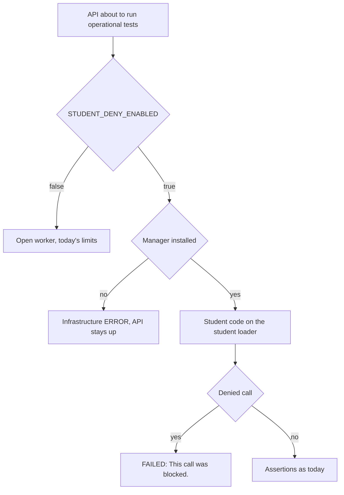

# Render Student Deny Policy - Plan

## Goal Capsule

- **Objective:** On Render, stop student operational-test code from using the network, the filesystem, or a new process, without a second host.
- **Product authority:** This Product Contract. The Docker runner is not active scope.
- **Open blockers:** None.
- **Stop conditions:** Do not require a second machine or a Docker socket. Do not jail compile or the Class tab. Do not install the deny policy on this PC or on the Windows desktop apps. Do not change the 3-second per-item execution budget or the 64 MB Render worker heap.
- **Execution:** Code. `ce-work` owns the shipping tail.
- **Product Contract preservation:** Unchanged — planning adds HOW sections; deferred Outstanding Questions resolved into KTDs.

---

## Product Contract

### Summary

Render operational-test invoke runs student code under a Java deny policy. The policy blocks network, filesystem, and process creation for student code only. The harness can still read compiled classes and return results. This PC and both Windows desktop apps keep today's open worker. The Docker runner leaves the product.

### Problem Frame

The container sandbox needs a host that can start Docker containers. Render does not give the API that privilege, and no second machine is available. The worker that runs today shares the API process's network and filesystem. A tight loop or a large allocation is already bounded. A socket, a file read, or a spawned process is not.

### Key Decisions

- **Java deny policy on Render** (session-settled: user-directed — chosen over a kernel jail, over stopping operational tests, and over waiting for a VM: the API process cannot set cgroups or a network namespace). Governs R1, R5.
- **Student code only** (session-settled: user-directed — chosen over locking down the whole worker: the harness must read compiled classes and return results). Governs R2.
- **This PC and Windows desktop stay open** (session-settled: user-directed — chosen over the same jail on every machine: local and desktop grading stay on today's worker, and a file or network call may pass there and fail on Render). Governs R7, R8.
- **Invoke only** (session-settled: user-directed — chosen over jailing compile and class load: javac and the Class tab stay in the API process). Governs R9.
- **Runner leaves** (session-settled: user-directed — chosen over keeping the Docker runner as a second mode: nothing available can host it). Governs R10.

### Actors

- **A1. Student on Render** — uploads a lab whose operational tests run in the cloud.
- **A2. Lecturer on Render** — dry-runs an operational test, or bulk-grades, on the cloud API.
- **A3. Local or desktop grader** — this PC, student practice, or the lecturer offline app. Uses the open worker.

### Key Flows

```mermaid
flowchart TB
  start[Operational test about to run]
  start --> where{Where is the API}
  where -->|Render| policy{Deny policy installed}
  where -->|This PC or Windows desktop| open[Open worker runs the test]
  policy -->|yes| student[Student code runs denied]
  policy -->|no| stop[Test does not run in the open worker]
  student --> call{Student uses network, files, or a process}
  call -->|yes| fail[That test fails and the reason is visible]
  call -->|no| grade[Assertions run as today]
```

- F1. Render invoke under the policy
  - **Trigger:** A1 uploads, or A2 dry-runs or bulk-grades, on Render, and the lab has operational tests to run.
  - **Actors:** A1 or A2
  - **Steps:** The worker installs the student deny policy. Student code runs inside the existing 3-second and 64 MB bounds. A blocked call fails that test. Other assertions still grade.
  - **Covered by:** R1, R2, R3, R5, R6

- F2. Policy did not install
  - **Trigger:** Render is about to invoke student code and the deny policy is not in force.
  - **Actors:** A1 or A2
  - **Steps:** That operational test does not run in the open worker. The API process stays up. The result is an infrastructure failure, not a silent pass.
  - **Covered by:** R4

- F3. Local or desktop invoke
  - **Trigger:** A3 runs the same lab on this PC or in a Windows desktop app.
  - **Actors:** A3
  - **Steps:** The open worker runs the test with today's limits. The deny policy is not installed.
  - **Covered by:** R7, R8

### Requirements

**Render deny**

- R1. On Render, student code running for an operational test cannot open a network connection, read or write the filesystem, or start a process.
- R2. The deny applies only to student code. The harness can still read the compiled classes for that test and return results to the API.
- R3. A blocked call fails that operational test, and the student-visible result says the call was blocked.
- R4. When the deny policy is not in force, Render does not run that operational test in the open worker. The API process stays up.
- R5. Render keeps the current resource bounds: 3 seconds of student-code execution per test item, and a 64 MB worker heap.
- R6. R1 covers student upload, lecturer bulk grade, and lecturer dry-run when those run on Render.

**Places that stay open**

- R7. This PC and both Windows desktop apps grade operational tests with today's open worker. They do not install the deny policy.
- R8. A file, network, or process call that fails on Render under R1 may still run on this PC and on the desktop apps.
- R9. Compile and Class-tab class load stay in the API process. A static initializer on that path is outside the deny policy.

**Runner**

- R10. Operational tests do not depend on a Docker runner or a second host. That mode is not part of the product.

### Acceptance Examples

- AE1. Socket on Render
  - **Covers:** R1, R3, R6
  - **Given:** A Render upload whose operational test opens an outbound connection
  - **When:** The test runs
  - **Then:** That test fails, the result says the call was blocked, and the API stays up
- AE2. File read on Render
  - **Covers:** R1, R3
  - **Given:** A Render dry-run whose student code reads a file on the host
  - **When:** The test runs
  - **Then:** That test fails and the result says the call was blocked
- AE3. Process start on Render
  - **Covers:** R1, R3
  - **Given:** A Render bulk grade whose student code starts a process
  - **When:** The test runs
  - **Then:** That test fails and the result says the call was blocked
- AE4. Policy missing
  - **Covers:** R4
  - **Given:** Render cannot install the deny policy
  - **When:** An operational test would otherwise run
  - **Then:** The test does not run in the open worker, the result is an infrastructure failure, and the API stays up
- AE5. Same file read off Render
  - **Covers:** R7, R8
  - **Given:** The same test as AE2, run on this PC or in a Windows desktop app
  - **When:** The test runs
  - **Then:** The open worker runs it and the deny policy is not applied
- AE6. Class tab stays outside
  - **Covers:** R9
  - **Given:** A class whose static initializer would touch the filesystem
  - **When:** The Class tab loads that class on Render
  - **Then:** That load is not covered by the deny policy
- AE7. Loop and heap stay bounded
  - **Covers:** R5
  - **Given:** Student code on Render spins or allocates until the heap is exhausted
  - **When:** The test runs
  - **Then:** The item stops at the 3-second budget or the worker exits on the 64 MB heap, and the API stays up

### Scope Boundaries

- Kernel network, CPU, and process-count limits. Render cannot enforce them from the API process.
- A second machine, a warm container pool, or a flag that turns the Docker runner back on.
- Jailing javac, or making Class-tab load use the deny policy.
- Forcing this PC or the desktop apps to fail the same file, network, and process calls as Render.
- Changing assertion kinds, pillar weights, or the 3-second and 64 MB bounds.

### Dependencies / Assumptions

- A Java-level check on Render can see student calls to the network, the filesystem, and process start. The mechanism is KTD1.
- A bug in that check can still be escaped. The policy is not a kernel boundary.
- Today's worker already enforces the 3-second item budget and the 64 MB Render heap. This work keeps those bounds and adds the deny.

### Sources / Research

- Current worker bounds and the unused container path: `docs/SANDBOX_RUNNER_DEPLOY.md`, `docs/plans/2026-09-15-001-feat-container-sandbox-invoke-plan.md`.
- Render cannot mount a Docker socket on the API image: `backend/DEPLOY_RENDER.md`.
- Open-worker limits that stay: 3-second item budget and 64 MB heap in `backend/src/main/resources/application.properties`. Desktop heap stays larger and is out of this policy.
- Render runs the worker on the image JDK in `backend/Dockerfile` (`eclipse-temurin:21-jdk`). The compile target in `backend/pom.xml` is 17.

---

## Planning Contract

### Key Technical Decisions

- KTD1. **Security manager on the OT worker.** When the deny flag is on, the OT worker process is started so Java 21 still allows a security manager, and the worker installs that manager before it loads student classes. Render's image is Temurin 21, where this still works. A move to JDK 24 removes the security manager; install failure then follows R4. Governs R1, R4.
- KTD2. **Student loader on the stack.** A check denies the call when the stack contains a class from that test's student class loader. File reads of `.class` files under that test's classes directory stay allowed so the test can load. Every other file read, every write, sockets, process start, native-library load, replacing the manager, and creating another class loader are denied. Governs R1, R2.
- KTD3. **Flag default off, Render turns it on** (session-settled: user-directed — chosen over applying the policy on every machine: this PC and the Windows desktop apps stay on the open worker). `STUDENT_DENY_ENABLED` defaults false. `STUDENT_DENY_REQUIRED` defaults false and, when true, cloud boot fails unless the deny flag is on. Render sets both true. Desktop profiles force the deny flag off. The flag is passed only to the operational-test worker, not to the Class-tab one-shot reflect process. Governs R6, R7, R8, R9.
- KTD4. **Blocked call is a failed test.** The student-visible feedback is `This call was blocked.` The grader records `FAILED`. It does not use the infrastructure `ERROR` path, which stays reserved for a missing policy and other harness failures. Governs R3, R4.
- KTD5. **No in-process fallback while the flag is on.** If the OT worker session cannot run under the policy, class parse for that upload does not fall back into the API process. Governs R1, R4.
- KTD6. **Remove the Docker runner mode** (session-settled: user-directed — chosen over keeping the runner as a second mode: nothing available can host it). The API no longer routes operational tests to a remote runner. Governs R10.

### High-Level Technical Design



The Class-tab one-shot reflect process does not receive the flag, per R9. An OT session that does receive the flag also covers the reflect that shares that session, so a static initializer on that path is denied.

### Assumptions

- Reading `.class` files under the test's own classes directory is required to run the test. KTD2 allows that read and no other filesystem access.
- A bug in the stack check can still be escaped. This is not a kernel boundary.
- Local `mvn spring-boot:run` uses the default profile, same as Render, so the profile cannot mean "this is Render". Only the explicit flag does.

### Sequencing

U1 first. U2 and U3 can proceed in parallel after U1. U4 after U2. U5 last.

### Risks

- The security manager is deprecated and is gone on JDK 24. The Render image is Temurin 21. If that base image moves forward, R4 must trip instead of running the open worker.
- Student code that runs during Class-tab load is still inside the API. R9 leaves that path outside the policy.
- A stack check that treats a harness frame as student, or the reverse, either breaks grading or opens the host files. U1 tests both directions.

---

## Implementation Units

### U1. Worker deny policy

- **Goal:** The worker can install a student-only deny check and report a blocked call without killing the process.
- **Requirements:** R1, R2, R3, R5. KTD1, KTD2, KTD4.
- **Dependencies:** None.
- **Files:** `backend/src/main/java/com/eiu/capstone/backend/grading/testcase/worker/`, `backend/src/test/java/unit/com/eiu/capstone/backend/grading/testcase/`
- **Approach:**
  - Install the manager only when the OT worker was started with the deny flag
  - Deny per KTD2
  - On a denied call, return a worker fact the API can map to `FAILED` with `This call was blocked.`
  - Leave the 3-second budget and the 64 MB heap flags unchanged
- **Patterns to follow:** `WorkerInvokeEngine.studentLoader` already uses the platform class loader as parent. `WorkerProcessClient` already builds the worker command and heap flags.
- **Test scenarios:**
  - Covers AE1. Student code opens a socket. The outcome is the blocked-call fact, and the worker process stays alive.
  - Covers AE2. Student code reads a path outside the classes directory. Same blocked-call fact.
  - Student code reads a `.class` file inside that test's classes directory. The read is allowed.
  - Covers AE3. Student code starts a process. Same blocked-call fact.
  - Harness code reads the classes directory with no student frame on the stack. The read is allowed.
  - Covers AE7. A tight loop still hits the existing timeout. An allocation past the heap still exits the worker. The deny check does not change those bounds.
  - Deny flag absent. A socket call is not blocked.
- **Verification:** The unit tests above pass, and a worker started without the flag behaves as it does today.

### U2. Turn the policy on only for Render operational tests

- **Goal:** Render can require the policy. This PC and desktop cannot turn it on by accident. Class-tab reflect stays outside it.
- **Requirements:** R4, R6, R7, R8, R9. KTD3, KTD5.
- **Dependencies:** U1
- **Files:** `backend/src/main/resources/application.properties`, `backend/src/main/resources/application-desktop.yml`, `backend/src/main/resources/application-desktop-lecturer.yml`, `backend/src/main/java/com/eiu/capstone/backend/grading/testcase/WorkerProcessClient.java`, `backend/src/main/java/com/eiu/capstone/backend/grading/testcase/WorkerSessionFactory.java`, `backend/src/main/java/com/eiu/capstone/backend/grading/ReflectionClassParser.java`, `backend/src/main/java/com/eiu/capstone/backend/config/`, `backend/src/test/java/unit/com/eiu/capstone/backend/config/`, `backend/src/test/java/unit/com/eiu/capstone/backend/grading/testcase/WorkerProcessClientTest.java`
- **Approach:**
  - Add the two flags in KTD3. Desktop profiles force the deny flag off
  - Cloud boot fails when required is true and enabled is false
  - Pass the deny launch only from the operational-test session start. The Class-tab `--reflect` command does not receive it
  - When the flag is on and the worker does not come up under the policy, mark the session failed and do not parse those classes inside the API
- **Patterns to follow:** `SandboxStartupValidator` is the boot-fail shape to copy, then U4 deletes the runner-specific validator.
- **Test scenarios:**
  - Covers AE4. Enabled is true and the worker reports the policy did not install. The session fails closed and the API process is still the one under test.
  - Required is true and enabled is false. Cloud startup throws. Desktop profile does not register that check.
  - Enabled is false. The worker command has no deny launch. Class-tab reflect command has no deny launch even when enabled is true.
  - Covers AE6. A Class-tab reflect does not install the policy.
  - Covers AE5. Desktop profile keeps enabled false even if the environment variable is set.
- **Verification:** Startup and command-line tests pass. A denied-policy session does not call the in-process class parser.

### U3. Grade a blocked call as a failed test

- **Goal:** Students see a failed operational test, not an infrastructure outage, when their code is blocked.
- **Requirements:** R3, R4, R6. KTD4.
- **Dependencies:** U1
- **Files:** `backend/src/main/java/com/eiu/capstone/backend/grading/pipeline/TestcaseGrader.java`, `backend/src/test/java/unit/com/eiu/capstone/backend/grading/TestcaseGraderTest.java`
- **Approach:**
  - Recognize the blocked-call fact before the branch that turns `ERROR` into an infrastructure result
  - Store `FAILED` and the sentence `This call was blocked.`
  - Leave timeout, missing rubric, and policy-install failure on the infrastructure path
- **Patterns to follow:** `TestcaseGrader.finishEvaluate` already maps `ERROR` and `TIMED_OUT` to infrastructure and every other assertion miss to `FAILED`.
- **Test scenarios:**
  - Covers AE1. A blocked-call outcome becomes status `FAILED` and feedback `This call was blocked.`
  - Covers AE4. An infrastructure outcome for a missing policy stays infrastructure and does not use that sentence.
  - A normal failing assertion is unchanged.
  - Upload, dry-run, and bulk grade share this mapper, so one test of the mapper covers R6.
- **Verification:** Grader tests pass and no student-facing path shows the blocked sentence on an infrastructure failure.

### U4. Remove the Docker runner

- **Goal:** Operational tests have one path. The remote runner cannot be switched back on.
- **Requirements:** R10. KTD6.
- **Dependencies:** U2
- **Files:** `backend/src/main/java/com/eiu/capstone/backend/grading/testcase/WorkerSessionFactory.java`, `backend/src/main/java/com/eiu/capstone/backend/grading/testcase/RemoteWorkerSessionClient.java`, `backend/src/main/java/com/eiu/capstone/backend/grading/testcase/SandboxInfraErrors.java`, `backend/src/main/java/com/eiu/capstone/backend/config/SandboxStartupValidator.java`, `backend/src/main/java/com/eiu/capstone/backend/grading/testcase/SharedLocalWorkerCache.java`, `sandbox-runner/`, `sandbox-image/`, `docker-compose.sandbox.yml`, `backend/src/test/java/unit/com/eiu/capstone/backend/grading/testcase/ContainerSandboxAeTest.java`, `backend/src/test/java/unit/com/eiu/capstone/backend/config/SandboxStartupValidatorTest.java`
- **Approach:**
  - Delete the remote session client, the runner module, the sandbox image, and the compose file
  - `WorkerSessionFactory` always starts the local worker
  - Keep the new deny boot check from U2
  - Drop sandbox branches that skip warm-park or swap in the remote client
- **Patterns to follow:** The local branch of `WorkerSessionFactory.open` is the path that remains.
- **Test scenarios:**
  - Factory open with the deny flag off returns a local session and does not reference a runner URL
  - No remaining production type reads `SANDBOX_ENABLED` or `SANDBOX_RUNNER_URL`
  - Existing local worker tests still pass
- **Verification:** Backend tests compile and pass with the runner module gone.

### U5. Docs for the new Render flags

- **Goal:** Operators can turn the policy on, and the retired runner is not described as the live path.
- **Requirements:** R7, R10. KTD3, KTD6.
- **Dependencies:** U4
- **Files:** `backend/DEPLOY_RENDER.md`, `backend/AGENTS.md`, `backend/src/main/java/com/eiu/capstone/backend/grading/AGENTS.md`, `docs/SANDBOX_RUNNER_DEPLOY.md`, `CONCEPTS.md`, `docs/solutions/architecture-patterns/operational-testcase-grading.md`
- **Approach:**
  - Render checklist sets `STUDENT_DENY_REQUIRED` and `STUDENT_DENY_ENABLED` true and drops the runner URL and token
  - State that this PC and desktop leave the flag off
  - Replace the container-sandbox glossary entry with the student deny policy: Render operational tests only, not a kernel jail, Class tab outside
- **Test scenarios:**
  - Test expectation: none — documentation only
- **Verification:** A reader of `backend/DEPLOY_RENDER.md` can enable the policy without a second host, and no live doc tells them to deploy `sandbox-runner`.

---

## Verification Contract

- Backend: `mvn test` from `backend/` covering U1, U2, and U3
- Desktop profile test, if one already boots that profile, still starts with the deny flag forced off
- Manual: on a workstation with the flag off, an operational test that opens a socket still runs. That is AE5

## Definition of Done

- Global: R1–R10 hold. U1–U5 are done. The Docker runner is not a reachable mode. The 3-second budget and 64 MB Render heap are unchanged.
- U1: deny tests pass for socket, outside file, process, allowed class-file read, and harness read.
- U2: Render-style flags fail closed. Desktop and Class-tab reflect do not install the policy.
- U3: blocked call is `FAILED` with `This call was blocked.` Policy install failure stays infrastructure.
- U4: backend tests pass without `sandbox-runner`.
- U5: Render deploy doc and `CONCEPTS.md` match the flag, not the runner.

