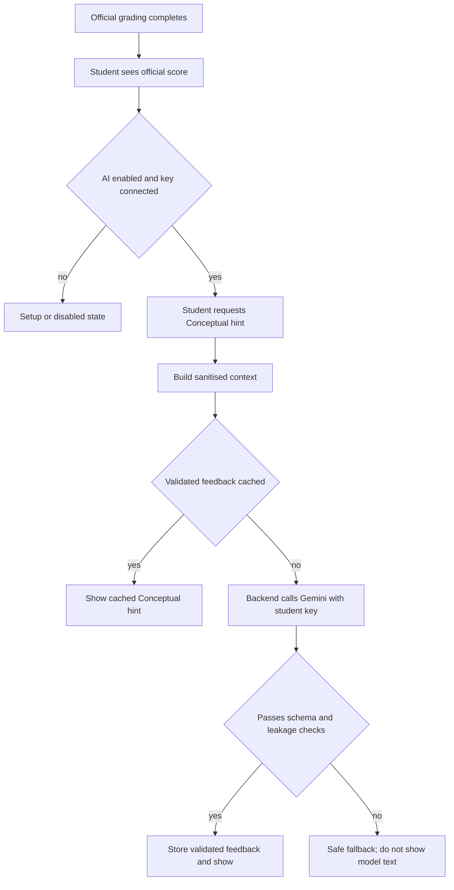
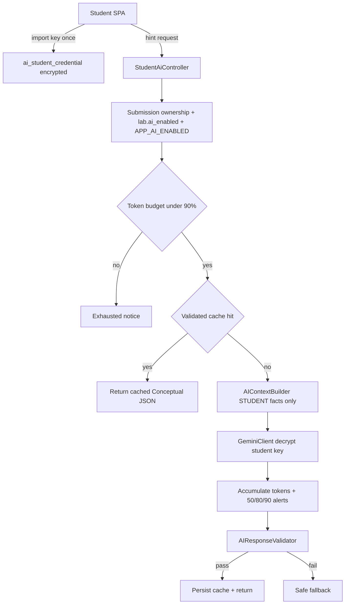

# AI Learning Assistant - Plan

## Goal Capsule

- **Objective:** After official grading finishes, let a student request one Conceptual AI hint for fields, methods, or constructors without ever revealing the assignment answer, and with ≥90% same-input feedback consistency.
- **Product authority:** This Product Contract. Later phases in How This Work Fits Together are not active scope.
- **Open blockers:** None.
- **Stop conditions:** Do not let Gemini change or restate official scores. Do not disclose exact missing identifiers, signatures, reference code, or hidden tests. Do not ship progressive multi-level hints. Do not send the expected answer list to Gemini “just to forbid revealing it.”
- **Execution:** Code. `ce-work` owns the shipping tail.
- **Product Contract preservation:** Unchanged — planning adds HOW sections; deferred Outstanding Questions resolved into KTDs.

---

## Product Contract

### Summary

Add an optional Gemini BYOK Learning Assistant on the student result experience. After a completed grading run, the student can request a single Conceptual hint for an eligible learning area. The platform builds a minimised, sanitised context, calls Gemini through a trusted backend boundary, validates the response, and shows only safe Conceptual guidance. Official scores stay entirely with the existing grading engine.

### Problem Frame

A score and a redacted structural failure tell a student that something is incomplete, but not how to reason about the gap. Showing the missing identifier would leak the assignment answer. Showing nothing leaves a weak learning loop. The product needs advisory Conceptual guidance that is useful, stable across repeated requests, and fail-closed on any answer-like output. The existing lecturer Reports “AI Summary” placeholder is analytics copy, not this student learning feature.

### Key Decisions

- **Single Conceptual hint level** (session-settled: user-directed — chosen over BRD Level 1–3 progressive hints: one Socratic conceptual response is enough for v1 and removes deeper-hint leakage pressure). Governs R6, R7.
- **No answer leakage is non-negotiable** (session-settled: user-approved — chosen over softer “prompt-only” protection: context must not contain the secret answer, and unsafe model output must never display). Governs R3, R4, R5, R12, R13.
- **≥90% same-input consistency** (session-settled: user-directed — chosen over freely varying generative replies: identical submission + learning area must usually yield the same student-visible feedback). Governs R8, R9.
- **Trusted backend-mediated Gemini calls** — chosen over browser-direct Gemini: only a server validation boundary can enforce fail-closed display and stable caching. Governs R10, R11, R12.
- **No raw Java source to Gemini by default** — chosen over sending full student files: sanitised structural summaries plus student-visible class/concept cues are enough for Conceptual hints. Governs R4.
- **Student-initiated requests only** — chosen over auto-calling after every grade: controls cost, consent, and third-party transmission. Governs R2.
- **MVP learning areas = fields, methods, constructors** — chosen over full OOP topic set for first release. Governs R6.
- **Pilot-safe enablement** — platform can disable AI globally; lecturers can disable per lab/challenge; default for new labs is off until a lecturer enables AI for that assignment. Governs R14.

### Actors

- A1. Student — configures own Gemini key, views official results, requests Conceptual hints on own graded submissions.
- A2. Lecturer — enables or disables AI assistance for a lab/challenge within platform policy.
- A3. Administrator — enables or disables the AI feature globally; cannot read plaintext student API keys.
- A4. Official Grading Engine — sole authority for scores and rubric outcomes; unchanged by AI.
- A5. Gemini (provider) — generates candidate Conceptual text under platform instructions; never trusted without validation.

### Key Flows

- F1. Configure BYOK access
  - **Trigger:** A1 opens AI settings and pastes a Gemini API key.
  - **Actors:** A1
  - **Steps:** System explains BYOK, third-party processing, and quotas. Connection test hits an approved model. Status becomes Connected or a clear failure. Full key is never re-shown; plaintext key is never stored in PostgreSQL or logs.
  - **Covered by:** R1, R15

- F2. Request Conceptual hint after grading
  - **Trigger:** A1 views a completed own submission where AI is enabled and requests a hint for an eligible learning area.
  - **Actors:** A1, A4, A5
  - **Steps:** Backend verifies ownership, assignment AI policy, and completed official result. Context builder uses only approved student-safe facts. If a validated cache hit exists for that submission + area, return it. Otherwise call Gemini, validate, cache on success, or show safe fallback on failure. Official score is untouched.
  - **Covered by:** R2, R3, R4, R5, R6, R8, R10, R11, R12, R13

- F3. Lecturer or admin disables AI
  - **Trigger:** A2 disables AI for a lab/challenge, or A3 disables the feature globally.
  - **Actors:** A1, A2, A3
  - **Steps:** Student UI hides or disables hint requests for affected assignments. Existing official results remain available.
  - **Covered by:** R14

### Requirements

**Access and grading separation**

- R1. A student can configure, test, replace, and disconnect their own Gemini API key, with connection status shown and the full key never re-exposed after submit.
- R2. Conceptual AI feedback is available only after the official grading result for that exact submission version is complete, and only when the student initiates a request.
- R3. AI output must never calculate, adjust, approve, override, or write an official score or rubric pass/fail decision. Covers BR-GRADE family from the source BRD intent.

**Answer protection and context**

- R4. The AI context must exclude reference solutions, hidden tests/outputs, exact missing identifiers, expected signatures, and lecturer-only rubric secrets; prefer sanitised structural summaries over raw source.
- R5. Student-controlled text in source, comments, filenames, or strings is untrusted data and must never become system instructions.
- R6. Supported MVP learning areas are field/data modelling, method/object responsibilities, and constructors/initial state. Feedback is Conceptual only: explanations and Socratic questions, never progressive deeper levels.
- R7. The UI exposes a single Conceptual hint experience for a learning area on a submission; there is no Level 2/3 deeper-hint ladder.

**Consistency**

- R8. For the same student, submission version, learning area, language, and policy/template version, the student-visible validated feedback must match on at least 90% of successful returns in pilot measurement, and a cache hit must return the identical validated payload.
- R9. Generation settings and prompt/policy versions used for Conceptual hints must be fixed and versioned so repeated generations for uncached identical context remain tightly constrained; when validation fails, use a curated safe fallback rather than an unbounded regenerate loop.

**Trusted delivery**

- R10. Gemini requests for this feature are backend-mediated: the backend prepares context, applies the student key for the provider call, validates the response, and only then returns displayable feedback.
- R11. API keys must not appear in logs, URLs, analytics, error traces, or plaintext database columns. A cleared key must not be reused.
- R12. Before display, every model response must pass schema, length, code/signature detection, identifier-leakage, and solution-equivalence checks; failure means suppress the model text and show a safe fallback.
- R13. If safety cannot be established, the system fails closed: no unvalidated model text is shown, and grading remains available.

**Controls, languages, disclosure**

- R14. Administrators can disable AI globally; lecturers can disable AI per lab or challenge; new assignments default to AI off until a lecturer enables them.
- R15. Before first transmission of submission-derived data, the student sees disclosure covering BYOK costs/quotas, third-party processing, and that AI feedback is advisory and not the official grade.
- R16. Conceptual feedback supports English and Vietnamese according to the student’s preferred language for the request.
- R17. Each AI request is bound to student, submission id/version, learning area, model id, policy version, status, and timestamp, without storing plaintext keys or hidden rubric answers in ordinary history/metrics.

### Acceptance Examples

- AE1. Missing field not named
  - **When:** Rubric expects a field the student omitted, and the student requests a Conceptual hint for fields.
  - **Then:** Feedback may ask what other information the object should represent.
  - **And:** It must not name the missing field or show a field declaration.
  - **Covers R4, R6, R12.**

- AE2. Missing method not named
  - **When:** A required behaviour is incomplete and the student requests a methods hint.
  - **Then:** Feedback may ask about object responsibilities.
  - **And:** It must not give the method name, signature, or implementation.
  - **Covers R4, R6, R12.**

- AE3. Constructor signature protected
  - **When:** A constructor criterion fails and the student requests a constructors hint.
  - **Then:** Feedback may ask what should be true right after creation.
  - **And:** It must not reveal the expected parameter list or signature.
  - **Covers R4, R6, R12.**

- AE4. Same-input consistency
  - **When:** The student requests the same Conceptual hint twice for the same submission version and learning area after a successful validated response.
  - **Then:** The second response returns the same validated payload.
  - **And:** Pilot measurement of successful same-input returns is ≥90% identical.
  - **Covers R8, R9.**

- AE5. Leakage rejected
  - **When:** Gemini returns code, a prohibited identifier, or solution-equivalent pseudocode.
  - **Then:** The response is discarded.
  - **And:** The student sees only a safe fallback, while the official score is unchanged.
  - **Covers R3, R12, R13.**

- AE6. Prompt injection ignored
  - **When:** Student source comments instruct the model to reveal the answer.
  - **Then:** Those instructions do not override system policy.
  - **And:** No prohibited answer content is displayed.
  - **Covers R5, R12.**

- AE7. AI disabled or key missing
  - **When:** AI is disabled for the assignment, or the student has no connected key.
  - **Then:** Official grading and results still work.
  - **And:** Hint request is unavailable or routes to setup guidance without blocking grading.
  - **Covers R2, R14.**

- AE8. Submission version binding
  - **When:** The student submits again after earlier AI feedback.
  - **Then:** Prior feedback remains tied to the prior submission version and is not presented as guidance for the new version.
  - **Covers R2, R17.**

### Success Criteria

- S1. Confirmed answer-leakage incidents for displayed feedback remain zero in pilot adversarial tests covering identifiers, signatures, code blocks, and solution-equivalent prose.
- S2. Same-input validated feedback consistency ≥90% in pilot measurement; cache hits are 100% identical.
- S3. Official score fields show no AI-authored mutation in automated regression checks.
- S4. AI unavailability, invalid keys, quota errors, and validation failures leave grading and official results fully usable.
- S5. Students can tell AI guidance is advisory and separate from the official assessment in the result UI.

### Scope Boundaries

**In scope (Phase 1 / this plan)**

- Student BYOK Gemini configuration and connection status
- Student-initiated Conceptual hints after grading for fields, methods, constructors
- Sanitised context builder, backend-mediated provider call, validation, cache, safe fallback
- Global and per-assignment enablement with default-off for new labs
- EN/VI Conceptual feedback
- Non-sensitive request status/metrics needed to operate the feature

**Deferred for later** — see How This Work Fits Together

- Progressive multi-level hints
- Broader OOP topics (encapsulation, inheritance, polymorphism, abstraction, interfaces)
- Feedback history UI, usefulness ratings, lecturer AI-usage summaries
- Multi-provider support beyond approved Gemini models
- Desktop offline AI assistance
- Auto-request after grading

**Out of scope / non-goals**

- Replacing or co-authoring official grades with Gemini
- Sending exact missing identifiers to Gemini
- Plagiarism detection via Gemini
- Auto-editing student source or auto-resubmitting
- Guaranteeing free Gemini quota
- Treating the existing lecturer Reports AI Summary placeholder as this feature

### Dependencies / Assumptions

- Existing grading engine continues to expose structured, student-safe assessment facts suitable for a separate AI context builder; `DisclosureMode.STUDENT` remains the student-facing truth boundary.
- Students can obtain a Gemini API key under Google’s current terms when they choose to use the feature.
- Institutional approval covers third-party transmission of the minimised submission-derived categories listed in disclosure.
- Desktop web-parity for AI is not assumed; Windows offline apps stay without this assistant until a later plan.
- Source BRD at the path in frontmatter informs tone and safety catalogue examples; this Product Contract is the authority where the two differ (especially single Conceptual hint level and ≥90% consistency).

### Outstanding Questions

**Resolve Before Planning**

- None.

**Deferred to Planning**

- None remaining — resolved into KTDs below.

<!-- ce-section: work-relationships -->
### How This Work Fits Together

This plan owns **Phase 1 – Conceptual Learning Assistant MVP** only. The list below is the current understanding of later work, not a committed roadmap; a later plan may revise, split, merge, or discard these areas.

- Phase 1 – Conceptual Learning Assistant MVP (this plan)
  - Owns: BYOK, one Conceptual hint, fields/methods/constructors, trusted validation, ≥90% consistency, assignment enablement
- Phase 2 – Learning coverage and lecturer controls
  - Depends on: Phase 1 safety pipeline and enablement model
  - Adds: encapsulation / inheritance / polymorphism / abstraction / interfaces guidance under the same Conceptual-only, no-leakage rules
  - Adds: richer lecturer controls for which learning areas are eligible per assignment
  - Can proceed independently of: desktop AI, multi-provider support
- Phase 3 – History, quality loop, and operations
  - Depends on: Phase 1 request/feedback persistence shape
  - Adds: student hint history UI, usefulness ratings, aggregate admin metrics, retention/deletion polish
  - Shares: answer-protection validator and advisory UI separation with Phase 1
  - Still to decide: whether ratings influence prompts automatically (default no)
- Phase 4 – Reach and providers
  - Depends on: Phase 1 provider boundary remaining modular
  - Adds: additional approved providers if Gemini-only is insufficient; optional desktop/offline posture if institutional policy allows local or proxied inference
  - Can proceed independently of: Phase 2 topic expansion if provider work is isolated
  - Still to decide: whether desktop ever sends submission-derived data off-machine

### Sources / Research

- External BRD: `OOP_AutoGrader_AI_Learning_Assistant_BRD.md` (local Downloads copy referenced in frontmatter) — business goals, safety catalogue, BYOK options; superseded here on progressive hint levels and consistency target.
- Anti-answer-leakage precedent: `docs/plans/2026-09-11-001-feat-student-disclosure-mode-plan.md` and `DisclosureMode.STUDENT` — student-facing results already redact rubric expected values.
- Existing “AI Summary” in lecturer Reports is a placeholder analytics string, not a student learning assistant (`AnalyticsService` / `ReportsPanel` / `docs/USER_GUIDE.md` Reports section).
- Student result loop today: upload → synchronous `lab_result` → StudentDashboard score toast and pillar tabs (`docs/OBJECTIVES.md`, `docs/USER_GUIDE.md`).
- Secrets UX adjacent patterns for planning (not product scope): Change Password modal via Header, and web-issued mascot practice token (`docs/plans/2026-11-14-001-feat-desktop-mascot-practice-token-plan.md`); env secrets today are `JWT_SECRET` / `BREVO_API_KEY` style, not student BYOK.
- HOW research: lab flag + migrator mirror `Lab.prefix`; bind to `lab_submission.id` via `SubmissionResolutionService`; student-safe facts via `DisclosureMode.STUDENT` / `StudentDisplayMessages`; `/api/students/**` already covers AI routes; desktop deferred (`@Profile("!desktop")`).

---

## Planning Contract

### Key Technical Decisions

- KTD1. **Lab-level `ai_enabled`, default false** — chosen over per-challenge for MVP schema simplicity. Lecturer `PATCH` mirrors `student-access` / `prefix`. Global kill switch is `app.ai.enabled` (`APP_AI_ENABLED`, default true once code ships) checked in the AI service, not a Security matcher. Governs R14.
- KTD2. **BYOK key is stored encrypted per student on the server** (session-settled: user-directed — chosen over browser `sessionStorage` + request header: student imports the key once; hints decrypt and use that student’s row). Plaintext never lands in PostgreSQL or logs. Governs R1, R11.
- KTD2b. **Token budget management** — track Gemini `totalTokenCount` against `APP_AI_TOKEN_BUDGET` (default 1_000_000). Toast/status alerts at 50% and 80%; hard-stop new provider calls at 90% with an exhausted notice. Cache hits do not spend budget. Governs R1.
- KTD3. **Bind hints to `lab_submission.id`** — ownership via `SubmissionResolutionService.resolveSubmissionId` for the authenticated student + lab. New upload ⇒ new id (AE8). Governs R2, R17.
- KTD4. **Context from STUDENT disclosure only** — pillar scores/applicability, generic Missing/Wrong field|method|constructor labels, student-authored present-member summaries, class name when student-visible. Never expected identifiers, signatures, hidden OT I/O, or LECTURER payloads. Governs R4, R5.
- KTD5. **Fixed Gemini model + temperature 0 + versioned prompt policy** — single allowlisted model id in config; Conceptual-only system prompt with structured JSON schema; `temperature=0` (or provider equivalent) for consistency. Governs R8, R9.
- KTD6. **Validated feedback cache** — persist only validated Conceptual payloads keyed by `(student_id, submission_id, learning_area, language, policy_version)`. Cache hit returns identical payload without calling Gemini (and without requiring the key). Retention 30 days or until submission/account cleanup. Governs R8, R9, R17.
- KTD7. **Fail-closed validator before any display** — schema, length bounds, code/signature heuristics, token-aware deny of assignment-secret identifiers the context builder never received as “missing” but that may appear in lecturer-only stores (validator loads prohibited token set server-side without putting it in the Gemini prompt). On failure: curated safe fallback, status `rejected`. Governs R12, R13.
- KTD8. **UI: settings modal + adjacent advisory panel** — `AiSettingsModal` cloned from `ChangePasswordModal` patterns via Header; Conceptual hint panel mounts beside the revealed result stage in `StudentUI` (not inside Declaration member rows, not merged into score pills). Governs R7, R15.
- KTD9. **Cloud-only beans** — `@Profile("!desktop")` (and not `desktop-lecturer`) for AI controllers/services/migrators that need PostgreSQL cloud. Desktop practice has no AI assistant in Phase 1. Governs desktop non-goal.

### High-Level Technical Design

### Assumptions

- Gemini generateContent (or current equivalent) accepts temperature 0 and JSON-oriented responses for the allowlisted model.
- Students accept encrypted server-side storage of their own Gemini key for Learning Assistant use.
- Prohibited-identifier checks can use lecturer-side expected names loaded only inside the validator, never into the Gemini request body.
- Admin “disable globally” for MVP is the `APP_AI_ENABLED` property (no new Admin UI screen).

### Sequencing

U1 first (schema + lecturer toggle). U2 and U3 in parallel after U1. U4 after U2+U3. U5 alongside or immediately after U2 validator lands.

### Risks

- Model still leaks despite temperature 0 → validator + fallback must hold (S1).
- False-positive identifier blocks on common English words → token-aware matching + fail closed on ambiguity (prefer fallback over leak).
- Students confuse AI panel with official score → visual separation and advisory label are mandatory in U4.
- Encrypted keys at rest → AES-GCM with `APP_AI_CREDENTIAL_SECRET` (or `JWT_SECRET` fallback); never log plaintext; disclose server storage in settings UI.

---

## Implementation Units

### U1. Lab AI enablement

- **Goal:** Labs carry `ai_enabled` default false; lecturers can toggle it; global `APP_AI_ENABLED` exists.
- **Requirements:** R14. KTD1, KTD9.
- **Dependencies:** None.
- **Files:** `backend/src/main/java/com/eiu/capstone/backend/model/Lab.java`, `backend/src/main/java/com/eiu/capstone/backend/config/LabAiEnabledSchemaMigrator.java` (new), `docs/sql/2026-11-16-lab-ai-enabled.sql` (new), `backend/src/main/java/com/eiu/capstone/backend/web/LecturerRubricController.java`, `backend/src/main/java/com/eiu/capstone/backend/service/LabStructureService.java`, related lab DTOs, `frontend/src/components/lecturer/LabSchedulingPanel.jsx` (or equivalent lab settings UI), `backend/src/main/resources/application.properties`, `backend/.env.backend.example`, `backend/src/test/java/.../SchemaMigratorCatalogTest.java`, unit/auth tests as needed
- **Approach:**
  - Add `ai_enabled` boolean NOT NULL DEFAULT false on `lab`
  - Mirror `LabPrefixSchemaMigrator` + operator SQL mirror
  - Lecturer PATCH endpoint for AI enablement; include flag on lab payloads the SPA already loads for scheduling
  - Add `app.ai.enabled=${APP_AI_ENABLED:true}`
- **Patterns to follow:** `Lab.prefix` migrator and `PATCH .../prefix` / `student-access`
- **Test scenarios:**
  - New lab / migrated lab reads `ai_enabled=false`
  - Lecturer PATCH true then false updates the column
  - Migrator FQCN listed in `SchemaMigratorCatalogTest`
  - Desktop profiles do not register the PostgreSQL migrator
- **Verification:** Migrator catalog test + service/controller unit or authorization probe for the PATCH

### U2. Conceptual hint API, context, Gemini, validator, cache

- **Goal:** Authenticated student can request a Conceptual hint for fields|methods|constructors on an owned graded submission; unsafe output never displays.
- **Requirements:** R2–R6, R8–R13, R16, R17. KTD2–KTD7, KTD9.
- **Dependencies:** U1
- **Files:** new package under `backend/src/main/java/com/eiu/capstone/backend/ai/` (controller, services, client, context builder, validator, fallback, cache entity/repo), schema migrator + `docs/sql/` for `ai_feedback_cache` (name may vary), `SecurityConfig` only if matcher gaps appear (expect none), tests under `backend/src/test/java/unit/.../ai/`, `authorization/...`, `support/...` as needed
- **Approach:**
  - `StudentAiController` under `/api/students/ai` (`!desktop`): status, token, connect (body `apiKey` → encrypt+store), DELETE connect, hint
  - Load encrypted Gemini key from `ai_student_credential`; refuse when usage ≥ 90%
  - Build sanitised context from STUDENT disclosure facts for the submission
  - Cache lookup before provider call; on miss call allowlisted model at temperature 0 with versioned Conceptual prompt and structured schema
  - Accumulate `usageMetadata.totalTokenCount`; one-shot alerts at 50%/80%/90%
  - Validate; store only validated payload; reject → safe fallback
  - Record non-sensitive request metadata (status, latency, model, policy version)
- **Patterns to follow:** `SubmissionResolutionService`, `DisclosureMode.STUDENT`, `StudentDisplayMessages`, burst-guard exemptions only if an OT-like long call needs them (prefer short timeout + normal budget first)
- **Test scenarios:**
  - Covers AE1–AE3: validator rejects identifier/signature/code; fallback returned
  - Covers AE4: second identical request returns same cached payload
  - Covers AE5–AE6: leakage and prompt-injection style student text do not surface answers
  - Covers AE7: lab `ai_enabled=false` or `APP_AI_ENABLED=false` denies hint without affecting grading APIs
  - Covers AE8: cache/history bound to submission id
  - Ownership: student A cannot hint student B’s submission id
  - Schema/malformed Gemini JSON → rejected
- **Verification:** Unit tests for validator/context/cache; authorization tests for ownership and role

### U3. Student BYOK settings UI + token management

- **Goal:** Student can import/replace/remove a Gemini key (server-encrypted) and see token budget with 50/80/90% alerts.
- **Requirements:** R1, R11, R15. KTD2, KTD2b, KTD8.
- **Dependencies:** U2 connect/token endpoints
- **Files:** `frontend/src/components/student/AiSettingsModal.jsx` (new), `frontend/src/pages/StudentDashboard.jsx` (Header entry), `frontend/src/components/student/AGENTS.md`
- **Approach:**
  - Clone `ChangePasswordModal` UX patterns (`apiFetch` + `authHandling: 'self'` + Toast)
  - `POST /connect` with `{ apiKey }`; `DELETE /connect`; `GET /token` for usage bar
  - Show key hint only (never echo full key); toast on 50%/80%/90%; hard-stop copy at 90%
  - Disclosure copy: advisory AI, encrypted server storage, provider quotas/charges
- **Patterns to follow:** `ChangePasswordModal.jsx`, Header profile commands
- **Test scenarios:**
  - Unit: `AiTokenBudget` thresholds and one-shot alerts
  - Manual/QA: import persists across refresh; remove clears server row; 90% blocks hints
- **Verification:** Backend budget unit test; otherwise exercise via integration checklist in DoD

### U4. Result-page Conceptual hint panel

- **Goal:** After results reveal, eligible students see an advisory Conceptual hint panel separate from official scores.
- **Requirements:** R2, R6, R7, R15, R16. KTD8.
- **Dependencies:** U1, U2, U3
- **Files:** `frontend/src/components/student/StudentUI.jsx`, `frontend/src/pages/StudentDashboard.jsx` (pass `submissionId` / lab AI flag), new `AiLearningAssistantPanel.jsx` (or equivalent), `frontend/src/components/student/AGENTS.md`, user-facing note in `docs/USER_GUIDE.md` if student workflow docs must mention it
- **Approach:**
  - Mount only when `resultsRevealed` and lab AI enabled and global AI on
  - Learning-area selector: fields / methods / constructors; language EN|VI; single Request Conceptual hint action
  - Loading / error / fallback / advisory label states; never paint AI text into score/rubric chrome
- **Patterns to follow:** Existing result stage layout; Toast/error patterns from upload flow
- **Test scenarios:**
  - Panel hidden when AI disabled or results not revealed
  - Successful hint renders advisory-labelled Conceptual content
  - Validation fallback shows safe message without code blocks
- **Verification:** Manual student-path check; FE smoke if selectors extracted

### U5. Safety and consistency regression suite

- **Goal:** Durable tests lock no-leakage and cache identity for Phase 1.
- **Requirements:** R4, R8, R12, R13. KTD6, KTD7.
- **Dependencies:** U2
- **Files:** `backend/src/test/java/unit/.../ai/` (validator, cache key), disclosure regression touch only if context builder shares helpers with `ClassStructureServiceDisclosureTest`
- **Approach:**
  - Table-driven prohibited outputs (field/method/constructor/code/pseudocode/hidden-test phrases)
  - Cache key equality tests for R8
  - Context builder never includes expected-identifier lists in outbound Gemini payload fixtures
- **Patterns to follow:** Existing `unit` / `authorization` / `support` homes; `ClassStructureServiceDisclosureTest` spirit
- **Test scenarios:**
  - All Appendix-B-style prohibited samples from the BRD intent are rejected
  - Ambiguous common-word vs identifier: fail closed or allow only when clearly non-identifier (document chosen rule in test name)
  - Cache hit skips client call (mock Gemini client never invoked)
- **Verification:** `mvn test` targeting new AI tests passes

---

## Verification Contract

- Backend: from `backend/`, `mvn test` (full suite on PR); during implementation prefer focused AI/unit/authorization tests first
- Frontend: from `frontend/`, `npm test` for any new util smoke tests
- Manual pilot checklist: enable lab AI → connect key → upload → request Conceptual hint → repeat request (cache) → disable lab AI → confirm grading still works
- Desktop: confirm AI endpoints/beans absent on `desktop` profile (no regress of practice grading)

---

## Definition of Done

- [ ] U1–U5 complete with tests listed above green for touched areas
- [ ] No plaintext Gemini keys in DB, logs, or FE storage (server stores AES-GCM ciphertext only; FE shows key hint)
- [ ] Official score path unchanged (no writes from AI services into score fields)
- [ ] Product Contract AEs AE1–AE8 demonstrably covered by automated or checklist verification
- [ ] DOX: `backend/AGENTS.md` API table + env notes; `frontend/AGENTS.md` / `frontend/src/components/student/AGENTS.md` as needed; root `AGENTS.md` Child DOX only if new durable doc paths; `docs/sql/README.md` lists the new SQL mirror; `CONCEPTS.md` already has AI terms
- [ ] Ask whether desktop zip under `backend/target` needs refresh — Phase 1 answer is no (cloud-only)
